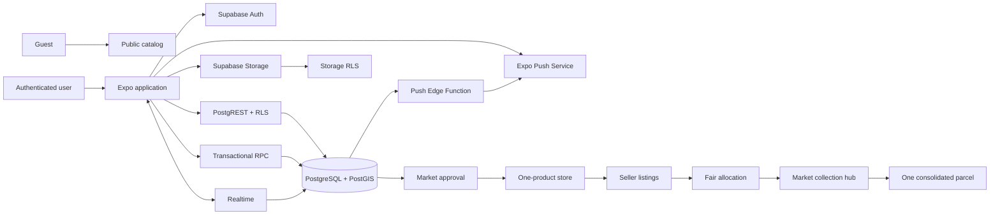
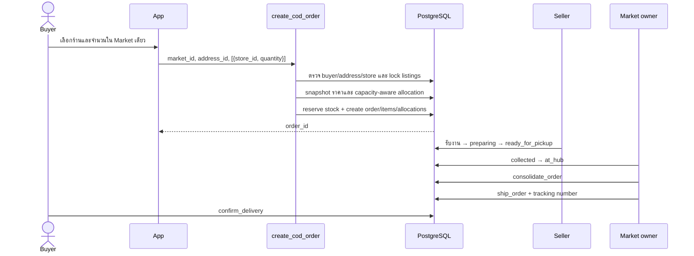
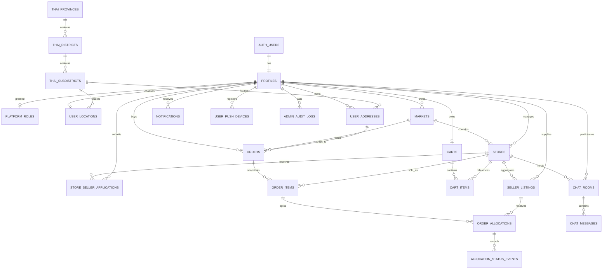
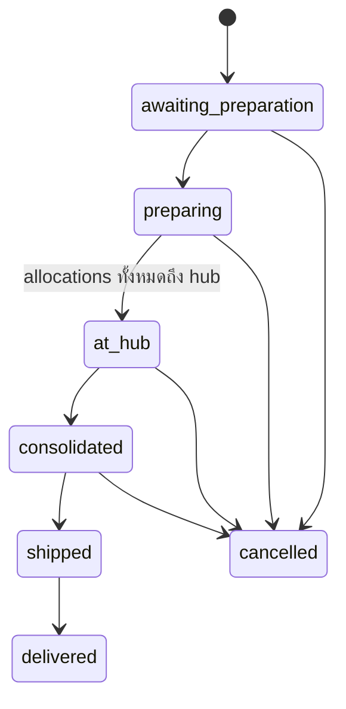

# Locomall

Locomall คือแพลตฟอร์ม Community Commerce สำหรับรวมสินค้าจากผู้ขายหลายรายใน
ชุมชนเดียวกัน โดยใช้โครงสร้างหลัก:

> Market ชุมชน → ร้านค้าหนึ่งสินค้า → ผู้ขายหลายราย → กระจายออเดอร์อย่างเป็นธรรม → รวมสินค้าที่ Market → ส่งหนึ่งพัสดุ

V1 รองรับ COD และ Wallet **เงินจำลองสำหรับโปรเจ็กต์สาธิตเท่านั้น** รวมถึงรีวิว,
บันทึกและติดตามตลาด/ร้านที่อนุมัติแล้ว ไม่รับหรือโอนเงินจริง.

## Technology stack

- React Native 0.86, React 19, Expo 57 และ Expo Router
- TypeScript แบบ strict
- Supabase Auth, PostgreSQL, PostGIS, Storage, Realtime และ Edge Functions
- Expo Notifications + Expo Push Service สำหรับแจ้งเตือนนอกแอป
- PostgreSQL RPC สำหรับ transaction สำคัญ และ RLS สำหรับ authorization
- Kanit สำหรับ UI ภาษาไทย และ Spectral สำหรับ branding
- Node test runner สำหรับ unit/contract tests

## Architecture



หลักแบ่งความรับผิดชอบ:

- Client รับ input, แสดงผล และ subscribe Realtime
- Wallet, คำสั่งซื้อ, งานขาย, ตะกร้า และคิวงานสำคัญอัปเดตผ่าน Realtime; ทุกหน้าข้อมูลหลักยังดึงลงรีเฟรชได้เมื่อเครือข่ายสะดุด
- Wallet เงินจำลองแยกยอดผู้ขายที่ชำระแล้วแต่ยังรอส่งมอบออกจากยอดขายรอโอน; COD ไม่สร้างเครดิตจำลอง
- การแจ้งเตือนออเดอร์แยกผู้ซื้อ/ผู้ขาย/เจ้าของตลาดตามผู้ที่ดำเนินการและขั้นตอนของออเดอร์
- RLS ตัดสินว่าใครอ่าน/เขียน row ใดได้
- RPC ตรวจ identity, ownership, state transition และทำ transaction/row locking
- Client ไม่สามารถกำหนดราคา, seller, allocation หรือยอดรวมของ order
- `platform_roles` เป็นแหล่งสิทธิ์ Admin; ไม่ใช้ `profiles.role` หรือ user metadata

## Business roles

| Role | ความสามารถหลัก |
|---|---|
| Guest | ดู Market และร้านที่ approved |
| Buyer | ตะกร้า, COD/ยอดจำลอง checkout, order tracking, รีวิวหลังรับสินค้า, chat |
| Seller | จัดการ stock และเตรียม allocation ของตนเอง |
| Store manager | ดูแลร้านหนึ่งสินค้าและ chat กับ buyer |
| Market owner | อนุมัติร้าน/ผู้ขาย, รับของ, รวมและจัดส่ง order |
| Platform Admin | อนุมัติ Market, ระงับ/คืนสิทธิ์ร้านค้า, ตรวจยอดจำลอง, ดูแลรีวิว และ audited override |

ผู้ใช้หนึ่งบัญชีเป็น Buyer, Seller, Store manager และ Market owner พร้อมกันได้
สิทธิ์เหล่านี้อนุมานจาก relationship; Platform Admin เป็นสิทธิ์พิเศษแยกต่างหาก.

### ระงับร้านค้าโดยผู้ดูแลระบบ

หน้า Admin → ภาพรวม → **ดูแลร้านค้า** ค้นหาและกรองร้านที่เปิดขาย/ถูกระงับได้
การระงับและคืนสิทธิ์ต้องระบุเหตุผล พร้อมยืนยันก่อนส่งผ่าน `set_store_suspension`.
RPC ตรวจ `platform_roles` ฝั่งฐานข้อมูลและตรวจเวอร์ชันข้อมูลร้าน ไม่ให้คำสั่งจากหน้าเก่า
เปลี่ยนสถานะที่ผู้ดูแลอื่นเพิ่งแก้ ทุกการเปลี่ยนบันทึกใน `approval_events` และ `admin_audit_logs`.

ร้านที่ถูกระงับไม่แสดงใน catalog สาธารณะและรับคำสั่งซื้อใหม่ไม่ได้ทั้ง COD/Wallet เงินจำลอง
แต่ออเดอร์เดิม สต็อก การจอง และประวัติยอดเงินยังอยู่เพื่อดำเนินการต่อ
ผู้ดูแลร้าน ผู้ขายร่วม และเจ้าของตลาดได้รับการแจ้งเตือนระบบเมื่อสถานะเปลี่ยน
ยกเว้นผู้ที่ทำรายการเอง การคืนสิทธิ์ไม่เปลี่ยนสถานะพักขายของผู้ขายร่วมและไม่ประกาศเป็นร้านใหม่.
นี่เป็นการระงับ **ร้านค้า** ไม่ใช่การแบนบัญชีหรือ blacklist ถาวร และยังไม่เชื่อมส่ง LINE.
แนวทาง OpenChat/LINE OA และสิ่งที่ต้องเตรียมก่อนเชื่อมอยู่ใน [`docs/line-integration.md`](docs/line-integration.md).

## Commerce flow



Fair allocation เรียงผู้ขายจาก `last_allocated_at` และกระจาย capacity ใหม่เมื่อ
ผู้ขายรายใด stock ไม่พอ ตัวอย่าง canonical:

- `30 / [100,100,100] → [10,10,10]`
- `30 / [5,100,100] → [5,13,12]` หรือ `[5,12,13]` ตาม fairness cursor

## Database schema



### Table groups

| Group | Tables | Purpose |
|---|---|---|
| Identity | `profiles`, `platform_roles` | ข้อมูลผู้ใช้และ Admin role |
| Thai location | `thai_provinces`, `thai_districts`, `thai_subdistricts`, `user_locations`, `user_addresses` | cascading address, GPS consent และ discovery |
| Catalog | `markets`, `stores`, `store_seller_applications`, `seller_listings` | approval, one-product store และ stock รายผู้ขาย |
| Commerce | `carts`, `cart_items`, `orders`, `order_items`, `order_allocations` | Market-scoped cart, price snapshot และ allocation |
| History | `approval_events`, `allocation_status_events`, `admin_audit_logs` | append-only operational/audit trail |
| Communication | `chat_rooms`, `chat_messages`, `notifications`, `user_push_devices` | participant-only chat, in-app Realtime และ private Expo push tokens |

Notification แบ่งเป็น `order`, `approval`, `chat`, `system`. Database triggers สร้าง
รายการสำหรับออเดอร์ใหม่ การเปลี่ยนสถานะ สินค้าพร้อมรับเข้าจุดรวม และข้อความแชต;
หน้าแอปรองรับ filter ตามหมวดและเฉพาะรายการที่ยังไม่ได้อ่าน.

Business IDs ใช้ `bigint identity`; user IDs ใช้ UUID จาก `auth.users`.

### Public RPC API

- Location: `complete_location_onboarding`, `discover_nearby`
- Approval: `apply_for_market`, `review_market`, `apply_to_open_store`, `review_store`, `apply_to_sell_in_store`, `review_store_seller`, `get_store_request_detail`
- Management: `update_market`, `update_store`
- Catalog media: `set_market_image`, `set_store_image`
- Stock/cart: `update_my_listing_stock`, `increment_cart_item`, `upsert_cart_item`, `remove_cart_item`
- Order: `create_cod_order`, `cancel_order`, `confirm_delivery`, `delete_cancelled_order`
- Pickup: `get_pickup_eligibility`
- Logistics: `accept_allocation`, `mark_allocation_ready`, `record_allocation_collected`, `record_allocation_at_hub`, `consolidate_order`, `ship_order`
- Notifications: `mark_notification_read`, `mark_all_notifications_read`, `register_my_push_device`, `disable_my_push_devices`

Helper functions อยู่ใน private schema และไม่เปิดผ่าน Data API.

## Order state model



Allocation ใช้ `awaiting_preparation → preparing → ready_for_pickup → collected → at_hub`
โดยผู้ขายต้องกดรับงานก่อนเริ่มเตรียมสินค้า ทุก transition ตรวจ actor และเขียน
`allocation_status_events`. หลังเริ่มส่ง การยกเลิกต้องใช้ Admin override และถูกบันทึก
audit log. Admin ลบถาวรได้เฉพาะ order ที่ยกเลิกแล้วและบันทึกเหตุผลไว้ใน audit log.

หน้า “คำสั่งซื้อ” แยกมุมมอง `รายการที่ซื้อ` และ `รายการที่ขาย` สำหรับบัญชีที่มีทั้งสอง
บทบาท สถานะและข้อความ action จะแปลตามบริบทของผู้ซื้อ/ผู้ขาย และการรับงานกับการส่งของ
ไปจุดรวมทำได้จบในหน้ารายละเอียดงานของผู้ขายหน้าเดียว.

คำสั่งซื้อแบบนัดรับใช้เส้นทางย่อ
`awaiting_preparation → preparing → at_hub → delivered` โดยเลือกได้เมื่อผู้ซื้ออยู่
ห่างจากจุดรวมสินค้าไม่เกิน 10 กม. และมีเพียงผู้ซื้อของคำสั่งซื้อนั้นที่ยืนยันรับสินค้าได้.

## Beginner-friendly UX

- หน้าแรกมีคำแนะนำสำหรับผู้ใช้ใหม่ที่ปิดได้และจำการตั้งค่าไว้ในอุปกรณ์
- คู่มือเปิดอ่านได้ตลอดเวลาจากหน้าแรกและหน้า **ตั้งค่า** (แทนแท็บโปรไฟล์เดิม)
- หน้าตั้งค่าแยกหมวดบัญชี/ความปลอดภัย, การซื้อ/Wallet, พื้นที่/ที่อยู่, แอป/ช่วยเหลือ
  และแสดงเมนูจัดการผู้ขาย เจ้าของตลาด และ Admin ตามสิทธิ์ของบัญชีเท่านั้น
- ข้อมูลส่วนตัวแก้ไขได้จากหมวดบัญชี; สิทธิ์การแจ้งเตือนเปิดหน้าตั้งค่าของ Android/iOS
- แท็บตั้งค่าใช้ไฟล์ `app/(tabs)/setting.tsx` และ route `/(tabs)/setting`
- ตั้งค่า → พื้นที่และการจัดส่ง → กรองตลาดในพื้นที่เดียวกัน: เลือกทุกพื้นที่ (ค่าเริ่มต้น)
  หรือเฉพาะตลาดและร้านในตำบล/แขวงเดียวกับพื้นที่หลัก โดยกรองก่อนแบ่งหน้าและใช้กับผลค้นหาด้วย
  ตำแหน่ง GPS ใช้เรียงระยะทางเท่านั้น ไม่ใช่เงื่อนไขพื้นที่เดียวกัน ตัวเลือกบันทึกแยกตามบัญชีบนเครื่อง
  โดยไม่มีสวิตช์จำลองหรือป้ายสถานะว่าเปิดแจ้งเตือนแล้ว
- คู่มือแยกขั้นตอนสำหรับผู้ซื้อ ผู้ขาย และเจ้าของตลาด
- หน้าผู้ขาย หน้าจัดการตลาด และหน้าสั่งซื้อมีคำแนะนำเฉพาะหน้าที่พับเก็บได้
- UI ใช้คำภาษาไทยแทนรหัสสถานะและคำเทคนิคจากฐานข้อมูล
- ขนาดปุ่มหลักยังใช้ design system เดิม ไม่ได้เพิ่มปุ่มขนาดใหญ่เป็นพิเศษ
- ช่องค้นหาบนหน้าแรกค้นหา Market, ร้าน และชื่อสินค้าจริง พร้อมแยกผลลัพธ์เป็นหมวด
- ตะกร้า ประวัติ และหน้ารายละเอียดคำสั่งซื้อแสดงรูปสินค้า จำนวน ราคาต่อหน่วย ยอดรวม
  วันที่สั่ง วิธีรับสินค้า และสถานะตามบทบาท
- ผู้ตรวจสอบคำขอเปิดร้าน/สมัครผู้ขายเห็นรูปสินค้าก่อนอนุมัติ โดยคำขอผู้ขายต้องแนบรูป
- Branding, app icon และ splash screen ใช้ `assets/images/APP_LOGO.png` เป็นแหล่งหลัก
- หน้าตั้งค่าสลับบัญชีที่เคยเข้าสู่ระบบบน Android/iOS ได้โดยไม่กรอกรหัสซ้ำ; refresh token ของบัญชีที่บันทึกเก็บใน SecureStore ของเครื่อง (ออกจากระบบจะลบบัญชีปัจจุบันออกจากรายการ)
- หน้าตลาด/ร้านแสดงรีวิวล่าสุด 3 รายการพร้อมชื่อแบบปกปิดบางส่วน วันที่ และป้ายซื้อจริงหลังรับสินค้า;
  รีวิวร้านแสดงชื่อสินค้าตอนซื้อด้วย ปุ่มดูเพิ่มเติมเปิด `/catalog/reviews` เพื่อดูคะแนนเฉลี่ย
  จำนวนแต่ละดาว กรอง 1–5 ดาว และโหลดหน้าถัดไป (10 รายการต่อหน้า) หรือลากลงรีเฟรช
- `get_catalog_review_page` สรุปและแบ่งหน้าแบบ keyset ในฐานข้อมูลเฉพาะรีวิวที่ไม่ถูกซ่อน
  ของตลาด/ร้านที่อนุมัติแล้ว ไม่เปิดเผย buyer ID, order ID, เบอร์โทร หรือรูปโปรไฟล์ส่วนตัว
  โดยคง RLS ตารางเดิมและใช้ public invoker RPC เรียก helper แบบอ่านอย่างเดียวใน private schema

## Nearby discovery

- ใช้ `geography(Point,4326)` และ GiST indexes
- เริ่มค้นหาที่ 10 กม. แล้วขยาย 15, 20, ... 100 กม.
- หากยังไม่พบ คืนรายการใกล้สุดทั่วประเทศ
- จัดอันดับ radius/distance ก่อนข้อความค้นหาและ stock
- Onboarding บันทึกจังหวัด/อำเภอ/ตำบลด้วย centroid ก่อนโดยไม่รอ GPS
- เมื่อเข้าหน้าหลัก แอปขอ GPS เพื่อส่งให้ discovery เฉพาะ request โดยไม่บันทึก exact GPS; หากปฏิเสธจะใช้ centroid ตำบล
- ข้อมูลอ้างอิง: 77 จังหวัด, 928 อำเภอ, 7,364 ตำบล
- รายละเอียด provenance อยู่ที่ [`docs/thai-address-data.md`](docs/thai-address-data.md)

## Security model

- RLS เปิดบนทุกตารางใน public schema
- Guest อ่านได้เฉพาะ catalog/reference data ที่ตั้งใจเปิดเผย
- Exact GPS, phone, shipping address, roles และ audit logs ไม่ออก public query
- Privileged RPC ใช้ empty immutable `search_path`, schema-qualified references และตรวจ `auth.uid()`/ownership/state
- ไม่มี Service Role key ในแอป
- Storage จำกัด JPG/PNG/WebP ขนาดไม่เกิน 5 MB
- Storage paths: `{user_id}/...`, `{market_id}/...`, `{store_id}/...`
- Approval/Admin actions มี audit trail และตรวจสิทธิ์จาก `platform_roles` ที่ผู้ใช้แก้เองไม่ได้
- ตรวจและ harden live schema ล่าสุดเมื่อ 2026-09-28: RLS เปิดครบทุก public table,
  sensitive writes ใช้ validated RPC, catalog ใช้ safe-shape RPC และหลักฐานผู้ขายอยู่ private bucket
- รายการช่องโหว่ RLS ผลการแก้ และหลักฐาน verification อยู่ที่
  `docs/rls-security-audit-2026-09-28.md` ในเครื่อง (รายงานไม่เผยแพร่บน GitHub)
- Supabase Security Advisor ยังมี warnings สำหรับ `SECURITY DEFINER` ที่อ่าน safe catalog
  หรือทำธุรกรรมตามสิทธิ์ และ leaked-password protection ที่ยังปิดอยู่;
  warning ไม่ได้เป็นหลักฐานว่าทุก RPC ปลอดภัย ต้องทบทวน DTO/สิทธิ์ทุกครั้งที่เปลี่ยน
  รายละเอียดล่าสุดอยู่ใน `docs/security-advisor.md` ในเครื่อง

ปิด email confirmation และไม่บังคับ MFA สำหรับ Admin ตามขอบเขต V1 โดยยังใช้รหัสผ่านขั้นต่ำ
10 ตัวแบบตัวพิมพ์เล็ก/ใหญ่+ตัวเลข+สัญลักษณ์ ส่วน CAPTCHA กับ
leaked-password protection ต้องใส่ provider/เปิดใน Supabase Dashboard ก่อน production
(leaked-password protection ต้องใช้ Supabase Pro หรือสูงกว่า).

## Project structure

```text
locomall/
├─ app/                         Expo Router screens
│  ├─ (auth)/                  sign in/up, recovery, location onboarding
│  ├─ (tabs)/                  Home, Chat, Orders, Notifications, Profile
│  ├─ admin/                   Admin dashboard, approvals, orders, demo finance, reviews, audit
│  ├─ guide.tsx                คู่มือผู้ซื้อ ผู้ขาย และเจ้าของตลาด
│  ├─ market/                  catalog, application, edit, owner approval/logistics
│  ├─ store/                   one-product store detail and management
│  ├─ seller/                  stock and allocation operations
│  ├─ order/                   cart, COD/demo checkout, tracking and reviews
│  ├─ chat/                    buyer ↔ store manager room
│  └─ profile/                 profile, demo wallet, saved catalog and shipping addresses
├─ src/
│  ├─ components/              reusable UI and permission gate
│  ├─ constants/               Figma-derived design tokens
│  ├─ context/                 auth/session and language state
│  ├─ hooks/                   Supabase data and capability hooks
│  ├─ lib/                     Supabase, allocation and Storage helpers
│  ├─ mock/                    test/story fixtures only
│  └─ types/                   generated Database types
├─ supabase/
│  ├─ migrations/              canonical schema history
│  ├─ schema.sql               psql include entry point
│  └─ seed.sql                 idempotent Thai address seed
├─ scripts/                    DOPA extraction and seed generation
├─ tests/                      Node unit and contract tests
├─ docs/                       security, data provenance and test matrix
├─ app.json                    Expo identifiers and native permissions
└─ eas.json                    development/preview/production profiles
```

## Getting started

Requirements: Node.js 22+, npm, Expo-compatible Android/iOS environment and access
to the Supabase project.

```bash
npm install
copy .env.example .env.local
npm run typecheck
npm test
npm start
```

Set only public client configuration in `.env.local`:

```env
EXPO_PUBLIC_SUPABASE_URL=https://YOUR_PROJECT_REF.supabase.co
EXPO_PUBLIC_SUPABASE_ANON_KEY=YOUR_PUBLISHABLE_OR_ANON_KEY
```

Never place a secret/service-role key in an `EXPO_PUBLIC_*` variable.

## Database workflow

`supabase/migrations` is the source of truth. Create migrations through the CLI:

```bash
npx supabase migration new descriptive_name
npx supabase gen types typescript --project-id YOUR_PROJECT_REF --schema public
```

Regenerate Thai reference data:

```bash
python scripts/extract-dopa-centroids.py tambon.xlsx dopa-centroids.json
node scripts/generate-thai-seed.mjs <hierarchy-data-dir> supabase/seed.sql dopa-centroids.json
```

The seed uses `ON CONFLICT ... DO UPDATE` and never truncates user data.

## Testing

```bash
npm test
npm run typecheck
npm run lint -- --quiet
npx expo export --platform web --output-dir dist
npm audit --omit=dev --audit-level=high
```

The complete V1 matrix is in [`docs/test-cases.md`](docs/test-cases.md). Before a
release, run the E2E scenario with separate Admin, Market owner, Store manager,
three Sellers and Buyer accounts on Android, iOS and web.

ขั้นตอนเชื่อม EAS credentials, Supabase webhook และการทดสอบ Push บนเครื่องจริงอยู่ใน
[`docs/push-notifications.md`](docs/push-notifications.md).
ขั้นตอนสร้าง APK สำหรับติดตั้งทดสอบอยู่ใน [`docs/BUILD_APK.md`](docs/BUILD_APK.md)
และการตั้งค่า Google Sign-In บน APK อยู่ใน [`docs/GOOGLE_SIGN_IN_ANDROID.md`](docs/GOOGLE_SIGN_IN_ANDROID.md).

Contract/unit suite รวมการทดสอบ AI และฐานข้อมูลจำลองด้วย การผ่านชุดนี้ไม่แทน penetration test,
concurrent database test หรือการทดสอบ role boundary กับ live Supabase.

สินค้าแบบชั่งน้ำหนักระบุปริมาณต่อหนึ่งหน่วยสั่งซื้อ เช่น `500 กรัม` หรือ
`1 กิโลกรัม`; ราคา สต็อก การจอง และจำนวนในออเดอร์นับเป็นจำนวนหน่วยสั่งซื้อ
ไม่ใช่น้ำหนักรวม หลังอนุมัติร้านหรือมีรายการสต็อก/ตะกร้า/ออเดอร์แล้ว
ระบบจะล็อกหน่วยขายเพื่อไม่ให้จำนวนเดิมถูกตีความผิด บัญชีที่สมัครด้วย Google
หรือบัญชีเก่าที่ยังไม่มีเบอร์มือถือถูกต้องต้องกรอกเบอร์ก่อนใช้งานส่วนอื่นของแอป.

## Release checklist

- Run migrations and regenerate TypeScript types
- ตรวจว่าการบันทึกและติดตามแสดงเฉพาะตลาด/ร้านที่อนุมัติแล้ว (ระบบแชร์พักไว้ก่อน)
- Rebuild APK after adding QR/native dependencies; test demo top-up, refund, seller settlement and review with Buyer/Seller/Admin accounts
- Check every wallet/QR amount visibly says “เงินจำลอง” and no real bank-app payment is possible
- Run Security/Performance Advisors and record accepted warnings
- Verify Auth production settings and redirect URLs
- Link EAS project, configure Android FCM V1/iOS APNs credentials และสร้าง Development/Production Build
- Connect the `notifications` INSERT database webhook to the deployed `push-notification` Edge Function with an authenticated service header
- หากเปิด Expo enhanced push security ให้เก็บ `EXPO_ACCESS_TOKEN` ใน Supabase Edge Function Secrets เท่านั้น
- Test GPS granted/denied and all role boundaries on real devices
- Verify concurrent checkout, cancellation idempotency and consolidated shipping
- Compare key screens with Figma at common phone sizes
- Publish Privacy Policy/Terms and provide account deletion/support contact
- Confirm backup/restore procedure before onboarding a real Market

## V1 non-goals

- **เงินจริง**: Payment Gateway, PromptPay QR ที่ใช้โอนได้, bank transfer,
  การเติม/ถอนเงินจริง และการโอนผู้ขายจริง
- ค่าคอมมิชชันและค่าจัดส่งในแอป
- AI chatbot, การตัดสินใจอนุมัติ/ราคา/สต็อกอัตโนมัติ (ไม่อยู่ในรอบนี้)

## ผู้ช่วย AI ร่างข้อมูลสินค้า

หน้าเปิดร้านและแก้ไขร้านมีปุ่ม “วิเคราะห์ข้อมูลสินค้า” เพื่อช่วยร่างชื่อสินค้า รายละเอียด คำค้น และข้อมูลที่ควรระบุเพิ่ม
จากรูป/ข้อมูลสินค้า ผู้ขายต้องยินยอมส่งข้อมูลให้ Google และตรวจแก้ร่างก่อนนำไปใช้
ไม่มีการเปลี่ยนราคา สต็อก หรือบันทึกร้านอัตโนมัติ คำค้นยังเป็นคำแนะนำ ไม่บันทึกเป็นแท็ก.

เรียก Gemini Developer API ผ่าน `suggest-listing` Edge Function เท่านั้น;
คีย์อยู่ใน Supabase Secrets ไม่อยู่ใน Expo/APK จำกัดภาพ 4 MB และโควตาต่อบัญชี/โปรเจ็กต์
ด้วย RPC ที่ให้สิทธิ์เฉพาะ backend ใช้ `gemini-3.5-flash-lite` เป็นหลักและ
`gemini-3.8-flash` สำรองเมื่อโมเดลหลักไม่พร้อม Free Tier ยังคงมีโควตาและเกิด 429/503 ได้.
ขั้นตอนตั้งค่า ใช้งาน เปลี่ยนโมเดล และข้อจำกัดการทดสอบอยู่ใน
[`docs/ai-google-ai-studio-setup.md`](docs/ai-google-ai-studio-setup.md).

ระบบ Wallet, QR อ้างอิง, การคืนยอด และการบันทึกโอนผู้ขายใน V1 เป็น **ข้อมูลจำลอง**
เท่านั้น คู่มือการติดตั้ง migration/Edge Function, การทดสอบและรีเซ็ตข้อมูลทดสอบอยู่ที่
[`docs/demo-v1.md`](docs/demo-v1.md). ยอดจริงไม่อ่านจาก `profiles.wallet_balance`;
รายการใหม่เก็บใน `demo_accounts`/`demo_ledger` และแก้ได้ผ่าน RPC ที่ตรวจสิทธิ์เท่านั้น.
