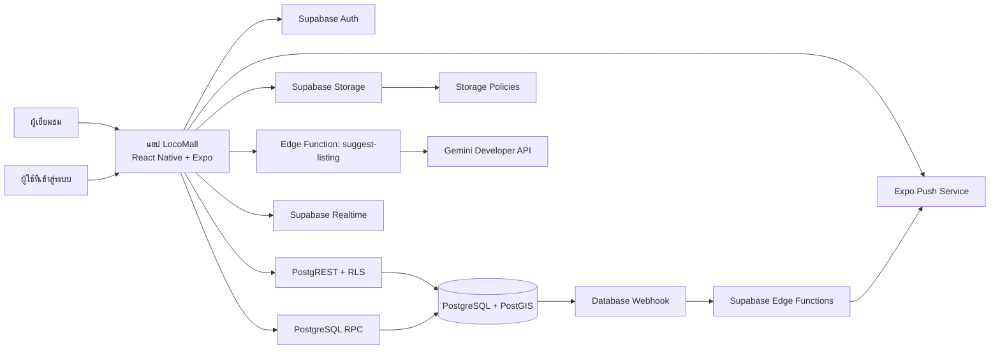
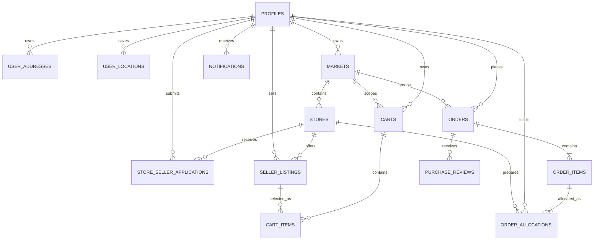

# บทที่ 2

# แนวคิด ทฤษฎี และงานวิจัยที่เกี่ยวข้อง

> ข้อมูลบทนี้เป็นร่างอ้างอิงช่วงตุลาคม 2026 ส่วน Stripe Sandbox และการปรับสิทธิ์ RPC
> ภายหลังอธิบายใน `docs/stripe-sandbox.md` และหัวข้อ Maintenance update ใน `README.md`.

> สถานะเอกสาร: ร่างปรับปรุงจากไฟล์ `บทที่ 2.pdf` โดยตรวจเทียบกับโค้ดและฐานข้อมูลของโครงการ ณ วันที่ 19 ตุลาคม 2569 (2026)\
> เอกสารนี้จัดทำเป็น Markdown เพื่อใช้เป็นข้อมูลสำหรับนำไปเรียบเรียงในรายงานฉบับจริง โดยไม่ได้แก้ไขไฟล์ PDF ต้นฉบับ

การพัฒนาแอปพลิเคชัน LocoMall มีเป้าหมายเพื่อเชื่อมโยงผู้ซื้อ ผู้ขาย ผู้ดูแลร้าน ผู้ดูแลตลาดชุมชน และผู้ดูแลแพลตฟอร์มไว้ในระบบเดียว จุดเด่นของระบบไม่ใช่เพียงการนำสินค้ามาจำหน่ายออนไลน์ แต่เป็นการจำลองโครงสร้างการค้าของตลาดชุมชนให้ทำงานบนอุปกรณ์เคลื่อนที่ ตั้งแต่การค้นหาตลาดและสินค้า การรวมสินค้าจากหลายร้านภายในตลาดเดียวกัน การจัดสรรคำสั่งซื้อให้ผู้ขายอย่างเป็นธรรม การรวบรวมสินค้าที่จุดกลางของตลาด ไปจนถึงการจัดส่งเป็นพัสดุเดียวแก่ผู้ซื้อ

บทนี้นำเสนอแนวคิดที่ใช้วิเคราะห์และออกแบบระบบ สถาปัตยกรรมซอฟต์แวร์ การออกแบบฐานข้อมูล เทคโนโลยีที่ใช้ ตลอดจนทฤษฎีและงานวิจัยที่เกี่ยวข้อง เพื่ออธิบายเหตุผลเบื้องหลังการออกแบบ LocoMall และแสดงความเชื่อมโยงระหว่างปัญหาของตลาดชุมชนกับแนวทางที่ระบบนำมาใช้แก้ไข

---

## 2.1 การวิเคราะห์และออกแบบระบบ

### 2.1.1 การวิเคราะห์ความต้องการของระบบ

การวิเคราะห์ความต้องการของ LocoMall แบ่งเป็นความต้องการเชิงหน้าที่และความต้องการที่ไม่ใช่เชิงหน้าที่ โดยกำหนดสิทธิ์จากความสัมพันธ์ที่ผู้ใช้มีกับตลาดหรือร้านค้า ไม่กำหนดจากข้อความบทบาทที่แก้ไขได้จากฝั่งแอป ผู้ใช้บัญชีเดียวจึงสามารถเป็นผู้ซื้อ ผู้ขาย ผู้ดูแลร้าน หรือเจ้าของตลาดได้พร้อมกันตามความสัมพันธ์จริงในฐานข้อมูล ส่วนผู้ดูแลแพลตฟอร์มกำหนดผ่านตารางสิทธิ์ส่วนกลางโดยเฉพาะ

#### 1) ความต้องการเชิงหน้าที่

**ผู้เยี่ยมชมและผู้ซื้อ**

1. ผู้ใช้สามารถดูตลาด ร้านค้า และสินค้าได้ก่อนเข้าสู่ระบบตามข้อมูลที่เผยแพร่สู่สาธารณะ
2. ผู้ใช้สามารถสมัครสมาชิก เข้าสู่ระบบ ออกจากระบบ และกู้คืนการเข้าถึงบัญชีผ่าน Supabase Auth
3. ผู้ใช้สามารถจัดการข้อมูลส่วนตัว ที่อยู่ และตำแหน่งที่ใช้สำหรับค้นหาตลาดหรือรับสินค้าได้
4. ผู้ใช้สามารถค้นหาและกรองตลาด ร้านค้า และสินค้าตามข้อความ หมวดหมู่ พื้นที่ และความพร้อมจำหน่าย
5. ผู้ใช้สามารถเพิ่มสินค้า ปรับจำนวน หรือลบสินค้าในตะกร้าได้ โดยตะกร้ารองรับสินค้าจากหลายตลาด แต่ระบบจะแยกการชำระรายการเป็นคำสั่งซื้อรายตลาด
6. ผู้ใช้สามารถยืนยันคำสั่งซื้อ โดยระบบฝั่งฐานข้อมูลเป็นผู้คำนวณราคา ยอดรวม ความพร้อมของสต็อก และการจัดสรรสินค้าให้ผู้ขาย ผู้ใช้ไม่สามารถส่งค่าราคา ผู้ขาย หรือยอดรวมเพื่อบังคับระบบได้
7. ผู้ใช้สามารถเลือกวิธีรับสินค้าที่ระบบรองรับ เช่น รับที่จุดรวมสินค้าของตลาดหรือจัดส่งตามเงื่อนไขที่กำหนด
8. ผู้ใช้สามารถติดตามสถานะคำสั่งซื้อและรับการแจ้งเตือนเมื่อสถานะสำคัญเปลี่ยนแปลง
9. ผู้ใช้สามารถยกเลิกคำสั่งซื้อได้ก่อนที่การจัดสรรรายการแรกจะถูกรับจากร้าน และระบบต้องคืนยอดหรือคืนการจองสต็อกแบบไม่ทำรายการซ้ำ
10. ผู้ใช้สามารถสนทนาในห้องแชตที่ได้รับอนุญาต และสามารถประเมินการสั่งซื้อหลังรายการเสร็จสมบูรณ์

**ผู้ขายและผู้ดูแลร้าน**

1. ผู้ใช้สามารถยื่นคำขอเป็นผู้ขายหรือขอเข้าร่วมร้านตามกระบวนการอนุมัติของระบบ
2. ผู้มีสิทธิ์สามารถสร้างและแก้ไขข้อมูลร้าน รูปภาพสินค้า ราคา และจำนวนคงเหลือภายในขอบเขตร้านของตน
3. ผู้ขายสามารถใช้ผู้ช่วย AI เพื่อร่างชื่อสินค้า คำอธิบาย และคำค้นจากข้อความหรือรูปภาพ โดยต้องยินยอมให้ส่งข้อมูลไปยังผู้ให้บริการ AI และต้องตรวจแก้ก่อนนำผลลัพธ์ไปใช้
4. ผู้ขายเห็นเฉพาะรายการจัดสรรที่เป็นของบัญชีตน และไม่สามารถเข้าถึงที่อยู่ เบอร์โทร หรือรายการสินค้าของร้านอื่นโดยไม่จำเป็น
5. ผู้ขายสามารถรับงาน เตรียมสินค้า ทำเครื่องหมายว่าพร้อมให้รับ และติดตามการส่งสินค้าไปยังจุดรวมของตลาดตามลำดับสถานะที่ระบบอนุญาต
6. ผู้ดูแลร้านสามารถบริหารข้อมูลร้าน สมาชิกของร้าน และสต็อกสินค้าได้ตามสิทธิ์ที่ได้รับ

**เจ้าของตลาดและผู้ดูแลตลาด**

1. ผู้ใช้สามารถยื่นคำขอสร้างตลาด พร้อมข้อมูลตำแหน่งและหลักฐานที่ระบบกำหนด
2. เจ้าของตลาดสามารถจัดการข้อมูลตลาด ร้านค้า การรับสมัครผู้ขาย และกระบวนการรวบรวมสินค้า
3. ผู้ดูแลตลาดสามารถบันทึกการรับสินค้าจากร้าน ตรวจสอบว่าสินค้าครบ รวมคำสั่งซื้อ และเปลี่ยนสถานะเป็นพร้อมจัดส่งได้
4. ระบบต้องตรวจสอบเงื่อนไขระยะทางหรือพื้นที่ให้บริการก่อนอนุญาตขั้นตอนที่อาศัยตำแหน่ง โดยไม่จำเป็นต้องเก็บพิกัดละเอียดของผู้ใช้เกินวัตถุประสงค์

**ผู้ดูแลแพลตฟอร์ม**

1. ผู้ดูแลแพลตฟอร์มสามารถตรวจสอบและอนุมัติหรือปฏิเสธคำขอที่เกี่ยวข้องกับตลาดและสิทธิ์ผู้ใช้งาน
2. ผู้ดูแลแพลตฟอร์มสามารถระงับหรือคืนสถานะร้านค้าและตลาดตามกระบวนการที่กำหนด
3. การดำเนินการสำคัญต้องบันทึกเหตุการณ์อนุมัติหรือบันทึกตรวจสอบย้อนหลัง เพื่อระบุผู้กระทำ เวลา เป้าหมาย และผลของการกระทำ
4. ผู้ดูแลสามารถแก้ไขสถานะกรณีพิเศษได้เฉพาะผ่านฟังก์ชันที่ตรวจสิทธิ์และบันทึกเหตุผล ไม่แก้ไขตารางธุรกรรมโดยตรงจากแอป

**การทำงานอัตโนมัติของระบบ**

1. ระบบจัดสรรคำสั่งซื้อโดยพิจารณาความจุของผู้ขายและลำดับการได้รับงานล่าสุด เพื่อลดการกระจุกตัวของคำสั่งซื้อ
2. ระบบจองสต็อกและสร้างคำสั่งซื้อ รายการสินค้า และรายการจัดสรรภายในธุรกรรมเดียว เพื่อลดปัญหาข้อมูลค้างเมื่อทำงานไม่ครบทุกขั้นตอน
3. ระบบบันทึกราคาสินค้า ณ เวลาสั่งซื้อเป็นข้อมูลประวัติ ไม่คำนวณคำสั่งซื้อเก่าจากราคาปัจจุบัน
4. ระบบตรวจสอบลำดับการเปลี่ยนสถานะทั้งระดับคำสั่งซื้อและระดับรายการจัดสรร
5. ระบบส่งข้อมูลแบบเวลาจริงในเหตุการณ์ที่เหมาะสม และมีการดึงข้อมูลซ้ำเป็นทางสำรองเมื่อการเชื่อมต่อแบบเวลาจริงไม่พร้อม
6. ระบบสร้างการแจ้งเตือนในฐานข้อมูลและส่ง Push Notification ผ่าน Edge Function โดยแยกความล้มเหลวของการส่ง Push ออกจากความถูกต้องของธุรกรรมหลัก

#### 2) ความต้องการที่ไม่ใช่เชิงหน้าที่

1. **ความปลอดภัย** — ทุกตารางที่แอปเข้าถึงต้องควบคุมด้วย Row Level Security (RLS) การเขียนข้อมูลสำคัญต้องผ่าน RPC หรือ Edge Function ที่ตรวจตัวตน สิทธิ์ ความเป็นเจ้าของ และสถานะปัจจุบัน
2. **ความเป็นส่วนตัว** — เก็บและเปิดเผยข้อมูลส่วนบุคคลเท่าที่จำเป็น จำกัดการเข้าถึงหลักฐานและภาพส่วนตัวด้วย Storage policy และ Signed URL พร้อมรองรับการลบบัญชีหรือคำขอตามนโยบายที่ประกาศ
3. **ความถูกต้องสอดคล้องของข้อมูล** — การตัดสต็อก การคืนสต็อก การคืนยอดจำลอง และการเปลี่ยนสถานะต้องรองรับการเรียกซ้ำโดยไม่เกิดผลซ้ำ และต้องป้องกันการแข่งขันของธุรกรรมพร้อมกัน
4. **ประสิทธิภาพ** — รายการข้อมูลขนาดใหญ่ต้องแบ่งหน้า จำกัดช่วงข้อมูลที่ดึง และใช้ดัชนีสำหรับคอลัมน์ที่ค้นหา เชื่อมโยง หรือเรียงลำดับบ่อย
5. **ความน่าเชื่อถือ** — ระบบต้องแสดงสถานะโหลด ว่าง และข้อผิดพลาดอย่างชัดเจน มีทางเลือกเมื่อ Realtime หรือ Push Notification ไม่พร้อม และไม่ถือว่าการแจ้งเตือนภายนอกเป็นหลักฐานว่าธุรกรรมสำเร็จ
6. **การใช้งานง่าย** — ส่วนติดต่อผู้ใช้รองรับภาษาไทย อุปกรณ์หลายขนาด Safe Area แป้นพิมพ์บนมือถือ และให้คำอธิบายขั้นตอนแก่ผู้ใช้ใหม่
7. **การบำรุงรักษา** — ใช้ TypeScript แบบ strict แยกความรับผิดชอบของส่วนติดต่อผู้ใช้ บริการข้อมูล และตรรกะฐานข้อมูล พร้อมใช้ migration และ automated test เพื่อให้การเปลี่ยนแปลงตรวจสอบย้อนหลังได้
8. **การตรวจสอบได้** — เหตุการณ์ด้านการอนุมัติ การเปลี่ยนสถานะ และการกระทำของผู้ดูแลต้องเก็บเป็นประวัติแบบเพิ่มรายการใหม่แทนการเขียนทับหลักฐานเดิม

### 2.1.2 การออกแบบสถาปัตยกรรมระบบ

LocoMall ใช้สถาปัตยกรรมแบบ Client–Backend-as-a-Service โดยแอปมือถือพัฒนาด้วย React Native และ Expo ส่วนบริการหลักใช้ Supabase ซึ่งประกอบด้วย Auth, PostgreSQL, PostGIS, Storage, Realtime และ Edge Functions การแบ่งชั้นดังกล่าวทำให้หน้าจอรับผิดชอบการนำเสนอและการรับข้อมูลจากผู้ใช้ ขณะที่กฎธุรกิจและการตัดสินใจที่มีผลต่อเงินจำลอง สต็อก สิทธิ์ และการจัดสรรอยู่ในฝั่งที่ผู้ใช้แก้ไขไม่ได้

สถาปัตยกรรมแบ่งเป็นส่วนสำคัญดังนี้

1. **Presentation Layer** — หน้าจอและคอมโพเนนต์ใน React Native/Expo Router จัดการการนำทาง การตรวจสอบข้อมูลเบื้องต้น และการแสดงสถานะการทำงาน
2. **Client Service Layer** — โมดูล TypeScript จัดการการเรียก Supabase การแบ่งหน้า การอัปโหลดไฟล์ การสมัคร Realtime channel และการแปลงข้อผิดพลาดเป็นข้อความที่ผู้ใช้เข้าใจได้
3. **Identity and Access Layer** — Supabase Auth ยืนยันตัวตนและออกโทเคน ส่วน RLS, ฟังก์ชันฐานข้อมูล และนโยบาย Storage เป็นผู้ตัดสินสิทธิ์เข้าถึงข้อมูลจริง
4. **Business Logic Layer** — PostgreSQL RPC ใช้กับงานที่ต้องทำหลายขั้นตอนแบบอะตอมมิก เช่น checkout การจัดสรร การเปลี่ยนสถานะ การคืนสต็อก และบัญชีจำลอง
5. **Integration Layer** — Edge Functions เก็บความลับและติดต่อบริการภายนอก เช่น Expo Push Service และ Gemini Developer API โดยไม่ฝังคีย์ไว้ในแอปหรือไฟล์ APK
6. **Data Layer** — PostgreSQL จัดเก็บข้อมูลธุรกรรม PostGIS สนับสนุนการคำนวณเชิงพื้นที่ Storage จัดเก็บไฟล์ และ Realtime เผยแพร่เหตุการณ์ที่ผู้ใช้มีสิทธิ์รับทราบ

หลักการสำคัญคือ **ไม่เชื่อถือข้อมูลที่มีผลต่อธุรกรรมจาก Client** แอปส่งเพียงเจตนาของผู้ใช้ เช่น รหัสสินค้าและจำนวนที่ต้องการ ส่วนราคาที่ใช้จริง ผู้ขายที่ได้รับการจัดสรร ความพร้อมของสต็อก และยอดรวมต้องคำนวณซ้ำภายในฐานข้อมูล

### 2.1.3 การออกแบบกระบวนการทำงาน

การอธิบายพฤติกรรมของระบบใช้แบบจำลองหลายชนิดร่วมกัน เนื่องจากแบบจำลองแต่ละชนิดตอบคำถามต่างกัน ดังนี้

1. **Use Case Diagram** ใช้ระบุขอบเขตระบบ ผู้มีส่วนร่วม และความสามารถที่แต่ละบทบาทใช้งานได้
2. **Use Case Description** ใช้อธิบายเงื่อนไขก่อนเริ่ม ขั้นตอนหลัก ทางเลือก ข้อยกเว้น และผลลัพธ์หลังสิ้นสุดของกรณีใช้งาน
3. **Activity Diagram** ใช้อธิบายลำดับกิจกรรม การตัดสินใจ และการส่งต่องานระหว่างผู้ใช้ ระบบ และฐานข้อมูล
4. **Sequence Diagram** ใช้อธิบายข้อความที่แลกเปลี่ยนตามเวลา โดยเฉพาะเส้นทางที่ Client เรียก RPC, Storage หรือ Edge Function
5. **State Machine Diagram** ใช้กำหนดสถานะและการเปลี่ยนสถานะที่อนุญาต เพื่อป้องกันการข้ามขั้นตอนหรือย้อนสถานะโดยไม่มีสิทธิ์
6. **Class Diagram** ใช้อธิบายโครงสร้างวัตถุในซอฟต์แวร์และความสัมพันธ์ระหว่างโมเดล บริการ และส่วนติดต่อผู้ใช้
7. **Entity Relationship Diagram** ใช้อธิบายเอนทิตี คีย์ และความสัมพันธ์ของข้อมูลใน PostgreSQL

กระบวนการคำสั่งซื้อแบ่งสถานะระดับคำสั่งซื้อเป็น `awaiting_preparation`, `preparing`, `at_hub`, `consolidated`, `shipped` และ `delivered` ส่วนรายการจัดสรรของผู้ขายใช้ `awaiting_preparation`, `preparing`, `ready_for_pickup`, `collected` และ `at_hub` การแยกระดับนี้ทำให้ติดตามได้ทั้งภาพรวมของคำสั่งซื้อและงานของผู้ขายแต่ละราย

### 2.1.4 การออกแบบฐานข้อมูล

การออกแบบฐานข้อมูลแบ่งเป็นสองระดับ ได้แก่

1. **การออกแบบเชิงแนวคิด** กำหนดเอนทิตีสำคัญ เช่น ผู้ใช้ ตลาด ร้าน สินค้า ตะกร้า คำสั่งซื้อ รายการจัดสรร การแจ้งเตือน แชต รีวิว และบัญชีจำลอง พร้อมกำหนด cardinality และข้อจำกัดทางธุรกิจ
2. **การออกแบบเชิงกายภาพ** แปลงแบบจำลองเป็นตาราง คอลัมน์ ชนิดข้อมูล Primary Key, Foreign Key, Unique Constraint, Check Constraint, Index, Trigger, RLS Policy และฟังก์ชัน PostgreSQL

ฐานข้อมูลใช้ UUID เป็นตัวระบุหลักในข้อมูลธุรกิจส่วนใหญ่ ใช้ `timestamptz` สำหรับเวลา และใช้ Foreign Key เพื่อป้องกันข้อมูลอ้างอิงที่ไม่มีอยู่จริง ค่าที่ต้องเก็บเป็นประวัติ เช่น ราคาต่อหน่วย ชื่อสินค้า ณ เวลาสั่งซื้อ หรือสถานะเหตุการณ์ ต้องทำเป็น snapshot หรือ event record ไม่อาศัยข้อมูลต้นทางที่อาจเปลี่ยนภายหลัง

### 2.1.5 การออกแบบบริการและส่วนเชื่อมต่อข้อมูล

ระบบใช้ช่องทางเข้าถึงข้อมูลให้เหมาะกับความเสี่ยงของงาน ดังนี้

1. **PostgREST** ใช้สำหรับการอ่านหรือการเขียนแบบตรงไปตรงมาที่ RLS และ constraint ควบคุมได้เพียงพอ โดยใช้ HTTP method มาตรฐาน เช่น `GET`, `POST`, `PATCH` และ `DELETE`
2. **PostgreSQL RPC** ใช้กับกฎธุรกิจที่ต้องตรวจหลายเงื่อนไขหรือเปลี่ยนหลายตารางภายใน transaction เดียว เช่น checkout การจัดสรร การรับสินค้า และการยกเลิกคำสั่งซื้อ
3. **Edge Functions** ใช้กับการเชื่อมต่อบริการภายนอกและงานที่ต้องใช้ secret เช่น การส่ง Push Notification และผู้ช่วย AI ร่างข้อมูลสินค้า
4. **Realtime** ใช้แจ้งการเปลี่ยนแปลงที่ผู้ใช้ควรเห็นโดยเร็ว เช่น สถานะงานหรือการแจ้งเตือน แต่ Client ยังต้องดึงข้อมูลยืนยันจากแหล่งจริงและมี fallback refresh
5. **Storage API** ใช้อัปโหลดและอ่านรูปภาพหรือหลักฐาน โดยกำหนด path ตามเจ้าของทรัพยากรและใช้นโยบายระดับ object

ผลลัพธ์ส่งในรูปแบบ JSON และต้องมีรูปแบบข้อผิดพลาดที่แปลงเป็นข้อความภาษาไทยได้ การเรียกฟังก์ชันที่อาจเกิดซ้ำจากเครือข่ายควรออกแบบให้เป็น idempotent หรือใช้คีย์/สถานะป้องกันผลซ้ำ

### 2.1.6 การออกแบบด้านความปลอดภัยและความเป็นส่วนตัว

การรักษาความปลอดภัยใช้แนวคิด defense in depth โดยไม่พึ่งการซ่อนปุ่มหรือเงื่อนไขในหน้าจอเพียงอย่างเดียว

1. **Authentication** — Supabase Auth ยืนยันตัวตน ส่วน session บนอุปกรณ์จริงจัดเก็บด้วย Expo SecureStore และไม่บันทึก service-role key หรือ secret ของบริการภายนอกไว้ใน Client
2. **Authorization** — สิทธิ์เกิดจากความเป็นเจ้าของหรือความสัมพันธ์ในตาราง เช่น สมาชิกของร้าน เจ้าของตลาด และ `platform_roles` ไม่เชื่อถือค่า role ที่ผู้ใช้แก้เองได้
3. **Row Level Security** — จำกัดแถวที่ผู้ใช้สามารถอ่าน เพิ่ม แก้ไข หรือลบ โดยนโยบายต้องครอบคลุมทั้งตารางหลัก ตารางประวัติ และ Storage
4. **Secure RPC** — ฟังก์ชันที่ใช้ `SECURITY DEFINER` ต้องตรวจ `auth.uid()` และสิทธิ์ภายในฟังก์ชัน กำหนด `search_path` อย่างปลอดภัย และถอนสิทธิ์จากบทบาทที่ไม่จำเป็น
5. **Input and state validation** — ตรวจชนิด ขนาด รูปแบบ เจ้าของทรัพยากร และลำดับสถานะทั้งใน Client เพื่อประสบการณ์ใช้งานและใน Server เพื่อความปลอดภัย
6. **Secret management** — คีย์ Gemini, service credential และ access token เก็บใน Supabase Secrets เท่านั้น ไม่รวมใน repository, environment ที่ส่งเข้าแอป หรือไฟล์ build
7. **File protection** — ไฟล์ที่มีข้อมูลส่วนบุคคลหรือหลักฐานใช้ bucket แบบ private และ Signed URL อายุจำกัด ส่วนภาพสาธารณะอนุญาตเฉพาะขอบเขตที่ตั้งใจเผยแพร่
8. **Auditability** — การอนุมัติ การเปลี่ยนสถานะสำคัญ และการใช้อำนาจผู้ดูแลบันทึกเป็นเหตุการณ์เพื่อการตรวจสอบย้อนหลัง
9. **Privacy by design** — จำกัดข้อมูลตำแหน่งและข้อมูลติดต่อให้แสดงเฉพาะผู้ที่ต้องใช้ในขั้นตอนนั้น แจ้งวัตถุประสงค์และขอความยินยอมก่อนส่งภาพหรือข้อความสินค้าไปยังบริการ AI ภายนอก

แนวทางดังกล่าวสอดคล้องกับหลักการของพระราชบัญญัติคุ้มครองข้อมูลส่วนบุคคล พ.ศ. 2562 ในด้านการกำหนดวัตถุประสงค์ การลดปริมาณข้อมูล การควบคุมการเข้าถึง และการจัดให้มีช่องทางใช้สิทธิของเจ้าของข้อมูล ทั้งนี้ ก่อนเปิดใช้งานจริงต้องจัดทำนโยบายความเป็นส่วนตัว เงื่อนไขการใช้บริการ ระยะเวลาเก็บรักษาข้อมูล และช่องทางติดต่ออย่างเป็นทางการ

### 2.1.7 การออกแบบส่วนติดต่อและประสบการณ์ผู้ใช้

ส่วนติดต่อผู้ใช้ยึดแนวคิด mobile-first เนื่องจากกลุ่มเป้าหมายใช้งานผ่านโทรศัพท์เป็นหลัก การออกแบบต้องลดภาระในการเรียนรู้และสะท้อนคำศัพท์ที่ใช้จริงในตลาดชุมชน โดยมีแนวทางดังนี้

1. แยกพื้นที่ใช้งานตามงาน เช่น การซื้อสินค้า งานผู้ขาย การจัดการร้าน งานจุดรวมสินค้า และงานผู้ดูแล โดยไม่บังคับให้ผู้ใช้สร้างหลายบัญชี
2. แสดงสถานะปัจจุบัน ขั้นตอนถัดไป และผู้รับผิดชอบอย่างชัดเจน แทนการใช้รหัสสถานะภายในโดยตรง
3. ปุ่มที่มีผลสำคัญ เช่น ยกเลิก ระงับ หรือยืนยันรับสินค้า ต้องมีข้อความยืนยันและอธิบายผลกระทบ
4. รองรับ Safe Area ขนาดตัวอักษร การเลื่อนหน้าจอ แป้นพิมพ์ และขนาดหน้าจอที่แตกต่างกัน
5. แสดง Loading, Empty, Error และ Retry state ครบถ้วน เพื่อไม่ให้ผู้ใช้เข้าใจว่าหน้าจอว่างคือไม่มีข้อมูลเสมอไป
6. ใช้สี ไอคอน และข้อความร่วมกัน ไม่ใช้สีเพียงอย่างเดียวในการสื่อสถานะ
7. แสดงข้อมูลส่วนบุคคลเท่าที่จำเป็นในแต่ละขั้นตอน และหลีกเลี่ยงการแสดงข้อมูลของผู้ซื้อให้ผู้ขายที่ไม่เกี่ยวข้อง
8. ผลจาก AI ต้องระบุว่าเป็นร่าง เปิดให้แก้ไข และไม่บันทึกราคา สต็อก หรือข้อมูลร้านโดยอัตโนมัติ

### 2.1.8 การทดสอบและการประกันคุณภาพ

โครงการใช้การตรวจสอบหลายระดับ ได้แก่ TypeScript type checking, ESLint, Node test runner, การทดสอบสัญญาระหว่าง Client กับ RPC, การทดสอบ migration บน PostgreSQL/PGlite และการทดสอบเส้นทางธุรกิจสำคัญ การทดสอบที่มีความเสี่ยงสูงควรครอบคลุมการ checkout พร้อมกัน การคืนสต็อกเมื่อยกเลิก การเรียกคำสั่งซ้ำ สิทธิ์ข้ามร้าน การมองเห็นข้อมูลส่วนบุคคล และการเปลี่ยนสถานะผิดลำดับ นอกจากนี้ต้องทดสอบบนอุปกรณ์จริงสำหรับ GPS, Push Notification, การเลือกภาพ และการจัดเก็บ session

---

## 2.2 ระบบฐานข้อมูล

### 2.2.1 แนวคิดของระบบฐานข้อมูล

LocoMall ใช้ PostgreSQL เป็นฐานข้อมูลเชิงสัมพันธ์ เนื่องจากธุรกรรมคำสั่งซื้อและสต็อกต้องอาศัยความสัมพันธ์ ข้อจำกัด และคุณสมบัติ ACID เพื่อรักษาความถูกต้องของข้อมูล ส่วน PostGIS ใช้เพิ่มความสามารถด้านตำแหน่ง เช่น การคำนวณระยะทางและตรวจเงื่อนไขการให้บริการเชิงพื้นที่

การใช้ฐานข้อมูลเชิงสัมพันธ์เหมาะกับระบบนี้เพราะคำสั่งซื้อหนึ่งรายการเชื่อมโยงกับตลาด ผู้ซื้อ ที่อยู่ รายการสินค้า และการจัดสรรหลายรายการ ขณะที่แต่ละรายการจัดสรรเชื่อมโยงกับผู้ขายและร้านที่รับผิดชอบ Foreign Key และ transaction ช่วยป้องกันข้อมูลกำพร้าและการบันทึกเพียงบางส่วน

### 2.2.2 กลุ่มข้อมูลหลักของระบบ

| กลุ่มข้อมูล | ตารางสำคัญ | หน้าที่ |
|---|---|---|
| ผู้ใช้และสิทธิ์ | `profiles`, `platform_roles` | เก็บโปรไฟล์และสิทธิ์ผู้ดูแลแพลตฟอร์ม |
| ที่อยู่และพื้นที่ | `thai_provinces`, `thai_districts`, `thai_subdistricts`, `user_locations`, `user_addresses` | เก็บข้อมูลพื้นที่ ที่อยู่ และตำแหน่งที่ผู้ใช้เลือก |
| ตลาดและร้าน | `markets`, `stores`, `store_seller_applications` | เก็บตลาด ร้าน สมาชิก และกระบวนการสมัครผู้ขาย |
| แค็ตตาล็อกและสต็อก | `seller_listings` | เก็บรายการขาย ราคา ความจุ และสถานะเผยแพร่ของผู้ขาย |
| ตะกร้าและคำสั่งซื้อ | `carts`, `cart_items`, `orders`, `order_items`, `order_allocations` | เก็บตะกร้ารายตลาด snapshot ราคา และผลการจัดสรร |
| ประวัติและการตรวจสอบ | `approval_events`, `allocation_status_events`, `admin_audit_logs` | เก็บเหตุการณ์อนุมัติ การเปลี่ยนสถานะ และการกระทำของผู้ดูแล |
| การสื่อสาร | `chat_rooms`, `chat_messages`, `notifications`, `user_push_devices` | เก็บห้องสนทนา ข้อความ การแจ้งเตือน และอุปกรณ์รับ Push |
| บัญชีจำลอง | `demo_accounts`, `demo_topup_requests`, `demo_order_requests`, `demo_ledger`, `demo_settlements` | ใช้สาธิตกระแสยอดคงเหลือและการชำระเงินโดยไม่ใช่เงินจริง |
| ความน่าเชื่อถือและการเชื่อมโยง | `purchase_reviews`, `user_catalog_links` | เก็บรีวิวที่ผูกกับการซื้อและการเชื่อมโยงรายการที่ผู้ใช้สนใจ |

> หมายเหตุ: รายชื่อตารางข้างต้นเป็นการจัดกลุ่มเชิงแนวคิด รายละเอียดคอลัมน์ ชนิดข้อมูล คีย์ และคำอธิบายควรอ้างอิง Data Dictionary ที่สร้างจาก schema และ migration ล่าสุดของโครงการ

### 2.2.3 ความสัมพันธ์หลักของข้อมูล

### 2.2.4 การรักษาความถูกต้องของธุรกรรม

การ checkout ต้องตรวจสอบรายการในตะกร้า สถานะตลาด ราคา ความจุ และสต็อกอีกครั้งภายในฐานข้อมูล จากนั้นจึงสร้างคำสั่งซื้อ snapshot รายการสินค้า จองสต็อก และสร้างการจัดสรรภายใน transaction เดียว หากขั้นตอนใดล้มเหลวต้องยกเลิกทั้ง transaction เพื่อไม่ให้เกิดคำสั่งซื้อที่ไม่มีสต็อกหรือสต็อกถูกจองโดยไม่มีคำสั่งซื้อ

การจัดสรรพิจารณาความจุที่เหลือและ `last_allocated_at` เพื่อหมุนเวียนโอกาสระหว่างผู้ขาย เมื่อความจุของผู้ขายรายหนึ่งไม่เพียงพอ ระบบต้องกระจายส่วนที่เหลือใหม่ให้ผู้ขายที่ยังมีความจุ การอัปเดตที่เกี่ยวกับการจัดสรรควรใช้ row lock หรือกลไกเทียบเท่าเพื่อป้องกันคำสั่งซื้อพร้อมกันใช้สต็อกชุดเดียวกัน

ระบบหักสต็อกจริงเมื่อรายการจัดสรรถึงจุดที่กำหนด และบันทึกเวลาที่หักแล้วเพื่อป้องกันการหักซ้ำ การยกเลิกและการคืนยอดจำลองใช้หลักเดียวกัน โดยตรวจสถานะเดิมและบันทึกหลักฐานก่อนเปลี่ยนยอด

### 2.2.5 การสืบค้น ตำแหน่ง และข้อมูลแบบเวลาจริง

รายการขนาดใหญ่ใช้ keyset pagination แทนการดึงทั้งหมดในครั้งเดียว โดยเฉพาะคำสั่งซื้อ งานผู้ขาย และการแจ้งเตือน การค้นหาตามพื้นที่ใช้ข้อมูลจังหวัด อำเภอ ตำบล ร่วมกับความสามารถของ PostGIS ในกรณีที่ต้องคำนวณระยะทาง ระบบควรเก็บตำแหน่งในระดับที่เพียงพอต่อวัตถุประสงค์และหลีกเลี่ยงการเก็บพิกัดต่อเนื่องโดยไม่จำเป็น

Realtime ใช้เพิ่มความรวดเร็วในการรับรู้เหตุการณ์ แต่ฐานข้อมูลยังเป็นแหล่งข้อมูลหลัก Client ต้องอ่านข้อมูลที่ผ่าน RLS หลังได้รับเหตุการณ์ และต้องรองรับการ refresh เมื่อหลุดการเชื่อมต่อหรือไม่ได้รับเหตุการณ์บางรายการ

---

## 2.3 ภาษา โปรแกรม และเครื่องมือที่ใช้ในการพัฒนา

เวอร์ชันในหัวข้อนี้ตรวจจาก `package.json` และโครงสร้างโครงการ ณ วันที่ 19 ตุลาคม 2569 ควรตรวจสอบอีกครั้งก่อนจัดทำรายงานฉบับสมบูรณ์

| เทคโนโลยี/เครื่องมือ | เวอร์ชันหรือรูปแบบที่ใช้ | หน้าที่ในโครงการ |
|---|---|---|
| React Native | 0.86.3 | พัฒนาแอปที่ใช้โค้ดร่วมกันบน Android, iOS และบางส่วนบนเว็บ |
| React | 19.2.3 | สร้างส่วนติดต่อผู้ใช้แบบ component-based |
| Expo | 57.0.28 | จัดการ runtime, native capability, build และเครื่องมือพัฒนา |
| Expo Router | 57.0.26 | จัดเส้นทางจากโครงสร้างไฟล์และรองรับ deep link |
| TypeScript | 6.0.3 แบบ strict | เพิ่มการตรวจชนิดข้อมูลและลดข้อผิดพลาดระหว่างพัฒนา |
| Supabase JavaScript Client | 2.112.3 | เชื่อม Auth, Database, RPC, Storage, Realtime และ Edge Functions |
| Supabase | Hosted backend | ให้บริการ Auth, PostgREST, PostgreSQL, Storage, Realtime และ Edge Functions |
| PostgreSQL และ PostGIS | จัดการผ่าน Supabase migration | จัดเก็บธุรกรรมและสนับสนุนข้อมูลเชิงพื้นที่ |
| Deno/TypeScript Edge Functions | Server-side functions | เชื่อมต่อบริการภายนอกโดยเก็บ secret ฝั่ง Server |
| Expo SecureStore | 57.0.4 | เก็บ session และข้อมูลที่ต้องป้องกันบนอุปกรณ์จริง |
| Expo Location | 57.0.21 | ขอสิทธิ์และอ่านตำแหน่งตามการกระทำของผู้ใช้ |
| Expo Notifications | 57.0.22 | ลงทะเบียนอุปกรณ์และรับ Push Notification |
| Gemini Developer API | เรียกผ่าน `suggest-listing` | สร้างร่างข้อมูลสินค้าโดยผู้ใช้ต้องตรวจทาน |
| Node.js test runner และ PGlite | Automated testing | ทดสอบตรรกะ TypeScript, contract และ migration บางส่วน |
| Visual Studio Code | IDE | แก้ไขโค้ด ตรวจ lint และใช้งาน Git |
| Git และ GitHub | Version control | ควบคุมเวอร์ชัน ตรวจสอบการเปลี่ยนแปลง และสำรองโค้ด |
| Figma | Design tool | ออกแบบ wireframe, mockup และตรวจความสอดคล้องของหน้าจอ |

#### React Native, Expo และ TypeScript

React Native ช่วยให้พัฒนาส่วนติดต่อบนอุปกรณ์เคลื่อนที่ด้วยแนวคิดของ React ขณะที่ Expo ลดภาระการตั้งค่า native module และให้ API สำหรับฟังก์ชันของอุปกรณ์ โครงการใช้ Expo Router สำหรับการนำทางแบบอิงไฟล์ และใช้ TypeScript แบบ strict เพื่อกำหนดสัญญาข้อมูลระหว่างหน้าจอ บริการ และฐานข้อมูลให้ชัดเจน

#### Supabase และ PostgreSQL

Supabase เป็นแพลตฟอร์ม backend ที่ให้ PostgreSQL เป็นแกนกลาง จึงยังคงใช้ constraint, transaction, function และ RLS ของฐานข้อมูลเชิงสัมพันธ์ได้ แตกต่างจากการให้ Client เขียนข้อมูลอย่างอิสระ กฎที่มีผลต่อความถูกต้องของธุรกรรมสามารถรวมไว้ใน RPC และทดสอบร่วมกับ migration ได้

#### Edge Functions และบริการ AI

ผู้ช่วยร่างข้อมูลสินค้าไม่ได้ทำงานด้วย Python หรือ Ollama ภายในแอป แต่เรียก Gemini Developer API ผ่าน `suggest-listing` Edge Function ฟังก์ชันตรวจ session ความเป็นเจ้าของร้าน ขนาดและชนิดรูปภาพ และโควตาก่อนส่งข้อมูลออกไป คีย์ API เก็บใน Supabase Secrets และระบบตั้งใจไม่บันทึกรูป prompt ข้อความผู้ใช้ หรือคำตอบดิบของผู้ให้บริการลงใน log ผลลัพธ์เป็นเพียงร่างและมี flag ให้ Client แสดงว่าต้องตรวจทาน

Python อาจใช้เป็นเครื่องมือสนับสนุนเฉพาะกิจ เช่น เตรียมชุดข้อมูลพิกัดจากแหล่งข้อมูลภาครัฐ แต่ไม่ใช่ runtime หลักของแอปหรือ backend ในเวอร์ชันปัจจุบัน

---

## 2.4 แนวคิดและทฤษฎีที่เกี่ยวข้อง

### 2.4.1 ตลาดดิจิทัลชุมชนและแพลตฟอร์มหลายฝ่าย

LocoMall เป็นแพลตฟอร์มหลายฝ่ายที่ต้องสร้างคุณค่าให้ผู้ซื้อ ผู้ขาย ร้าน และตลาดพร้อมกัน ผู้ซื้อได้ช่องทางค้นหาสินค้าท้องถิ่น ผู้ขายเข้าถึงลูกค้าโดยไม่ต้องสร้างระบบเอง ร้านและตลาดมีเครื่องมือบริหารการรวบรวมสินค้า ส่วนแพลตฟอร์มทำหน้าที่กำหนดกติกาและความน่าเชื่อถือ การออกแบบจึงต้องคำนึงถึง network effect ควบคู่กับการป้องกันไม่ให้ฝ่ายใดฝ่ายหนึ่งรับภาระหรือผลประโยชน์อย่างไม่สมดุล

แนวคิด Direct-to-Consumer (D2C) ยังเกี่ยวข้องในแง่การลดขั้นตอนระหว่างผู้ผลิตกับผู้บริโภค แต่ LocoMall ไม่ใช่ D2C แบบผู้ขายรายเดียว เนื่องจากมีตลาดและจุดรวมสินค้าทำหน้าที่ประสานหลายร้าน ระบบจึงเป็นรูปแบบ community-mediated commerce ที่ผสมการขายตรงกับโครงสร้างโลจิสติกส์ร่วมของชุมชน

### 2.4.2 การจัดสรรคำสั่งซื้ออย่างเป็นธรรม

ในสินค้าประเภทเดียวกันอาจมีผู้ขายหลายราย หากระบบเลือกผู้ขายจากราคาต่ำสุดหรือเลือกผู้ขายรายเดิมเสมอ รายได้อาจกระจุกตัวและทำให้ผู้ขายรายย่อยเสียแรงจูงใจ LocoMall จึงใช้แนวคิด fair allocation โดยเรียงผู้ขายตามเวลาที่ได้รับการจัดสรรล่าสุดและตรวจความจุที่พร้อมขาย ระบบหมุนเวียนโอกาสพร้อมกระจายส่วนที่เกินความจุไปยังผู้ขายรายอื่น

ความเป็นธรรมไม่ได้หมายความว่าทุกคนต้องได้รับจำนวนเท่ากันทุกครั้ง แต่หมายถึงการใช้กติกาที่ตรวจสอบได้ สอดคล้องกับข้อจำกัดจริง และลดการได้เปรียบซ้ำของผู้ขายรายเดิม ตัวชี้วัดที่ควรประเมินประกอบด้วยสัดส่วนการได้รับงาน ความถี่ในการได้รับงาน ระยะเวลารอ และอัตราที่คำสั่งซื้อสำเร็จ โดยต้องพิจารณาร่วมกับความพร้อมของสต็อกและคุณภาพการให้บริการ

### 2.4.3 การรวมสินค้าและการจัดส่งจากจุดกลาง

หากผู้ซื้อสั่งสินค้าหลายร้านแล้วแต่ละร้านส่งแยกกัน จะเพิ่มจำนวนพัสดุ ค่าใช้จ่าย และความซับซ้อนในการติดตาม LocoMall ใช้แนวคิด consolidation hub โดยให้ผู้ขายเตรียมสินค้า ตลาดบันทึกการรับและรวมรายการ ก่อนจัดส่งเป็นคำสั่งซื้อระดับตลาดหนึ่งรายการ

แบบจำลองนี้ต้องแยกสถานะงานของผู้ขายออกจากสถานะรวมของคำสั่งซื้อ เพราะสินค้าบางร้านอาจพร้อมก่อนร้านอื่น การรวมสินค้าจะเกิดขึ้นได้เมื่อรายการจัดสรรทุกส่วนถึงจุดกลางและผ่านเงื่อนไขที่กำหนด หลักการดังกล่าวทำให้ผู้ซื้อเห็นภาพรวมที่เข้าใจง่าย ขณะที่ผู้ดูแลยังติดตามจุดที่ล่าช้าได้

### 2.4.4 การพาณิชย์ผ่านอุปกรณ์เคลื่อนที่และการยอมรับเทคโนโลยี

Mobile Commerce หรือ M-Commerce คือการทำธุรกรรมผ่านอุปกรณ์เคลื่อนที่ ความสำเร็จไม่ได้ขึ้นอยู่กับการมีฟังก์ชันครบเท่านั้น แต่ขึ้นอยู่กับความง่ายในการใช้งาน ความเชื่อมั่น และประโยชน์ที่ผู้ใช้รับรู้ แนวคิด Technology Acceptance Model (TAM) อธิบายว่า perceived usefulness และ perceived ease of use มีผลต่อความตั้งใจใช้เทคโนโลยี

สำหรับ LocoMall แนวคิดนี้นำไปสู่การลดจำนวนขั้นตอน ใช้ภาษาที่ผู้ใช้คุ้นเคย แสดงผลลัพธ์ของการกระทำทันที และให้ความช่วยเหลือแก่ผู้ใช้ใหม่ นอกจากนี้ยังต้องจัดให้มีเงื่อนไขสนับสนุน เช่น การเชื่อมต่อที่ไม่เสถียร อุปกรณ์หลายระดับ และผู้ใช้ที่มีทักษะดิจิทัลต่างกัน เพราะความตั้งใจใช้ไม่ได้แปลว่าจะใช้งานสำเร็จหากขาดเงื่อนไขสนับสนุน

### 2.4.5 การค้นหาตามตำแหน่ง

ตลาดชุมชนมีความสัมพันธ์กับพื้นที่จริง การค้นหาจึงควรใช้ทั้งเขตการปกครองและระยะทาง แนวคิด location-based service ช่วยให้แสดงตลาดที่เกี่ยวข้องกับตำแหน่งของผู้ใช้ ตรวจเงื่อนไขการรับสินค้า และลดผลลัพธ์ที่ไม่สามารถให้บริการได้

อย่างไรก็ตาม ตำแหน่งเป็นข้อมูลส่วนบุคคลที่มีความละเอียดสูง ระบบจึงควรขอสิทธิ์เมื่อจำเป็น อธิบายวัตถุประสงค์ ให้ผู้ใช้เลือกตำแหน่งด้วยตนเองได้ และเก็บข้อมูลเท่าที่จำเป็นต่อการค้นหาและการให้บริการ

### 2.4.6 ความไว้วางใจ รีวิว และการสื่อสาร

การซื้อขายสินค้าชุมชนต้องอาศัยความไว้วางใจ เนื่องจากผู้ซื้ออาจไม่รู้จักผู้ขายและไม่เห็นสินค้าจริงก่อนสั่ง ระบบสามารถสร้างความน่าเชื่อถือผ่านข้อมูลตลาดและร้านที่ผ่านขั้นตอนอนุมัติ ประวัติสถานะที่ตรวจสอบได้ รีวิวที่ผูกกับการซื้อจริง และช่องทางสื่อสารที่จำกัดผู้เข้าร่วมตามความสัมพันธ์ในระบบ

รีวิวควรเปิดได้หลังคำสั่งซื้อถึงเงื่อนไขที่กำหนด เพื่อป้องกันรีวิวที่ไม่มีประสบการณ์ซื้อจริง ส่วนแชตไม่ควรทำให้ผู้ใช้เห็นห้องหรือข้อความของผู้อื่น และไม่ควรใช้แทนหลักฐานการเปลี่ยนสถานะของธุรกรรม

### 2.4.7 ปัญญาประดิษฐ์เชิงกำเนิดแบบมีมนุษย์กำกับ

Generative AI สามารถลดภาระการเขียนชื่อและคำอธิบายสินค้า โดยเฉพาะผู้ขายที่ไม่คุ้นเคยกับการเขียนเนื้อหาออนไลน์ แต่ผลลัพธ์อาจไม่ถูกต้อง เกินจริง หรือไม่สอดคล้องกับสินค้าจริง LocoMall จึงใช้แนวคิด human-in-the-loop ให้ AI สร้างเพียงร่าง ผู้ขายต้องอ่าน แก้ไข และตัดสินใจก่อนบันทึก

AI ไม่มีสิทธิ์กำหนดราคา สต็อก อนุมัติผู้ใช้ หรือตัดสินใจจัดสรรคำสั่งซื้อ การออกแบบยังต้องมีการยินยอมก่อนส่งข้อมูล จำกัดขนาดข้อมูล ควบคุมโควตา มี fallback ให้กรอกเอง และไม่บันทึกข้อมูลดิบเกินจำเป็น แนวทางนี้ทำให้ AI เป็นเครื่องมือช่วยงานแทนการเป็นผู้ตัดสินใจแทนมนุษย์

### 2.4.8 Security by Design และ Privacy by Design

Security by Design หมายถึงการนำความปลอดภัยเข้าไปอยู่ในสถาปัตยกรรมตั้งแต่เริ่มต้น ไม่เพิ่มภายหลังเฉพาะหน้าจอ ส่วน Privacy by Design เน้นการลดข้อมูล จำกัดวัตถุประสงค์ และควบคุมวงจรชีวิตข้อมูล สำหรับ LocoMall แนวคิดทั้งสองปรากฏใน RLS, transaction, private storage, audit log, session storage, การไม่ฝัง secret ใน Client และการเปิดเผยข้อมูลติดต่อเฉพาะบทบาทที่จำเป็น

---

## 2.5 งานวิจัยที่เกี่ยวข้อง

งานวิจัยที่เกี่ยวข้องสามารถแบ่งเป็นสามกลุ่ม ได้แก่ แพลตฟอร์มดิจิทัลสำหรับเกษตรกรและตลาดชุมชน การยอมรับเทคโนโลยีของผู้ใช้ชนบท และความเป็นธรรมในการจัดสรรทรัพยากร

| งานวิจัย | วิธีการและผลสำคัญ | ความเชื่อมโยงกับ LocoMall | ข้อจำกัดเมื่อนำมาใช้ |
|---|---|---|---|
| *Exploring the Key Success Factors: A Case Study of a Digital Marketplace Platform for Brazilian Small Farmers* (2024) | ศึกษากรณีแพลตฟอร์มตลาดดิจิทัลสำหรับเกษตรกรรายย่อยในบราซิล พบว่าการสนับสนุนจากผู้บริหาร ความเข้าใจความต้องการผู้มีส่วนได้ส่วนเสีย ความสัมพันธ์กับลูกค้า และความพร้อมของทรัพยากรเป็นปัจจัยสำคัญ | สนับสนุนการออกแบบ LocoMall ให้มีบทบาทของตลาดและผู้ดูแลอย่างชัดเจน ไม่มองแพลตฟอร์มเป็นเพียงหน้าร้าน | เป็นกรณีศึกษาในบริบทต่างประเทศ โครงสร้างตลาดและพฤติกรรมผู้ใช้ต่างจากไทย |
| *Developing a Precision-Based E-Marketing Application for Improved Adoption Among Traditional Farmers in the Eastern Cape, South Africa* (2025) | ประเมินแอป e-marketing กับเกษตรกรและผู้ใช้ พบว่าความง่ายในการแก้ไขข้อมูล การใช้งาน และความประทับใจโดยรวมมีผลต่อการยอมรับ | สนับสนุน mobile-first UI ขั้นตอนสั้น ข้อความที่เข้าใจง่าย และเครื่องมือช่วยสร้างข้อมูลสินค้า | กลุ่มตัวอย่างและสภาพโครงสร้างพื้นฐานเฉพาะพื้นที่ ไม่ได้ประเมินกลไกจัดสรรแบบ LocoMall |
| *Understanding Farmers’ Acceptance of Digital Technologies: A Meta-Analytic Structural Equation Modeling Study Using the Technology Acceptance Model* (2026) | สังเคราะห์งานตาม TAM และชี้ว่าประโยชน์ที่รับรู้ ความง่ายในการใช้ และเงื่อนไขสนับสนุนมีความสำคัญ รวมทั้งมีช่องว่างระหว่างความตั้งใจกับการใช้งานจริง | ใช้เป็นเหตุผลในการออกแบบคู่มือผู้ใช้ สถานะข้อผิดพลาด และเส้นทางสำรองเมื่อบริการบางส่วนไม่พร้อม | เป็นการรวมเทคโนโลยีเกษตรหลายประเภท ไม่ได้เจาะจงตลาดออนไลน์หรือผู้ใช้ไทย |
| *Towards Fair Allocation in Social Commerce Platforms* (2024) | เสนอการจัดสรรที่พิจารณาความเป็นธรรมของโอกาสสร้างรายได้ และอภิปรายเกณฑ์ความเป็นธรรมภายใต้ข้อจำกัด | สนับสนุนแนวคิดกระจายคำสั่งซื้อโดยไม่เลือกผู้ขายรายเดิมซ้ำ และเปิดทางให้ประเมิน fairness อย่างเป็นระบบ | แบบจำลองเชิงทฤษฎีอาจใช้สมมติฐานที่ไม่ครอบคลุมสต็อก คุณภาพ และโลจิสติกส์จริงทั้งหมด |
| *Fair Distribution of Delivery Orders* (2025) | ศึกษาความสัมพันธ์ระหว่างประสิทธิภาพกับความเป็นธรรมในการกระจายงานจัดส่ง แสดงให้เห็นว่าการเพิ่มความเป็นธรรมอาจมี trade-off กับผลลัพธ์ด้านอื่น | ช่วยกำหนดว่าการประเมิน LocoMall ต้องดูทั้ง fairness ความสำเร็จของคำสั่งซื้อ และเวลาปฏิบัติงาน | มุ่งที่งานจัดส่ง ไม่ใช่การแบ่งสินค้าให้ผู้ขายในตลาดชุมชนโดยตรง |
| *Influence of E-Commerce Platforms on Sustainable Agriculture Practices among Smallholder Farmers in Sub-Saharan Africa* (2024) | วิเคราะห์บทบาท e-commerce ต่อการเชื่อมต่อเกษตรกรรายย่อย พร้อมชี้ข้อจำกัดด้านทักษะดิจิทัลและความพร้อมในการเข้าถึงเทคโนโลยี | สนับสนุนการออกแบบที่คำนึงถึงผู้ใช้ใหม่ อุปกรณ์ระดับต่าง ๆ และการสนับสนุนจากผู้ดูแลตลาด | ผลลัพธ์อยู่ในบริบท Sub-Saharan Africa และไม่สามารถสรุปแทนบริบทไทยทั้งหมด |

จากงานวิจัยพบว่าแพลตฟอร์มสำหรับเกษตรกรรายย่อยจะสำเร็จได้เมื่อเชื่อมความต้องการของหลายฝ่าย ใช้งานง่าย มีโครงสร้างสนับสนุน และมีกติกาที่น่าเชื่อถือ อย่างไรก็ตาม งานจำนวนมากมุ่งที่การนำผู้ซื้อและผู้ขายมาพบกัน หรือศึกษาการยอมรับเทคโนโลยี แต่ไม่ได้รวมการจัดสรรคำสั่งซื้ออย่างเป็นธรรม การรวบรวมสินค้าหลายร้านในระดับตลาด การควบคุมสถานะปฏิบัติงาน และการบังคับสิทธิ์ในระดับฐานข้อมูลไว้ในระบบเดียว

---

## 2.6 การสังเคราะห์แนวคิดและช่องว่างที่โครงการต้องการแก้ไข

จากแนวคิดและงานวิจัยที่ศึกษา สามารถสรุปช่องว่างสำคัญได้ดังนี้

1. แพลตฟอร์มตลาดทั่วไปมักเน้นการลงประกาศและชำระเงิน แต่ไม่สะท้อนโครงสร้างตลาดชุมชนที่มีหลายร้านและจุดรวบรวมสินค้าร่วมกัน
2. การเลือกผู้ขายโดยเน้นประสิทธิภาพเพียงด้านเดียวอาจทำให้คำสั่งซื้อกระจุกตัว จึงต้องพิจารณาความเป็นธรรมร่วมกับสต็อกและความจุ
3. ผู้ใช้ในชุมชนมีทักษะดิจิทัลและอุปกรณ์แตกต่างกัน ระบบจึงต้องลดความซับซ้อนและมีผู้ดูแลตลาดเป็นกลไกสนับสนุน
4. การใช้ Realtime, Push Notification หรือ AI เพิ่มความสะดวก แต่บริการเหล่านี้ไม่ควรเป็นเงื่อนไขเดียวที่ทำให้ธุรกรรมถูกต้อง ระบบต้องมีแหล่งข้อมูลหลักและทางสำรอง
5. การควบคุมสิทธิ์เฉพาะในหน้าจอไม่เพียงพอสำหรับข้อมูลคำสั่งซื้อ ที่อยู่ สต็อก และยอดบัญชี จึงต้องบังคับสิทธิ์ในฐานข้อมูลและฟังก์ชันฝั่ง Server
6. AI เหมาะสำหรับช่วยร่างข้อมูล แต่ไม่ควรตัดสินใจเรื่องราคา สต็อก การอนุมัติ หรือการจัดสรรแทนผู้ใช้และกฎธุรกิจ

LocoMall จึงเสนอระบบตลาดชุมชนบนมือถือที่รวมแค็ตตาล็อกสินค้า ตะกร้าแบบหลายตลาด การแยกคำสั่งซื้อรายตลาด การจัดสรรตามความจุและความเป็นธรรม การรวมสินค้าที่จุดกลาง การควบคุมสิทธิ์ด้วย RLS/RPC และผู้ช่วย AI แบบมีมนุษย์กำกับไว้ในสถาปัตยกรรมเดียว ทั้งนี้ ระบบการชำระเงินในรุ่น V1 เป็นข้อมูลจำลองเพื่อทดสอบกระบวนการเท่านั้น ไม่ใช่ Payment Gateway หรือการรับส่งเงินจริง

---

## 2.7 สรุป

บทนี้อธิบายพื้นฐานของการพัฒนา LocoMall ตั้งแต่การวิเคราะห์ความต้องการ สถาปัตยกรรม React Native/Expo และ Supabase การออกแบบฐานข้อมูล PostgreSQL/PostGIS การใช้ RLS, RPC, Storage, Realtime และ Edge Functions ตลอดจนแนวคิดตลาดดิจิทัลชุมชน การจัดสรรอย่างเป็นธรรม การรวมสินค้า M-Commerce, TAM, location-based service, human-in-the-loop AI และ security/privacy by design

สาระสำคัญคือการแยกความรับผิดชอบให้ชัดเจน หน้าจอช่วยให้ผู้ใช้ทำงานได้ง่าย แต่กฎธุรกิจและการตัดสินใจที่มีผลต่อข้อมูลสำคัญต้องอยู่ในฐานข้อมูลหรือบริการฝั่ง Server การออกแบบดังกล่าวเป็นพื้นฐานสำหรับการวิเคราะห์และออกแบบรายละเอียดของระบบในบทถัดไป

---

## เอกสารอ้างอิง

1. Expo. (2026). *Expo Documentation*. https://docs.expo.dev/
2. Expo. (2026). *SecureStore*. https://docs.expo.dev/versions/latest/sdk/securestore/
3. Meta Platforms, Inc. (2026). *React Native Architecture*. https://reactnative.dev/architecture/overview
4. PostgreSQL Global Development Group. (2026). *PostgreSQL Documentation*. https://www.postgresql.org/docs/
5. PostGIS Project Steering Committee. (2026). *PostGIS Documentation*. https://postgis.net/documentation/
6. Supabase. (2026). *Supabase Auth*. https://supabase.com/docs/guides/auth
7. Supabase. (2026). *Row Level Security*. https://supabase.com/docs/guides/database/postgres/row-level-security
8. Supabase. (2026). *Realtime*. https://supabase.com/docs/guides/realtime
9. Supabase. (2026). *Edge Functions*. https://supabase.com/docs/guides/functions
10. Google. (2026). *Gemini API Documentation*. https://ai.google.dev/gemini-api/docs
11. Davis, F. D. (1989). Perceived usefulness, perceived ease of use, and user acceptance of information technology. *MIS Quarterly, 13*(3), 319–340. https://doi.org/10.2307/249008
12. Prado, G. M. B. C. do, Catapan, E., Zanuzzi, C. M. da S., Matos, F., & Seliga, P. M. (2024). Exploring the key success factors: A case study of a digital marketplace platform for Brazilian small farmers. *Procedia Computer Science, 232*, 159–168. https://doi.org/10.1016/j.procs.2024.01.016
13. Fatumo, D. E., Owolabi, S. T., Aduradola, J. T., & Belle, J. A. (2025). Developing a precision-based e-marketing application for improved adoption among traditional farmers in the Eastern Cape, South Africa. *International Journal of E-Services and Mobile Applications, 17*(1), 1–25. https://doi.org/10.4018/IJESMA.373584
14. Gouroubera, W. M., Gouthon, M., Segnon, A. C., Dosso, F., Togbévi, Q. F., Moumouni-Moussa, I., & Zougmoré, R. B. (2026). Understanding farmers’ acceptance of digital technologies: A meta-analytic structural equation modeling approach based on the technology acceptance model. *Frontiers in Sustainable Food Systems, 10*, 1723715. https://doi.org/10.3389/fsufs.2026.1723715
15. Gupta, A., Nagori, S. J., Chakraborty, A., Vaish, R., Ranu, S., Nadkarni, P. P., Dasararaju, N. V., & Chelliah, M. (2024). *Towards fair allocation in social commerce platforms*. arXiv:2402.12759. https://doi.org/10.48550/arXiv.2402.12759
16. Hosseini, H., Narang, S., & Wąs, T. (2025). Fair distribution of delivery orders. *Artificial Intelligence, 347*, 104389. https://doi.org/10.1016/j.artint.2025.104389
17. Morepje, M. T., Sithole, M. Z., Msweli, N. S., & Agholor, A. I. (2024). The influence of e-commerce platforms on sustainable agriculture practices among smallholder farmers in Sub-Saharan Africa. *Sustainability, 16*(15), 6496. https://doi.org/10.3390/su16156496

---

## หมายเหตุสำหรับนำไปแก้รายงาน

- เปลี่ยนหัวข้อเทคโนโลยีจาก Flutter/Dart เป็น React Native, Expo และ TypeScript
- ไม่ควรระบุว่า Python หรือ Ollama เป็น runtime หลัก เพราะระบบ AI ปัจจุบันใช้ Gemini ผ่าน Supabase Edge Function
- เปลี่ยนแบบจำลองร้านค้าออนไลน์ทั่วไปเป็นตลาดชุมชนที่มี Market, Store, Seller Listing, Order Allocation และ Hub workflow
- ระบุให้ชัดว่าตะกร้ารองรับหลายตลาด แต่ checkout แยกสร้างคำสั่งซื้อรายตลาด
- ระบุให้ชัดว่าระบบยอดเงินและการชำระเงิน V1 เป็นข้อมูลจำลอง ไม่ใช่เงินจริง
- เมธอดแก้ไข REST ใช้คำว่า `PATCH` ไม่ใช่ `UPDATE`
- ก่อนส่งรายงานฉบับสมบูรณ์ควรตรวจเวอร์ชัน package, schema, ขอบเขต V1 และสถานะการ deploy อีกครั้ง
