# ข้อมูลสำหรับปรับปรุงบทที่ 3: การวิเคราะห์และออกแบบระบบ LocoMall

> แผนผังและตารางในบทนี้เป็น snapshot ช่วงตุลาคม 2026 ส่วน Stripe Sandbox ที่เพิ่ม
> เดือนพฤศจิกายนอยู่ใน `docs/stripe-sandbox.md` และการแยก implementation ของ RPC
> ไป `private` อยู่ใน `README.md` โดยชื่อ API ที่แอปเรียกยังใช้ `public` ตามเดิม.

> สถานะเอกสาร: ข้อมูลร่างสำหรับนำไปแก้เอกสารภายหลัง ยังไม่ได้แก้ไขไฟล์ PDF ต้นฉบับ\
> วันที่จัดทำ: 10 ตุลาคม 2569\
> รูปแบบไดอะแกรม: PlantUML และ Mermaid; Mermaid สามารถนำไปวางใน [Mermaid Live Editor](https://mermaid.live/) ได้ ส่วน PlantUML ภาษาไทยแนะนำให้ render บนเครื่องตามขั้นตอนด้านล่าง

## การสร้างภาพ PlantUML ภาษาไทย

ทุกแผนผัง PlantUML ในเอกสารกำหนด `skinparam defaultFontName Tahoma` เพื่อใช้ฟอนต์ที่รองรับภาษาไทยบน Windows โดยเครื่องที่ render ต้องติดตั้งฟอนต์นี้ด้วย

1. คัดลอกเฉพาะโค้ดตั้งแต่ `@startuml` ถึง `@enduml` ของแผนผังที่ต้องการ ไม่รวมบรรทัดครอบ Markdown แล้วบันทึกเป็นไฟล์ `.puml` ด้วย encoding UTF-8
2. ใน VS Code ติดตั้งส่วนขยาย PlantUML และกำหนด `plantuml.render` เป็น `Local` ไม่ใช่ `PlantUMLServer`; ติดตั้ง Java และ Graphviz ตามที่ส่วนขยายต้องใช้
3. เปิด preview ของไฟล์ `.puml` แล้วตรวจว่าภาษาไทยอ่านได้ก่อน export เป็น PNG หรือ SVG เพื่อนำไปใส่เอกสาร

หาก render บน macOS, Linux หรือเซิร์ฟเวอร์ที่ไม่มี Tahoma ให้ติดตั้งฟอนต์ภาษาไทย เช่น Noto Sans Thai แล้วเปลี่ยน `defaultFontName` เป็นชื่อฟอนต์ที่ติดตั้งจริง

**ข้อจำกัดของเว็บ:** [PlantUML Web Server](https://www.plantuml.com/plantuml/) ใช้ฟอนต์ของเซิร์ฟเวอร์ ไม่ใช่ฟอนต์บนเครื่องผู้ใช้ หากเซิร์ฟเวอร์ไม่มีฟอนต์รองรับภาษาไทย อักษรอาจกลายเป็นสี่เหลี่ยมแม้โค้ดถูกต้อง การใส่ชื่อ Tahoma อย่างเดียวจึงไม่รับประกันว่าจะหายบนเว็บ ดูวิธีตรวจฟอนต์ด้วย `listfonts` ใน [เอกสารฟอนต์ PlantUML](https://plantuml.com/font)

## ขอบเขตและหลักการที่ใช้

เอกสารนี้ยึดรูปแบบการนำเสนอจากบทที่ 3 เดิม แต่ปรับเนื้อหาให้ตรงกับระบบ LocoMall รุ่นปัจจุบัน ซึ่งเป็นแพลตฟอร์ม Community Commerce ที่มีโครงสร้างหลักดังนี้

> ตลาดชุมชน (Market) → ร้านหนึ่งสินค้า (Store) → ผู้ขายหลายราย (Seller) → ระบบกระจายออเดอร์อย่างเป็นธรรม → จุดรวมสินค้าของตลาด → ส่งเป็นพัสดุเดียวหรือรับที่จุดรวม

ข้อกำหนดสำคัญที่ใช้ตลอดเอกสารมีดังนี้

1. ผู้ใช้หนึ่งบัญชีสามารถเป็นผู้ซื้อ ผู้ขาย ผู้จัดการร้าน และเจ้าของตลาดพร้อมกันได้ตามความสัมพันธ์ของข้อมูล
2. สิทธิ์ผู้ดูแลระบบเก็บแยกใน `platform_roles` และไม่อ้างอิงค่าบทบาทที่ผู้ใช้แก้ไขเอง
3. ร้านหนึ่งร้านขายสินค้าหนึ่งชนิด ใช้ราคากลางและหน่วยขายเดียวกันสำหรับผู้ขายทุกรายในร้าน
4. ผู้ขายระบุจำนวนสินค้าที่พร้อมขาย ระบบเป็นผู้กระจายจำนวนสั่งซื้อให้ผู้ขายอย่างเป็นธรรม
5. การสร้างออเดอร์ การจองสต็อก การหักยอดจำลอง และการคืนยอดต้องทำในธุรกรรมฐานข้อมูลเดียวกัน
6. V1 รองรับเก็บเงินปลายทางและ Wallet เงินจำลองเท่านั้น ไม่รับหรือโอนเงินจริง
7. ตำแหน่ง GPS ที่ใช้ค้นหาใกล้เคียงไม่ถูกบันทึกเป็นตำแหน่งจริงถาวร โดยมีตำบลเป็นข้อมูลสำรอง

---

# 3.1 Functional Requirements

## ตารางที่ 3.1 Functional Requirements ของระบบ LocoMall

| Actors | Functional Requirements |
|---|---|
| ผู้เยี่ยมชม (Guest) | **FR-G01** ดูตลาดและร้านที่ได้รับอนุมัติแล้วได้<br>**FR-G02** ค้นหาตลาด ร้าน และสินค้าได้<br>**FR-G03** ดูรายละเอียด ราคา หน่วยขาย สต็อกรวม และรีวิวสาธารณะได้<br>**FR-G04** สมัครสมาชิกหรือเข้าสู่ระบบเพื่อใช้งานฟังก์ชันส่วนบุคคลได้ |
| ผู้ใช้งาน/ผู้ซื้อ (User/Buyer) | **FR-U01** สมัครสมาชิกด้วยอีเมลและรหัสผ่าน หรือเข้าสู่ระบบด้วย Google ได้<br>**FR-U02** เข้าสู่ระบบ ออกจากระบบ กู้คืนรหัสผ่าน เปลี่ยนรหัสผ่าน และสลับบัญชีที่บันทึกไว้บนอุปกรณ์ได้<br>**FR-U03** แก้ไขข้อมูลส่วนตัว รูปโปรไฟล์ ภาษา และตำแหน่งหลักได้<br>**FR-U04** เพิ่ม แก้ไข เลือกค่าเริ่มต้น และลบที่อยู่จัดส่งได้<br>**FR-U05** ค้นหาตลาด/ร้านใกล้ตำแหน่ง โดยระบบขยายรัศมี 10-100 กิโลเมตรและคืนรายการใกล้ที่สุดเมื่อไม่พบในรัศมีได้<br>**FR-U06** บันทึกตลาด/ร้านเป็นรายการโปรด และติดตามรายการที่อนุมัติแล้วได้<br>**FR-U07** เพิ่มสินค้าในตะกร้า แก้จำนวน และลบสินค้าได้ โดยตะกร้าหนึ่งชุดอยู่ในตลาดเดียวกัน<br>**FR-U08** เลือกการจัดส่งหรือรับที่จุดรวมเมื่ออยู่ในระยะที่กำหนดได้<br>**FR-U09** สั่งซื้อแบบเก็บเงินปลายทางหรือยอดเงินจำลองได้<br>**FR-U10** ดูประวัติ ติดตามสถานะ ยกเลิกออเดอร์ในสถานะที่อนุญาต และยืนยันรับสินค้าได้<br>**FR-U11** รีวิวตลาดและร้านที่ซื้อจริงหลังออเดอร์ส่งมอบแล้วได้<br>**FR-U12** สนทนากับผู้จัดการร้านแบบ Realtime ได้<br>**FR-U13** รับ ดู กรอง และทำเครื่องหมายการแจ้งเตือนว่าอ่านแล้วได้<br>**FR-U14** ขอเติมยอดเงินจำลองและดูยอด/ประวัติรายการจำลองของตนได้ |
| ผู้ขาย (Seller) | **FR-S01** สมัครเข้าร่วมขายในร้านที่ได้รับอนุมัติ พร้อมแนบรูปสินค้าหลักฐานได้<br>**FR-S02** ดูผลการอนุมัติการสมัครเป็นผู้ขายได้<br>**FR-S03** กำหนดจำนวนสินค้าที่พร้อมขาย และพัก/เปิดรายการขายของตนได้<br>**FR-S04** ดูงานขายที่ระบบกระจายให้เฉพาะตนเองได้<br>**FR-S05** รับงาน เปลี่ยนสถานะเป็นกำลังเตรียม และแจ้งพร้อมให้ตลาดรับสินค้าได้<br>**FR-S06** ดูยอดชำระรอส่งมอบ ยอดขายรอโอน และยอดที่บันทึกโอนแล้วในระบบจำลองได้ |
| ผู้จัดการร้าน (Store Manager) | **FR-R01** ยื่นคำขอเปิดร้านหนึ่งสินค้าในตลาดที่อยู่พื้นที่เดียวกันได้<br>**FR-R02** กำหนดชื่อร้าน ชื่อสินค้า รายละเอียด หน่วยขาย ราคากลาง และรูปสินค้าได้<br>**FR-R03** แก้ไขข้อมูลร้านภายใต้ข้อจำกัดของสถานะและการล็อกหน่วยขายได้<br>**FR-R04** ตรวจสอบ อนุมัติ หรือปฏิเสธคำขอเข้าร่วมขายในร้านได้<br>**FR-R05** สนทนากับผู้ซื้อที่เปิดห้องสนทนาของร้านได้ |
| เจ้าของตลาด (Market Owner) | **FR-M01** ยื่นคำขอสร้างตลาดพร้อมข้อมูลพื้นที่ จุดรวมสินค้า และรูปตลาดได้<br>**FR-M02** แก้ไขข้อมูลตลาดที่ตนเป็นเจ้าของได้<br>**FR-M03** ดูและตรวจคำขอเปิดร้านในตลาด พร้อมอนุมัติหรือปฏิเสธได้<br>**FR-M04** บันทึกรับสินค้าจากผู้ขายและบันทึกว่าสินค้าถึงจุดรวมได้<br>**FR-M05** รวมสินค้าของออเดอร์เมื่อ allocation ครบ และบันทึกการจัดส่ง/เลขติดตามได้<br>**FR-M06** จัดการออเดอร์แบบรับที่จุดรวมตามเส้นทางสถานะที่กำหนดได้ |
| ผู้ดูแลระบบ (Platform Admin) | **FR-A01** ตรวจ อนุมัติ ปฏิเสธ หรือระงับตลาดได้<br>**FR-A02** ตรวจคำขอทั้งหมดและดูข้อมูลประกอบการอนุมัติร้าน/ผู้ขายได้ตามสิทธิ์<br>**FR-A03** ติดตามออเดอร์ผิดปกติ ยกเลิกแบบ override และลบถาวรได้เฉพาะออเดอร์ที่ยกเลิกแล้วพร้อมเหตุผล<br>**FR-A04** อนุมัติหรือปฏิเสธคำขอเติมยอดเงินจำลองได้<br>**FR-A05** บันทึกการโอนยอดจำลองให้ผู้ขายพร้อมหมายเหตุหลักฐานได้<br>**FR-A06** ซ่อนหรือแสดงรีวิวพร้อมบันทึกเหตุผลได้<br>**FR-A07** ตรวจสอบประวัติการอนุมัติและ audit log ของการกระทำสำคัญได้ |
| ระบบ (System) | **FR-X01** ตรวจ Authentication, Ownership, Role, RLS และ state transition ก่อนเปลี่ยนข้อมูลสำคัญ<br>**FR-X02** กระจายจำนวนสินค้าให้ผู้ขายตาม stock ที่พร้อมใช้และ `last_allocated_at` โดยไม่ให้สต็อกติดลบ<br>**FR-X03** snapshot ชื่อสินค้า หน่วยขาย ราคา และยอดรวมไว้ในออเดอร์<br>**FR-X04** สร้างประวัติสถานะ allocation และ audit log ที่จำเป็น<br>**FR-X05** ส่งการแจ้งเตือนในแอปแบบ Realtime และ Push ตามเหตุการณ์และบทบาท<br>**FR-X06** คืนยอดเงินจำลองครั้งเดียวเมื่อยกเลิก และเพิ่มยอดผู้ขายรอโอนครั้งเดียวเมื่อส่งมอบสำเร็จ<br>**FR-X07** ป้องกันคำขอซ้ำด้วย request UUID ในธุรกรรมยอดเงินจำลองและออเดอร์ |

---

# 3.2 Use Case Diagram

## 3.2.1 รายการ Use Case

| Use Case ID | Use Case Name | Primary Actors |
|---|---|---|
| UC01 | จัดการบัญชีผู้ใช้และการยืนยันตัวตน | Guest, User |
| UC02 | จัดการโปรไฟล์ ตำแหน่ง และที่อยู่จัดส่ง | User |
| UC03 | ค้นหา ดู บันทึก และติดตามแค็ตตาล็อก | Guest, User |
| UC04 | สมัครสร้างและจัดการตลาดชุมชน | User, Market Owner |
| UC05 | ตรวจสอบคำขอตลาดชุมชน | Platform Admin |
| UC06 | สมัครเปิดและจัดการร้านหนึ่งสินค้า | User, Store Manager |
| UC07 | ตรวจสอบคำขอร้านและผู้ขาย | Market Owner, Store Manager |
| UC08 | สมัครเป็นผู้ขายและจัดการสต็อก | User, Seller |
| UC09 | จัดการตะกร้าและสั่งซื้อสินค้า | Buyer |
| UC10 | เตรียม รวม และจัดส่งสินค้า | Seller, Market Owner |
| UC11 | ติดตาม ยกเลิก ยืนยันรับ และรีวิวออเดอร์ | Buyer |
| UC12 | สนทนาและจัดการการแจ้งเตือน | User, Store Manager |
| UC13 | จัดการ Wallet เงินจำลองและกำกับดูแลระบบ | User, Seller, Platform Admin |

## รูปที่ 3.1 Use Case Diagram ของระบบ LocoMall

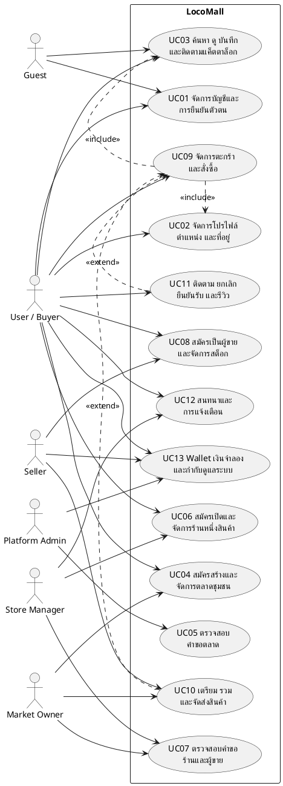

---

# 3.3 Use Case Description

## ตารางที่ 3.2 รายละเอียด Use Case: จัดการบัญชีผู้ใช้และการยืนยันตัวตน

| หัวข้อ | รายละเอียด |
|---|---|
| Use Case Name | จัดการบัญชีผู้ใช้และการยืนยันตัวตน |
| Use Case ID | UC01 |
| Brief Description | สมัครสมาชิก เข้าสู่ระบบด้วยอีเมล/Google กู้คืนหรือเปลี่ยนรหัสผ่าน สลับบัญชี และออกจากระบบ |
| Primary Actors | Guest, User |
| Secondary Actors | Supabase Auth, Google OAuth |
| Preconditions | ผู้ใช้เชื่อมต่ออินเทอร์เน็ต; การเข้าสู่ระบบต้องมีบัญชีอยู่แล้ว |
| Main Flow | 1. ผู้ใช้เลือกสมัครหรือเข้าสู่ระบบ<br>2. กรอกข้อมูลหรือยืนยันผ่าน Google<br>3. ระบบตรวจรูปแบบและยืนยันตัวตน<br>4. เมื่อสมัครสำเร็จ ระบบสร้าง `profiles` อัตโนมัติ<br>5. ระบบสร้าง session และนำผู้ใช้ไปทำ location onboarding หรือหน้าหลัก |
| Post Condition | มีบัญชีและ session ที่ถูกต้อง หรือ session ถูกยกเลิกเมื่อออกจากระบบ |
| Alternation Flows | ผู้ใช้เลือกกู้คืนรหัสผ่าน; ผู้ใช้สลับไปยังบัญชีที่บันทึกใน SecureStore; Guest ดูแค็ตตาล็อกต่อโดยไม่เข้าสู่ระบบ |
| Exception | อีเมลซ้ำ ข้อมูลไม่ครบ รหัสผ่านไม่ผ่านเกณฑ์ OAuth ถูกยกเลิก session หมดอายุ หรือเชื่อมต่อ Auth ไม่ได้ |

## ตารางที่ 3.3 รายละเอียด Use Case: จัดการโปรไฟล์ ตำแหน่ง และที่อยู่จัดส่ง

| หัวข้อ | รายละเอียด |
|---|---|
| Use Case Name | จัดการโปรไฟล์ ตำแหน่ง และที่อยู่จัดส่ง |
| Use Case ID | UC02 |
| Brief Description | แก้ไขข้อมูลส่วนตัว เลือกจังหวัด/อำเภอ/ตำบล ใช้ GPS โดยความยินยอม และจัดการที่อยู่จัดส่งหลายรายการ |
| Primary Actors | User |
| Secondary Actors | Location Service, Database, Storage |
| Preconditions | ผู้ใช้เข้าสู่ระบบแล้ว |
| Main Flow | 1. ผู้ใช้เปิดหน้าโปรไฟล์ ตำแหน่ง หรือที่อยู่จัดส่ง<br>2. ระบบโหลดข้อมูลเดิม<br>3. ผู้ใช้แก้ไขข้อมูลหรือเพิ่มที่อยู่<br>4. ระบบตรวจเบอร์โทร ลำดับพื้นที่ และข้อมูลบังคับ<br>5. ระบบบันทึกข้อมูลและตั้งค่ารายการเริ่มต้นตามที่เลือก |
| Post Condition | โปรไฟล์ ตำแหน่งหลัก หรือที่อยู่จัดส่งถูกปรับปรุงและใช้ในการค้นหา/checkout ได้ |
| Alternation Flows | หากไม่อนุญาต GPS ระบบใช้ centroid ของตำบล; ผู้ใช้มีที่อยู่หลายรายการและเปลี่ยนค่าเริ่มต้นได้ |
| Exception | พื้นที่ไม่สัมพันธ์กัน เบอร์โทรผิดรูปแบบ ที่อยู่ไม่ครบ อัปโหลดรูปไม่ผ่านชนิด/ขนาด หรือเครือข่ายขัดข้อง |

## ตารางที่ 3.4 รายละเอียด Use Case: ค้นหา ดู บันทึก และติดตามแค็ตตาล็อก

| หัวข้อ | รายละเอียด |
|---|---|
| Use Case Name | ค้นหา ดู บันทึก และติดตามแค็ตตาล็อก |
| Use Case ID | UC03 |
| Brief Description | ค้นหาตลาด ร้าน และสินค้าใกล้เคียง ดูรายละเอียด รีวิว และสต็อกรวม รวมถึงบันทึก/ติดตามรายการ |
| Primary Actors | Guest, User |
| Secondary Actors | Location Service, Database |
| Preconditions | ไม่มีสำหรับข้อมูลสาธารณะ; การบันทึก/ติดตามต้องเข้าสู่ระบบ |
| Main Flow | 1. Actor เปิดหน้าหลักหรือกรอกคำค้น<br>2. ระบบใช้ GPS ชั่วคราวหรือตำแหน่งหลักค้นหารัศมี 10-100 กม.<br>3. ระบบแสดงเฉพาะตลาด/ร้านที่ approved และเรียงตามระยะ/ความเกี่ยวข้อง/สต็อก<br>4. Actor เปิดรายละเอียดและดูข้อมูลหรือรีวิว<br>5. User เลือก favorite/follow ได้ |
| Post Condition | ผู้ใช้เห็นข้อมูลปัจจุบันและรายการที่บันทึกถูกเก็บใน `user_catalog_links` |
| Alternation Flows | ไม่พบในรัศมี 100 กม. ระบบคืนรายการที่ใกล้ที่สุดทั่วประเทศ; Guest ถูกนำไปเข้าสู่ระบบเมื่อต้องบันทึก |
| Exception | ไม่สามารถอ่านตำแหน่ง เครือข่ายขัดข้อง หรือรายการถูกระงับระหว่างเปิดหน้า |

## ตารางที่ 3.5 รายละเอียด Use Case: สมัครสร้างและจัดการตลาดชุมชน

| หัวข้อ | รายละเอียด |
|---|---|
| Use Case Name | สมัครสร้างและจัดการตลาดชุมชน |
| Use Case ID | UC04 |
| Brief Description | ผู้ใช้ยื่นคำขอสร้างตลาด และเจ้าของตลาดแก้ไขรายละเอียด/จุดรวมสินค้าของตลาดตน |
| Primary Actors | User, Market Owner |
| Secondary Actors | Storage, Database |
| Preconditions | เข้าสู่ระบบ กรอกเบอร์โทรและตำแหน่งหลักครบ |
| Main Flow | 1. ผู้ใช้กรอกชื่อตลาด รายละเอียด พื้นที่ จุดรวม และรูปภาพ<br>2. ระบบตรวจข้อมูลและอัปโหลดรูป<br>3. ระบบสร้างตลาดสถานะ pending และบันทึก approval event<br>4. เมื่อได้รับอนุมัติ ผู้ใช้เป็นเจ้าของตลาดตาม relationship<br>5. เจ้าของตลาดแก้ไขข้อมูลที่อนุญาตได้ |
| Post Condition | มีคำขอตลาดรอตรวจ หรือข้อมูลตลาดที่อนุมัติแล้วถูกปรับปรุง |
| Alternation Flows | เจ้าของตลาดเปลี่ยนรูปภาพหรือข้อมูลจุดรวม; Admin ส่งกลับด้วยสถานะ rejected พร้อมหมายเหตุ |
| Exception | ชื่อ/จุดรวมว่าง พื้นที่ไม่ตรง รูปไม่ถูกต้อง ไม่มีสิทธิ์แก้ไข หรือคำขอถูกระงับ |

## ตารางที่ 3.6 รายละเอียด Use Case: ตรวจสอบคำขอตลาดชุมชน

| หัวข้อ | รายละเอียด |
|---|---|
| Use Case Name | ตรวจสอบคำขอตลาดชุมชน |
| Use Case ID | UC05 |
| Brief Description | ผู้ดูแลระบบตรวจข้อมูลและอนุมัติ ปฏิเสธ หรือระงับตลาด |
| Primary Actors | Platform Admin |
| Secondary Actors | Database, Notification Service |
| Preconditions | เข้าสู่ระบบและมี `platform_admin` ใน `platform_roles` |
| Main Flow | 1. Admin เปิดคิวคำขอ<br>2. ระบบโหลดข้อมูลตลาดและหลักฐาน<br>3. Admin เลือกอนุมัติหรือปฏิเสธพร้อมหมายเหตุ<br>4. ระบบตรวจสิทธิ์และสถานะปัจจุบัน<br>5. ระบบอัปเดตสถานะ บันทึก approval event/audit log และแจ้งเจ้าของคำขอ |
| Post Condition | ตลาดมีสถานะ approved/rejected/suspended ที่ตรวจสอบย้อนหลังได้ |
| Alternation Flows | Admin ระงับตลาดที่เคยอนุมัติเมื่อพบเหตุผิดปกติ |
| Exception | ไม่ใช่ Admin คำขอถูกตัดสินแล้ว ข้อมูลเปลี่ยนพร้อมกัน หรือฐานข้อมูลขัดข้อง |

## ตารางที่ 3.7 รายละเอียด Use Case: สมัครเปิดและจัดการร้านหนึ่งสินค้า

| หัวข้อ | รายละเอียด |
|---|---|
| Use Case Name | สมัครเปิดและจัดการร้านหนึ่งสินค้า |
| Use Case ID | UC06 |
| Brief Description | ผู้ใช้ยื่นเปิดร้านหนึ่งสินค้าในตลาด และผู้จัดการร้านแก้ไขชื่อ รายละเอียด ราคา หน่วยขาย และรูปสินค้า |
| Primary Actors | User, Store Manager |
| Secondary Actors | Storage, Database |
| Preconditions | เข้าสู่ระบบ; ตลาด approved; ผู้สมัครอยู่พื้นที่ที่ระบบอนุญาต |
| Main Flow | 1. ผู้ใช้เลือกตลาดและกรอกข้อมูลร้าน/สินค้า<br>2. ระบบตรวจชื่อสินค้าไม่ซ้ำในตลาด ราคา หน่วย และรูป<br>3. ระบบสร้างร้านสถานะ pending<br>4. เจ้าของตลาดตรวจคำขอ<br>5. หลังอนุมัติ ผู้จัดการร้านแก้ไขข้อมูลที่ยังไม่ถูกล็อกได้ |
| Post Condition | มีคำขอร้าน หรือร้าน approved พร้อมผู้จัดการและราคากลาง |
| Alternation Flows | แก้รายละเอียด/รูปโดยไม่เปลี่ยนหน่วยขาย; ส่งคำขอใหม่หลังถูกปฏิเสธตามเงื่อนไขระบบ |
| Exception | ตลาดไม่ active สินค้าชื่อซ้ำ ราคาไม่ถูกต้อง หน่วยขายถูกล็อกหลังมีข้อมูลอ้างอิง หรือไม่มีสิทธิ์ |

## ตารางที่ 3.8 รายละเอียด Use Case: ตรวจสอบคำขอร้านและผู้ขาย

| หัวข้อ | รายละเอียด |
|---|---|
| Use Case Name | ตรวจสอบคำขอร้านและผู้ขาย |
| Use Case ID | UC07 |
| Brief Description | เจ้าของตลาดตรวจคำขอเปิดร้าน และผู้จัดการร้านตรวจคำขอเข้าร่วมขาย |
| Primary Actors | Market Owner, Store Manager |
| Secondary Actors | Database, Notification Service |
| Preconditions | Actor เข้าสู่ระบบและเป็นเจ้าของตลาด/ผู้จัดการร้านเป้าหมาย |
| Main Flow | 1. Actor เปิดคิวคำขอที่ตนมีสิทธิ์<br>2. ระบบแสดงข้อมูลผู้สมัคร ร้าน และรูปหลักฐาน<br>3. Actor เลือกอนุมัติหรือปฏิเสธพร้อมหมายเหตุ<br>4. ระบบตรวจ ownership และสถานะ<br>5. ระบบอัปเดตคำขอ สร้าง listing เมื่ออนุมัติผู้ขาย และส่งการแจ้งเตือน |
| Post Condition | คำขอมีผลตัดสินและมีประวัติ; ผู้ขายที่อนุมัติมี listing ของตน |
| Alternation Flows | Actor เปิดดูรายละเอียดก่อนตัดสิน; คำขอถูกปฏิเสธพร้อมเหตุผล |
| Exception | Actor ไม่มีสิทธิ์ คำขอไม่ใช่ pending ร้าน/ตลาดถูกระงับ หรือข้อมูลหลักฐานอ่านไม่ได้ |

## ตารางที่ 3.9 รายละเอียด Use Case: สมัครเป็นผู้ขายและจัดการสต็อก

| หัวข้อ | รายละเอียด |
|---|---|
| Use Case Name | สมัครเป็นผู้ขายและจัดการสต็อก |
| Use Case ID | UC08 |
| Brief Description | ผู้ใช้สมัครเข้าร่วมร้าน และผู้ขายกำหนดจำนวนพร้อมขายหรือพักรายการของตน |
| Primary Actors | User, Seller |
| Secondary Actors | Store Manager, Storage, Database |
| Preconditions | เข้าสู่ระบบ; ร้านและตลาด approved |
| Main Flow | 1. ผู้ใช้เปิดร้านและส่งคำขอพร้อมหมายเหตุ/รูปสินค้า<br>2. ผู้จัดการร้านอนุมัติคำขอ<br>3. ระบบสร้าง seller listing<br>4. Seller กรอก stock และสถานะ active/paused<br>5. ระบบตรวจ `reserved_quantity <= stock_quantity` แล้วบันทึก |
| Post Condition | ผู้ขายมี listing ที่ใช้เป็นแหล่งกระจายออเดอร์ และ stock พร้อมใช้ถูกต้อง |
| Alternation Flows | ผู้ขายพักรายการชั่วคราว; ปรับเพิ่ม/ลด stock ได้ตราบใดที่ไม่ต่ำกว่าจำนวนที่จอง |
| Exception | สมัครซ้ำ ร้านถูกระงับ รูปหลักฐานไม่ถูกต้อง จำนวนติดลบ หรือลดต่ำกว่ายอดจอง |

## ตารางที่ 3.10 รายละเอียด Use Case: จัดการตะกร้าและสั่งซื้อสินค้า

| หัวข้อ | รายละเอียด |
|---|---|
| Use Case Name | จัดการตะกร้าและสั่งซื้อสินค้า |
| Use Case ID | UC09 |
| Brief Description | ผู้ซื้อเลือกสินค้าในตลาดเดียวกัน เลือกวิธีรับและชำระ จากนั้นระบบสร้างออเดอร์และกระจายงานให้ผู้ขาย |
| Primary Actors | Buyer |
| Secondary Actors | Database, Location Service, Notification Service |
| Preconditions | เข้าสู่ระบบ โปรไฟล์/เบอร์โทรครบ ร้าน approved และมี stock พร้อมใช้ |
| Main Flow | 1. Buyer เพิ่มสินค้าและจำนวนลงตะกร้า<br>2. ระบบตรวจว่ารายการอยู่ตลาดเดียวกัน<br>3. Buyer เลือกจัดส่งหรือรับที่จุดรวม และเลือก COD หรือ Wallet เงินจำลอง<br>4. ระบบตรวจที่อยู่/ระยะรับสินค้า ยอดจำลอง และ stock<br>5. RPC lock listing, snapshot ราคา, กระจายจำนวนตาม fairness และเพิ่ม reserved quantity<br>6. ระบบสร้าง order, items, allocations ใน transaction เดียวและแจ้งผู้เกี่ยวข้อง |
| Post Condition | มีออเดอร์สมบูรณ์ สต็อกถูกจอง และตะกร้าถูกเคลียร์; กรณี Wallet ยอดถูกหักครั้งเดียว |
| Alternation Flows | Buyer เปลี่ยนจำนวน/ลบสินค้า; เลือกรับที่จุดรวมเมื่อไม่เกิน 10 กม.; เลือก COD แทน Wallet |
| Exception | stock หรือยอดไม่พอ ที่อยู่ไม่ใช่ของผู้ซื้อ ร้านต่างตลาด request UUID ซ้ำแต่ payload ต่าง หรือ transaction ล้มเหลว ซึ่งต้อง rollback ทั้งหมด |

## ตารางที่ 3.11 รายละเอียด Use Case: เตรียม รวม และจัดส่งสินค้า

| หัวข้อ | รายละเอียด |
|---|---|
| Use Case Name | เตรียม รวม และจัดส่งสินค้า |
| Use Case ID | UC10 |
| Brief Description | ผู้ขายรับและเตรียม allocation; เจ้าของตลาดรับเข้าจุดรวม รวมออเดอร์ และจัดส่งหรือเตรียมให้รับ |
| Primary Actors | Seller, Market Owner |
| Secondary Actors | Database, Notification Service |
| Preconditions | มี order/allocation ที่ยังไม่ยกเลิก และ Actor มี ownership ตรงกับงาน |
| Main Flow | 1. Seller เปิดงานที่ได้รับและกดรับงาน<br>2. Seller เตรียมสินค้าและแจ้งพร้อมรับ<br>3. Owner บันทึกรับสินค้าและถึงจุดรวมสำหรับทุก allocation<br>4. ระบบเปลี่ยน order เป็น at_hub เมื่อครบ<br>5. กรณีจัดส่ง Owner รวมสินค้าแล้วบันทึกบริษัท/เลขติดตาม<br>6. กรณีรับที่จุดรวม ระบบแจ้ง Buyer ให้มารับ |
| Post Condition | ออเดอร์อยู่สถานะ shipped หรือพร้อมให้ Buyer ยืนยันรับ; ทุก transition มี event |
| Alternation Flows | ออเดอร์แบบ pickup ข้าม consolidated/shipped และรอ Buyer ยืนยันที่จุดรวม |
| Exception | ข้ามลำดับสถานะ allocation ยังมาไม่ครบ Actor ไม่ใช่ผู้รับผิดชอบ หรือเลขติดตามไม่ครบ |

## ตารางที่ 3.12 รายละเอียด Use Case: ติดตาม ยกเลิก ยืนยันรับ และรีวิวออเดอร์

| หัวข้อ | รายละเอียด |
|---|---|
| Use Case Name | ติดตาม ยกเลิก ยืนยันรับ และรีวิวออเดอร์ |
| Use Case ID | UC11 |
| Brief Description | ผู้ซื้อดูสถานะออเดอร์ ยกเลิกเมื่ออนุญาต ยืนยันรับสินค้า และรีวิวตลาด/ร้านที่ซื้อจริง |
| Primary Actors | Buyer |
| Secondary Actors | Database, Notification Service |
| Preconditions | เข้าสู่ระบบและเป็นเจ้าของออเดอร์ |
| Main Flow | 1. Buyer เปิดรายการที่ซื้อและรายละเอียดออเดอร์<br>2. ระบบแสดงสินค้า ราคา วิธีรับ เลขติดตาม และสถานะ<br>3. เมื่อส่งถึงแล้ว Buyer ยืนยันรับสินค้า<br>4. ระบบเปลี่ยนสถานะเป็น delivered และลงยอดผู้ขายรอโอนกรณี Wallet<br>5. Buyer ให้คะแนนตลาดหนึ่งครั้งและร้านตาม order item ที่ซื้อจริง |
| Post Condition | ออเดอร์ delivered และมีรีวิวที่ตรวจสอบแหล่งซื้อได้ หรือ order cancelled พร้อมคืน stock/ยอดจำลองครั้งเดียว |
| Alternation Flows | Buyer ยกเลิกก่อนถึงสถานะห้ามยกเลิก; แก้ไขรีวิวเดิม; เลือกรีวิวเฉพาะบางร้าน |
| Exception | ไม่ใช่เจ้าของออเดอร์ สถานะไม่อนุญาต ยืนยันซ้ำ รีวิวก่อน delivered หรือรีวิวรายการที่ไม่ได้ซื้อ |

## ตารางที่ 3.13 รายละเอียด Use Case: สนทนาและจัดการการแจ้งเตือน

| หัวข้อ | รายละเอียด |
|---|---|
| Use Case Name | สนทนาและจัดการการแจ้งเตือน |
| Use Case ID | UC12 |
| Brief Description | ผู้ซื้อสนทนากับผู้จัดการร้าน และผู้ใช้รับ/อ่านการแจ้งเตือนตามบทบาท |
| Primary Actors | User, Store Manager |
| Secondary Actors | Realtime, Expo Push Service, Database |
| Preconditions | เข้าสู่ระบบ; ห้องสนทนาผูกกับผู้ซื้อและร้านที่ถูกต้อง |
| Main Flow | 1. User เปิดห้องสนทนาจากหน้าร้าน<br>2. ระบบสร้างหรือคืนห้องเดิมและตรวจ participant<br>3. ผู้ใช้ส่งข้อความ 1-2,000 ตัวอักษร<br>4. ระบบบันทึกและส่ง Realtime ไปยังคู่สนทนา<br>5. trigger สร้าง notification และ Edge Function ส่ง Push ไปยังอุปกรณ์ที่เปิดใช้งาน<br>6. ผู้รับเปิดรายการและทำเครื่องหมายว่าอ่านแล้ว |
| Post Condition | ข้อความและสถานะการอ่านการแจ้งเตือนถูกบันทึก |
| Alternation Flows | Push ส่งไม่สำเร็จแต่ข้อความ/notification ในแอปยังคงอยู่; ผู้ใช้ปิด push device หรืออ่านทั้งหมด |
| Exception | ไม่ใช่ participant ข้อความว่าง/ยาวเกิน token ไม่ถูกต้อง หรือ Realtime หลุด ซึ่งยังดึงใหม่ได้ |

## ตารางที่ 3.14 รายละเอียด Use Case: จัดการ Wallet เงินจำลองและกำกับดูแลระบบ

| หัวข้อ | รายละเอียด |
|---|---|
| Use Case Name | จัดการ Wallet เงินจำลองและกำกับดูแลระบบ |
| Use Case ID | UC13 |
| Brief Description | ผู้ใช้ขอเติมยอดจำลอง ผู้ขายดูยอด และ Admin อนุมัติยอด บันทึก settlement ดูแลรีวิว/ออเดอร์ และตรวจ audit |
| Primary Actors | User, Seller, Platform Admin |
| Secondary Actors | Database, Notification Service |
| Preconditions | เข้าสู่ระบบ; การตัดสินใจหรือ override ต้องเป็น Platform Admin |
| Main Flow | 1. User สร้างคำขอเติมยอด 1-10,000 บาทพร้อม request UUID<br>2. Admin ตรวจและอนุมัติ/ปฏิเสธ<br>3. ระบบเพิ่มยอดและ ledger ครั้งเดียวเมื่ออนุมัติ<br>4. Seller ดูยอดชำระรอส่งมอบ ยอดรอโอน และยอดที่บันทึกโอน<br>5. Admin บันทึก settlement พร้อมหลักฐาน หรือจัดการรีวิว/ออเดอร์ผิดปกติ<br>6. ระบบบันทึก audit log ของการกระทำสำคัญ |
| Post Condition | บัญชีและ ledger จำลองสมดุล การตัดสินใจ/override ตรวจสอบย้อนหลังได้ |
| Alternation Flows | Admin ปฏิเสธ top-up; ซ่อน/แสดงรีวิวพร้อมเหตุผล; override ยกเลิกและลบออเดอร์ที่ cancelled แล้ว |
| Exception | request ซ้ำ การตัดสินซ้ำ ยอดเกินช่วง ยอดผู้ขายไม่พอ ไม่มีหลักฐาน ไม่มีสิทธิ์ หรือพยายามใช้เป็นเงินจริง |

---

# 3.4 Activity Diagram

Activity Diagram ต่อไปนี้ใช้ swimlane ตามตัวอย่างเดิม และมีคำอธิบายใต้โค้ดทุก Use Case

## รูปที่ 3.2 Activity Diagram ของ UC01 จัดการบัญชีผู้ใช้และการยืนยันตัวตน

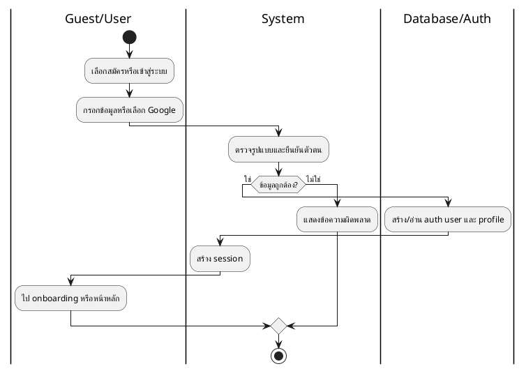

คำอธิบาย: ผู้ใช้ส่งข้อมูลให้ระบบตรวจสอบ หากสมัครใหม่ Auth จะสร้างบัญชีและ trigger สร้าง profile จากนั้นระบบสร้าง session; หากไม่ผ่านจะไม่สร้างข้อมูลบางส่วนค้างไว้

## รูปที่ 3.3 Activity Diagram ของ UC02 จัดการโปรไฟล์ ตำแหน่ง และที่อยู่จัดส่ง

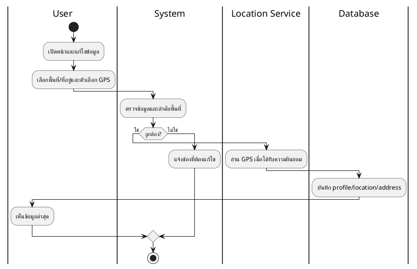

คำอธิบาย: หากไม่อนุญาตหรืออ่าน GPS ไม่ได้ ระบบใช้พิกัด centroid ของตำบล และเก็บที่อยู่จัดส่งแยกจากตำแหน่งสำหรับค้นหา

## รูปที่ 3.4 Activity Diagram ของ UC03 ค้นหา ดู บันทึก และติดตามแค็ตตาล็อก

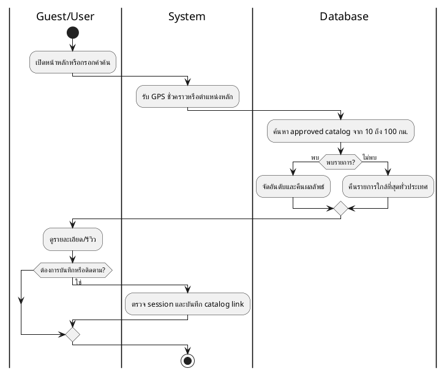

คำอธิบาย: ระบบเปิดเผยเฉพาะรายการที่ approved และไม่เปิดข้อมูลส่วนบุคคลของผู้ขาย; การ favorite/follow ต้องยืนยันตัวตน

## รูปที่ 3.5 Activity Diagram ของ UC04 สมัครสร้างและจัดการตลาดชุมชน

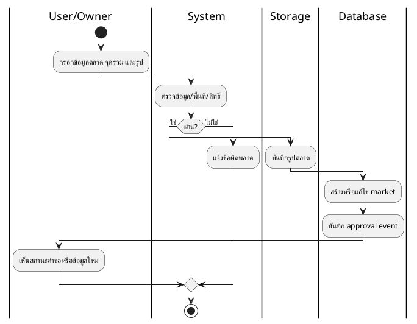

คำอธิบาย: คำขอใหม่เริ่มที่ pending และยังไม่ปรากฏในแค็ตตาล็อกสาธารณะจนกว่า Admin จะอนุมัติ

## รูปที่ 3.6 Activity Diagram ของ UC05 ตรวจสอบคำขอตลาดชุมชน

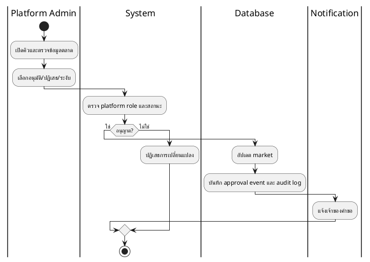

คำอธิบาย: ทุกการตัดสินใจผูกกับ Admin ผู้กระทำและหมายเหตุ เพื่อให้ตรวจสอบย้อนหลังได้

## รูปที่ 3.7 Activity Diagram ของ UC06 สมัครเปิดและจัดการร้านหนึ่งสินค้า

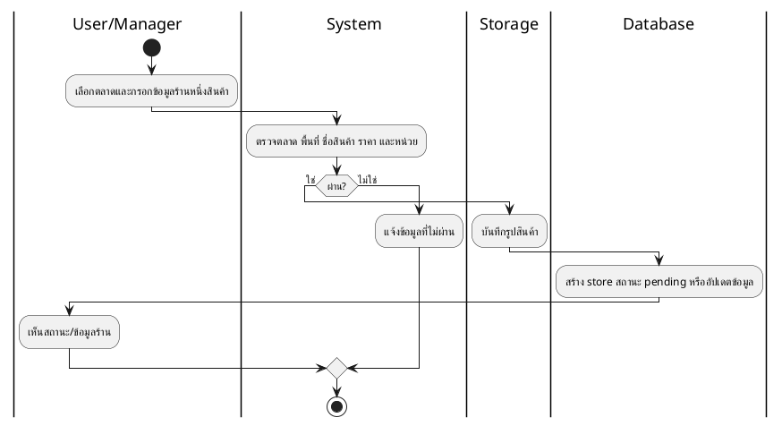

คำอธิบาย: ระบบบังคับสินค้าไม่ซ้ำภายในตลาด และล็อกหน่วยขายเมื่อร้าน approved หรือมีข้อมูลสต็อก/ตะกร้า/ออเดอร์อ้างอิงแล้ว

## รูปที่ 3.8 Activity Diagram ของ UC07 ตรวจสอบคำขอร้านและผู้ขาย

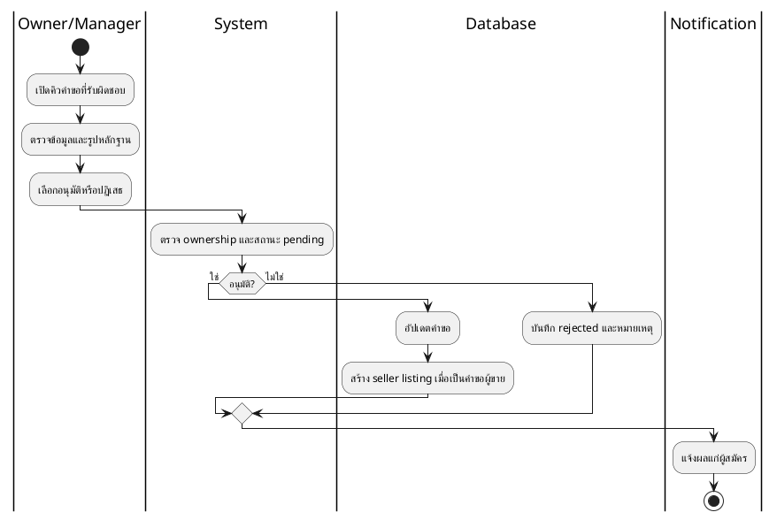

คำอธิบาย: เจ้าของตลาดตัดสินคำขอร้าน ส่วนผู้จัดการร้านตัดสินคำขอผู้ขาย และทั้งสองกรณีต้องตรวจขอบเขต ownership

## รูปที่ 3.9 Activity Diagram ของ UC08 สมัครเป็นผู้ขายและจัดการสต็อก

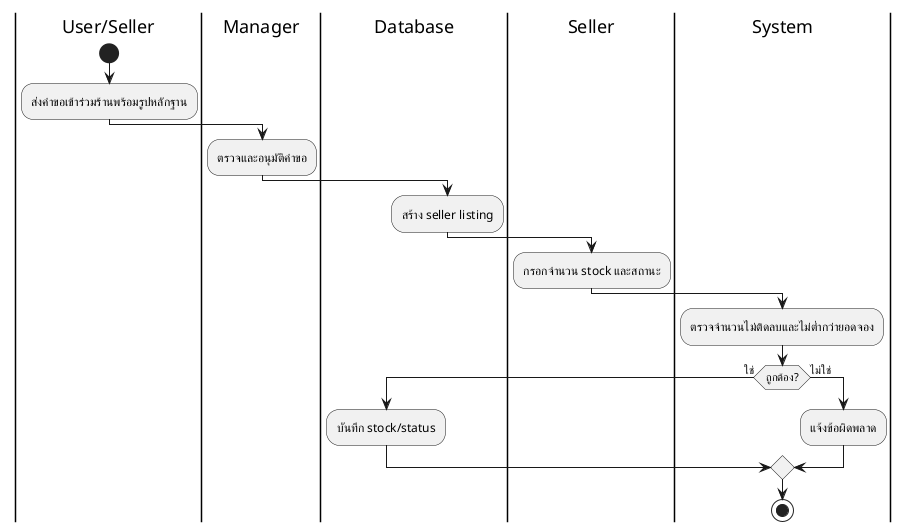

คำอธิบาย: ผู้ขายแก้ได้เฉพาะ listing ของตน และจำนวนพร้อมขายคำนวณจาก `stock_quantity - reserved_quantity`

## รูปที่ 3.10 Activity Diagram ของ UC09 จัดการตะกร้าและสั่งซื้อสินค้า

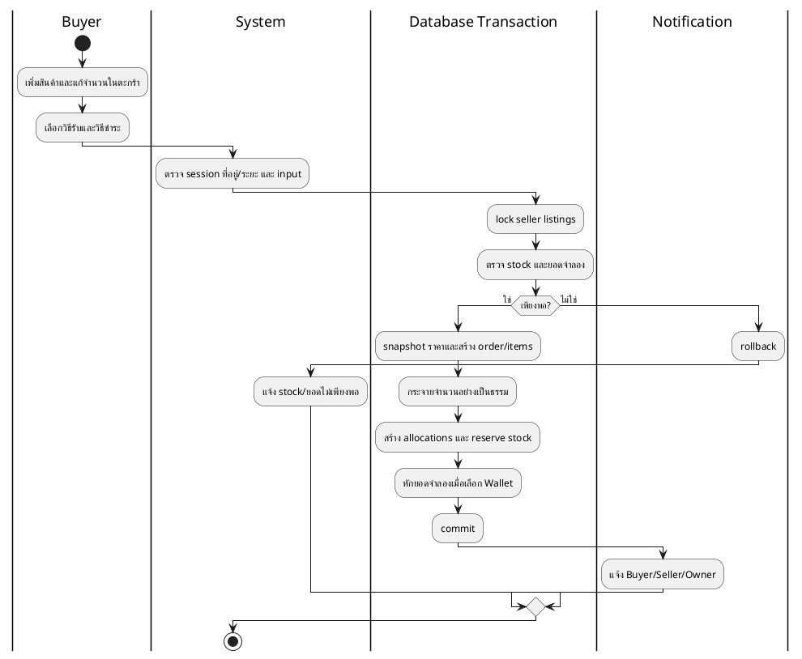

คำอธิบาย: ส่วนสำคัญเกิดใน PostgreSQL transaction เดียวเพื่อป้องกัน oversell, allocation ซ้ำ และการหักยอดโดยไม่มีออเดอร์

## รูปที่ 3.11 Activity Diagram ของ UC10 เตรียม รวม และจัดส่งสินค้า

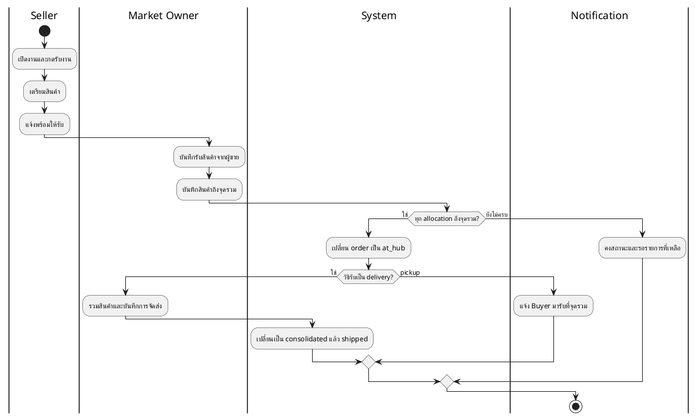

คำอธิบาย: ลำดับ allocation คือ preparing → ready_for_pickup → collected → at_hub และทุก transition ถูกตรวจ actor พร้อมบันทึก event

## รูปที่ 3.12 Activity Diagram ของ UC11 ติดตาม ยกเลิก ยืนยันรับ และรีวิวออเดอร์

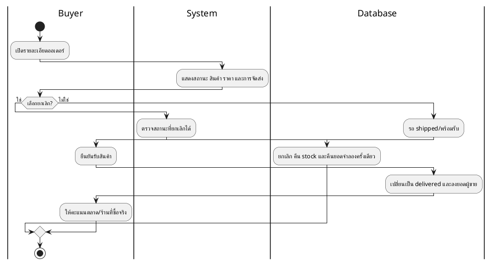

คำอธิบาย: รีวิวเกิดได้หลัง delivered เท่านั้น และระบบตรวจทั้งเจ้าของออเดอร์กับ order item เพื่อป้องกันรีวิวที่ไม่ได้ซื้อจริง

## รูปที่ 3.13 Activity Diagram ของ UC12 สนทนาและจัดการการแจ้งเตือน

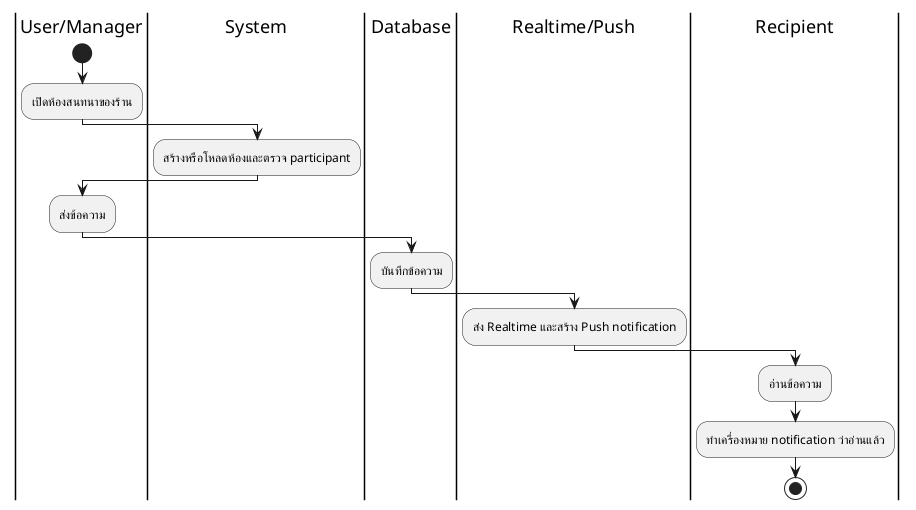

คำอธิบาย: Push เป็นช่องทางเสริม หากส่งไม่สำเร็จข้อมูลในฐานข้อมูลและ Realtime ยังเป็นแหล่งข้อมูลหลักที่ดึงใหม่ได้

## รูปที่ 3.14 Activity Diagram ของ UC13 จัดการ Wallet เงินจำลองและกำกับดูแลระบบ

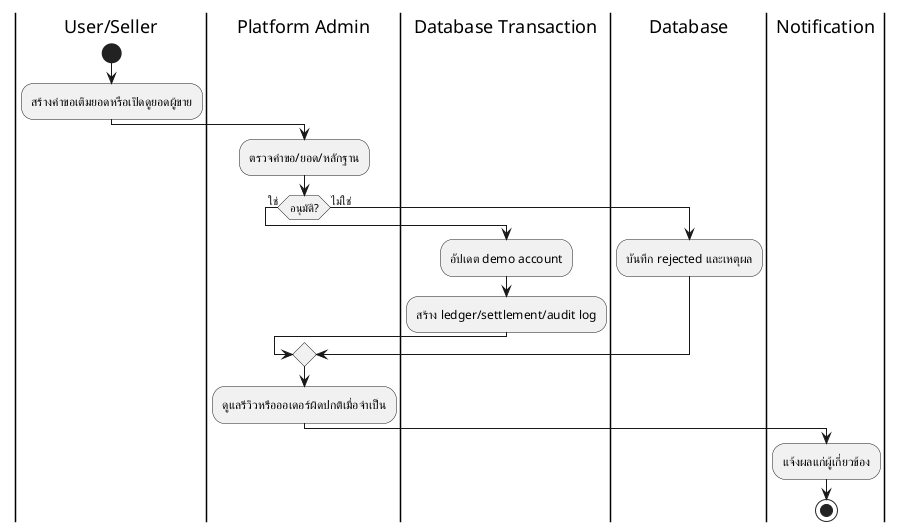

คำอธิบาย: ทุกจำนวนเงินใน Use Case นี้เป็นข้อมูลจำลอง การเพิ่ม/ลดต้องผ่าน RPC ที่ตรวจสิทธิ์และ idempotency ห้าม client เขียนยอดโดยตรง

---

# 3.5 Sequence Diagram

Sequence Diagram ทุกภาพต่อไปนี้อิงลำดับเดียวกับ Activity Diagram ในหัวข้อ 3.4

## รูปที่ 3.15 Sequence Diagram ของ UC01

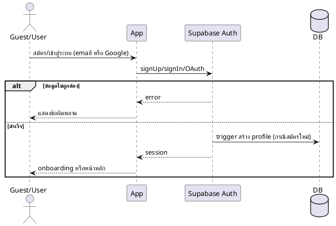

## รูปที่ 3.16 Sequence Diagram ของ UC02

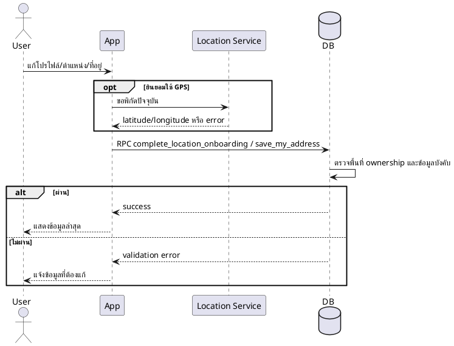

## รูปที่ 3.17 Sequence Diagram ของ UC03

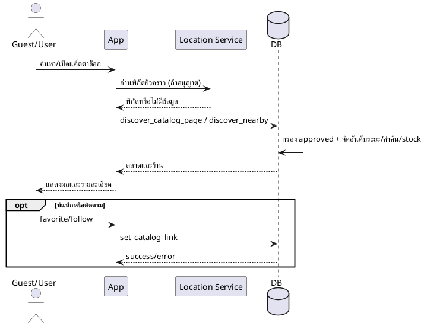

## รูปที่ 3.18 Sequence Diagram ของ UC04

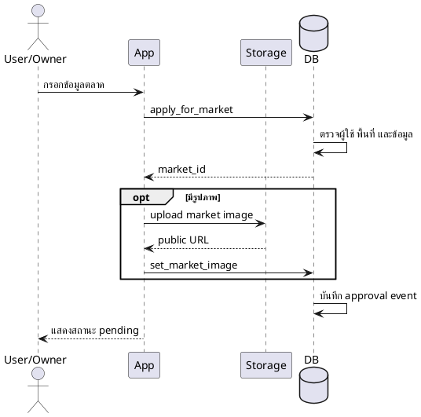

## รูปที่ 3.19 Sequence Diagram ของ UC05

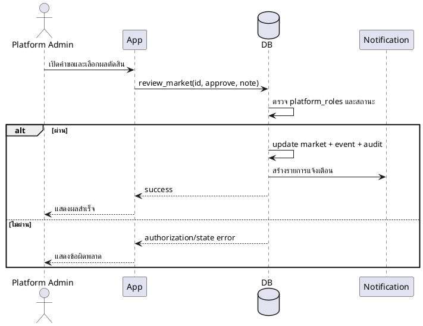

## รูปที่ 3.20 Sequence Diagram ของ UC06

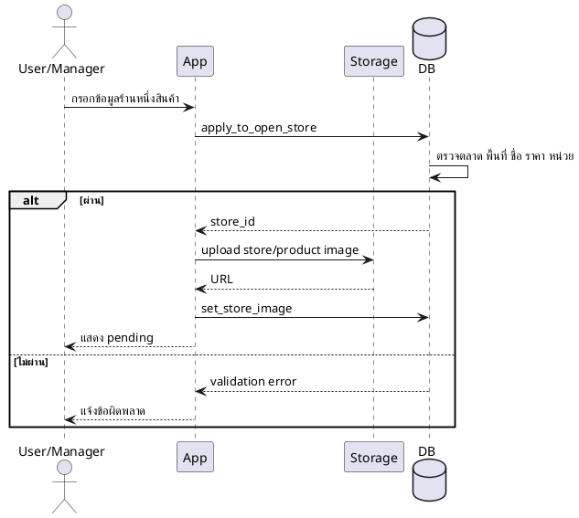

## รูปที่ 3.21 Sequence Diagram ของ UC07

```plantuml
@startuml
skinparam defaultFontName Tahoma
actor "Owner/Manager" as Reviewer
participant App
database DB
participant Notification
Reviewer -> App: เปิดคิวคำขอ
App -> DB: อ่านคำขอในขอบเขต ownership
DB --> App: รายละเอียดและหลักฐาน
Reviewer -> App: อนุมัติ/ปฏิเสธพร้อมหมายเหตุ
App -> DB: review_store หรือ review_store_seller
DB -> DB: ตรวจ actor/state และบันทึกผล
opt อนุมัติผู้ขาย
  DB -> DB: สร้าง seller_listing
end
DB -> Notification: แจ้งผลผู้สมัคร
DB --> App: success/error
@enduml
```

## รูปที่ 3.22 Sequence Diagram ของ UC08

```plantuml
@startuml
skinparam defaultFontName Tahoma
actor "User/Seller" as Seller
participant App
participant Storage
database DB
Seller -> App: สมัครเข้าร่วมร้าน
App -> Storage: upload evidence image
Storage --> App: private path
App -> DB: apply_to_sell_in_store
DB --> App: pending
... หลังได้รับอนุมัติ ...
Seller -> App: แก้จำนวนและสถานะ
App -> DB: update_my_listing_stock
DB -> DB: ตรวจ ownership และ reserved <= stock
alt ผ่าน
  DB --> App: success
else ไม่ผ่าน
  DB --> App: validation error
end
App --> Seller: แสดงผลล่าสุด
@enduml
```

## รูปที่ 3.23 Sequence Diagram ของ UC09

```plantuml
@startuml
skinparam defaultFontName Tahoma
actor Buyer
participant App
participant "Order RPC" as RPC
database DB
participant Notification
Buyer -> App: ยืนยันตะกร้า วิธีรับ และชำระ
App -> RPC: create_cod_order หรือ create_demo_wallet_order
RPC -> DB: ตรวจ buyer/address/pickup/market
RPC -> DB: lock active listings
RPC -> DB: ตรวจ stock และยอดจำลอง
alt ไม่เพียงพอหรือข้อมูลผิด
  DB --> RPC: error + rollback
  RPC --> App: error
  App --> Buyer: แจ้งสาเหตุ
else ผ่าน
  RPC -> DB: create order + items + fair allocations
  RPC -> DB: reserve stock + wallet ledger (ถ้ามี)
  DB --> RPC: commit order_id
  RPC -> Notification: แจ้งผู้เกี่ยวข้อง
  RPC --> App: order_id
  App --> Buyer: เปิดรายละเอียดออเดอร์
end
@enduml
```

## รูปที่ 3.24 Sequence Diagram ของ UC10

```plantuml
@startuml
skinparam defaultFontName Tahoma
actor Seller
actor "Market Owner" as Owner
participant App
database DB
participant Notification
Seller -> App: รับงาน/แจ้งพร้อมรับ
App -> DB: accept_allocation / mark_allocation_ready
DB -> DB: ตรวจ seller และ transition
DB -> Notification: แจ้ง Owner
Owner -> App: รับสินค้า/ถึงจุดรวม
App -> DB: record_allocation_collected / at_hub
DB -> DB: ตรวจทุก allocation
alt จัดส่งและครบทุก allocation
  Owner -> App: รวมสินค้าและกรอกเลขติดตาม
  App -> DB: consolidate_order / ship_order
  DB -> Notification: แจ้ง Buyer ว่าจัดส่งแล้ว
else รับที่จุดรวมและครบ
  DB -> Notification: แจ้ง Buyer ให้มารับ
end
@enduml
```

## รูปที่ 3.25 Sequence Diagram ของ UC11

```plantuml
@startuml
skinparam defaultFontName Tahoma
actor Buyer
participant App
database DB
participant Notification
Buyer -> App: เปิดรายละเอียดออเดอร์
App -> DB: อ่าน order/items/allocations
DB --> App: ข้อมูลตามสิทธิ์
alt ยกเลิก
  Buyer -> App: ยืนยันยกเลิก
  App -> DB: cancel_order
  DB -> DB: คืน stock และยอดจำลองแบบ idempotent
  DB -> Notification: แจ้งผู้เกี่ยวข้อง
else ยืนยันรับ
  Buyer -> App: ยืนยันรับสินค้า
  App -> DB: confirm_delivery
  DB -> DB: delivered + ลงยอดผู้ขายรอโอน
  Buyer -> App: ส่งคะแนน/ข้อความรีวิว
  App -> DB: save_purchase_review
end
DB --> App: success/error
@enduml
```

## รูปที่ 3.26 Sequence Diagram ของ UC12

```plantuml
@startuml
skinparam defaultFontName Tahoma
actor "User/Manager" as Sender
participant App
database DB
participant Realtime
participant "Push Function" as Push
actor Recipient
Sender -> App: เปิดห้องและส่งข้อความ
App -> DB: get_or_create_chat_room + insert message
DB -> DB: ตรวจ participant
DB -> Realtime: publish row change
Realtime -> Recipient: แสดงข้อความใหม่
DB -> DB: trigger สร้าง notification
DB -> Push: webhook notification
Push -> Recipient: Expo push
Recipient -> App: เปิด/ทำเครื่องหมายว่าอ่าน
App -> DB: mark_notification_read
@enduml
```

## รูปที่ 3.27 Sequence Diagram ของ UC13

```plantuml
@startuml
skinparam defaultFontName Tahoma
actor User
actor Seller
actor "Platform Admin" as Admin
participant App
database DB
User -> App: ขอเติมยอดจำลอง
App -> DB: request_demo_topup(request_uuid, amount)
DB --> App: pending
Admin -> App: ตรวจและตัดสินคำขอ
App -> DB: decide_demo_topup
alt อนุมัติ
  DB -> DB: เพิ่ม demo account + ledger ครั้งเดียว
else ปฏิเสธ
  DB -> DB: บันทึก rejected/note
end
Seller -> App: ดูยอดรอโอน
Admin -> App: บันทึก settlement พร้อมหลักฐาน
App -> DB: record_demo_settlement
DB -> DB: ลด seller_pending + เพิ่ม settled + ledger/audit
DB --> App: success/error
@enduml
```

---

# 3.6 Class Diagram

## รูปที่ 3.28 Class Diagram ของระบบ LocoMall

```plantuml
@startuml
skinparam defaultFontName Tahoma
skinparam classAttributeIconSize 0

class Profile {
  +UUID userId
  +String fullName
  +String username
  +String phone
  +String avatarUrl
}
class UserLocation {
  +String provinceCode
  +String districtCode
  +String subdistrictCode
  +Boolean gpsConsent
}
class UserAddress {
  +Long addressId
  +String recipientName
  +String phone
  +String addressLine
  +Boolean isDefault
}
class PlatformRole {
  +String role
  +DateTime createdAt
}
class Market {
  +Long marketId
  +String name
  +String hubAddress
  +String approvalStatus
}
class Store {
  +Long storeId
  +String name
  +String productName
  +String unit
  +Decimal unitPrice
  +String approvalStatus
}
class SellerApplication {
  +Long applicationId
  +String status
  +String reviewNote
}
class SellerListing {
  +Long listingId
  +Int stockQuantity
  +Int reservedQuantity
  +Int fulfilledQuantity
  +String status
  +availableQuantity()
}
class Cart {
  +Long cartId
}
class CartItem {
  +Long cartItemId
  +Int quantity
}
class Order {
  +Long orderId
  +String orderNumber
  +Decimal totalAmount
  +String status
  +String paymentMethod
  +String fulfillmentMethod
  +cancel()
  +confirmDelivery()
}
class OrderItem {
  +Long orderItemId
  +String productName
  +String unit
  +Decimal unitPrice
  +Int quantity
}
class OrderAllocation {
  +Long allocationId
  +Int quantity
  +String status
  +transitionTo(status)
}
class AllocationStatusEvent
class ChatRoom
class ChatMessage
class Notification
class PurchaseReview
class CatalogLink
class DemoAccount
class DemoTopupRequest
class DemoLedger
class DemoSettlement
class ApprovalEvent
class AdminAuditLog

class DiscoveryService {
  +discoverNearby(query, location)
}
class ApprovalService {
  +reviewMarket()
  +reviewStore()
  +reviewSeller()
}
class AllocationService {
  +allocateFairly(quantity, listings)
  +reserveStock()
}
class OrderService {
  +createOrder()
  +cancelOrder()
  +confirmDelivery()
}
class NotificationService {
  +publishRealtime()
  +sendPush()
}

Profile "1" -- "0..1" PlatformRole
Profile "1" -- "1" UserLocation
Profile "1" -- "0..*" UserAddress
Profile "1" -- "0..*" Market : owns
Market "1" -- "0..*" Store
Profile "1" -- "0..*" Store : manages
Store "1" -- "0..*" SellerApplication
Profile "1" -- "0..*" SellerApplication : applies
Store "1" -- "0..*" SellerListing
Profile "1" -- "0..*" SellerListing : supplies
Profile "1" -- "0..1" Cart
Cart "1" -- "0..*" CartItem
Store "1" -- "0..*" CartItem
Profile "1" -- "0..*" Order : buys
Market "1" -- "0..*" Order
Order "1" *-- "1..*" OrderItem
Store "1" -- "0..*" OrderItem
OrderItem "1" *-- "1..*" OrderAllocation
SellerListing "1" -- "0..*" OrderAllocation
OrderAllocation "1" *-- "0..*" AllocationStatusEvent
Store "1" -- "0..*" ChatRoom
ChatRoom "1" *-- "0..*" ChatMessage
Profile "1" -- "0..*" Notification
Order "1" -- "0..*" PurchaseReview
Profile "1" -- "0..*" CatalogLink
Profile "1" -- "1" DemoAccount
Profile "1" -- "0..*" DemoTopupRequest
Profile "1" -- "0..*" DemoLedger
Profile "1" -- "0..*" DemoSettlement : seller
Market "1" -- "0..*" ApprovalEvent
Profile "1" -- "0..*" AdminAuditLog : acts

DiscoveryService ..> Market
ApprovalService ..> ApprovalEvent
AllocationService ..> SellerListing
AllocationService ..> OrderAllocation
OrderService ..> Order
OrderService ..> AllocationService
NotificationService ..> Notification
@enduml
```

คำอธิบาย: Class Diagram แยก domain entity ออกจาก service ที่ทำธุรกรรมสำคัญ โดย `AllocationService` และ `OrderService` ต้องทำงานฝั่งฐานข้อมูลผ่าน RPC ไม่ใช่คำนวณขั้นสุดท้ายที่ client

---

# 3.7 Entity Relationship Diagram

## รูปที่ 3.29 Entity Relationship Diagram ของระบบ LocoMall

```mermaid
erDiagram
    AUTH_USERS ||--|| PROFILES : has
    PROFILES ||--o| PLATFORM_ROLES : granted
    PROFILES ||--|| USER_LOCATIONS : chooses
    PROFILES ||--o{ USER_ADDRESSES : owns

    THAI_PROVINCES ||--o{ THAI_DISTRICTS : contains
    THAI_DISTRICTS ||--o{ THAI_SUBDISTRICTS : contains
    THAI_SUBDISTRICTS ||--o{ USER_LOCATIONS : locates
    THAI_SUBDISTRICTS ||--o{ USER_ADDRESSES : locates

    PROFILES ||--o{ MARKETS : owns
    MARKETS ||--o{ STORES : contains
    PROFILES ||--o{ STORES : manages
    STORES ||--o{ STORE_SELLER_APPLICATIONS : receives
    PROFILES ||--o{ STORE_SELLER_APPLICATIONS : submits
    STORES ||--o{ SELLER_LISTINGS : aggregates
    PROFILES ||--o{ SELLER_LISTINGS : supplies

    PROFILES ||--o| CARTS : owns
    MARKETS ||--o{ CARTS : scopes
    CARTS ||--o{ CART_ITEMS : contains
    STORES ||--o{ CART_ITEMS : references

    PROFILES ||--o{ ORDERS : buys
    MARKETS ||--o{ ORDERS : fulfills
    USER_ADDRESSES o|--o{ ORDERS : ships_to
    ORDERS ||--|{ ORDER_ITEMS : contains
    STORES ||--o{ ORDER_ITEMS : snapshots
    ORDER_ITEMS ||--|{ ORDER_ALLOCATIONS : splits
    SELLER_LISTINGS ||--o{ ORDER_ALLOCATIONS : reserves
    PROFILES ||--o{ ORDER_ALLOCATIONS : fulfills
    ORDER_ALLOCATIONS ||--o{ ALLOCATION_STATUS_EVENTS : records

    PROFILES ||--o{ CHAT_ROOMS : buyer
    STORES ||--o{ CHAT_ROOMS : hosts
    CHAT_ROOMS ||--o{ CHAT_MESSAGES : contains
    PROFILES ||--o{ CHAT_MESSAGES : sends

    PROFILES ||--o{ NOTIFICATIONS : receives
    PROFILES ||--o{ USER_PUSH_DEVICES : registers
    PROFILES ||--o{ USER_CATALOG_LINKS : saves

    ORDERS ||--o{ PURCHASE_REVIEWS : permits
    ORDER_ITEMS o|--o| PURCHASE_REVIEWS : store_review
    MARKETS o|--o{ PURCHASE_REVIEWS : market_target
    STORES o|--o{ PURCHASE_REVIEWS : store_target
    PROFILES ||--o{ PURCHASE_REVIEWS : writes

    PROFILES ||--|| DEMO_ACCOUNTS : owns
    PROFILES ||--o{ DEMO_TOPUP_REQUESTS : requests
    PROFILES ||--o{ DEMO_ORDER_REQUESTS : submits
    ORDERS o|--o| DEMO_ORDER_REQUESTS : created_by
    PROFILES ||--o{ DEMO_LEDGER : has
    ORDERS o|--o{ DEMO_LEDGER : references
    DEMO_TOPUP_REQUESTS o|--o| DEMO_LEDGER : credits
    PROFILES ||--o{ DEMO_SETTLEMENTS : seller
    DEMO_SETTLEMENTS o|--o{ DEMO_LEDGER : settles

    PROFILES ||--o{ APPROVAL_EVENTS : acts
    PROFILES ||--o{ ADMIN_AUDIT_LOGS : acts

    PROFILES {
      uuid user_id PK
      text full_name
      text username UK
      text phone_num
      text user_img_url
    }
    MARKETS {
      bigint market_id PK
      uuid owner_id FK
      text name
      text hub_address
      text approval_status
      geography geography
    }
    STORES {
      bigint store_id PK
      bigint market_id FK
      uuid manager_id FK
      text product_name
      text unit
      numeric unit_price
      text approval_status
    }
    SELLER_LISTINGS {
      bigint listing_id PK
      bigint store_id FK
      uuid seller_id FK
      int stock_quantity
      int reserved_quantity
      int fulfilled_quantity
      text status
      timestamptz last_allocated_at
    }
    ORDERS {
      bigint order_id PK
      uuid buyer_id FK
      bigint market_id FK
      bigint address_id FK
      numeric total_amount
      text status
      text payment_method
      text fulfillment_method
    }
    ORDER_ITEMS {
      bigint order_item_id PK
      bigint order_id FK
      bigint store_id FK
      text product_name
      text unit
      numeric unit_price
      int quantity
    }
    ORDER_ALLOCATIONS {
      bigint allocation_id PK
      bigint order_item_id FK
      bigint listing_id FK
      uuid seller_id FK
      int quantity
      text status
    }
    PURCHASE_REVIEWS {
      bigint review_id PK
      uuid buyer_id FK
      bigint order_id FK
      bigint order_item_id FK
      bigint market_id FK
      bigint store_id FK
      int stars
      text body
      timestamptz hidden_at
    }
    DEMO_ACCOUNTS {
      uuid user_id PK_FK
      numeric wallet_balance
      numeric seller_pending
      numeric seller_settled
    }
    DEMO_LEDGER {
      bigint entry_id PK
      uuid user_id FK
      text entry_type
      numeric wallet_delta
      numeric seller_delta
      bigint order_id FK
    }
    DEMO_ORDER_REQUESTS {
      uuid user_id PK_FK
      uuid request_id PK
      jsonb payload
      bigint order_id FK
    }
```

## คำอธิบายความสัมพันธ์สำคัญ

1. `profiles` เชื่อมกับ `auth.users` แบบหนึ่งต่อหนึ่ง และไม่เก็บรหัสผ่านใน public schema
2. ตลาดหนึ่งแห่งมีหลายร้าน แต่ร้านหนึ่งร้านอยู่ในตลาดเดียวและขายสินค้าชนิดเดียว
3. ร้านหนึ่งมีผู้ขายหลายรายผ่าน `seller_listings`; ผู้ขายหนึ่งรายเข้าร่วมได้หลายร้าน
4. ตะกร้าหนึ่งชุดผูกกับตลาดเดียว เพื่อให้ออเดอร์หนึ่งรายการรวมส่งจากจุดรวมเดียวกัน
5. `order_items` เก็บ snapshot ของชื่อสินค้า หน่วย ราคา และจำนวน ณ เวลาซื้อ
6. `order_allocations` แยกหนึ่ง order item ไปยัง seller listing หลายรายการ และเป็นแกนหลักของการกระจายอย่างเป็นธรรม
7. `allocation_status_events`, `approval_events` และ `admin_audit_logs` เป็นข้อมูลประวัติสำหรับตรวจสอบย้อนหลัง
8. รีวิวต้องอ้างถึงออเดอร์ที่ส่งมอบแล้ว โดยรีวิวตลาดและรีวิวร้านมีข้อกำหนด foreign key ต่างกัน
9. ตาราง `demo_*` ใช้เฉพาะเงินจำลอง การเปลี่ยนยอดทุกครั้งต้องมี ledger และการป้องกันรายการซ้ำ
10. `notifications` และ `user_push_devices` แยกข้อมูลแจ้งเตือนในแอปออกจาก token ของอุปกรณ์

---

# 3.8 ข้อกำหนดสถานะและกฎธุรกิจที่ใช้ประกอบไดอะแกรม

## สถานะออเดอร์

```mermaid
stateDiagram-v2
    [*] --> awaiting_preparation
    awaiting_preparation --> preparing
    preparing --> at_hub: allocation ทั้งหมดถึงจุดรวม
    at_hub --> consolidated: แบบจัดส่ง
    consolidated --> shipped
    shipped --> delivered: ผู้ซื้อยืนยันรับ
    at_hub --> delivered: แบบรับที่จุดรวม
    awaiting_preparation --> cancelled
    preparing --> cancelled
    at_hub --> cancelled
    consolidated --> cancelled
```

## สถานะ Allocation

```mermaid
stateDiagram-v2
    [*] --> awaiting_preparation
    awaiting_preparation --> preparing: ผู้ขายกดรับงาน
    preparing --> ready_for_pickup: ผู้ขายแจ้งพร้อมรับ
    ready_for_pickup --> collected: เจ้าของตลาดรับสินค้า
    collected --> at_hub: สินค้าถึงจุดรวม
    preparing --> cancelled
    ready_for_pickup --> cancelled
    collected --> cancelled
```

## กฎการกระจายสินค้า

1. เลือกเฉพาะ listing สถานะ active และมี `stock_quantity - reserved_quantity > 0`
2. lock แถว listing ที่เกี่ยวข้องก่อนคำนวณ
3. เรียงผู้ขายตาม `last_allocated_at` เพื่อหมุนความเป็นธรรม
4. แบ่งจำนวนเท่า ๆ กันตาม capacity และกระจายใหม่เมื่อผู้ขายรายใดมี stock ไม่พอ
5. ห้าม allocation รวมต่ำกว่าจำนวนที่ผู้ซื้อสั่ง
6. เพิ่ม `reserved_quantity` และสร้าง allocations ใน transaction เดียว
7. เมื่อยกเลิกต้องคืนยอดจองเพียงครั้งเดียว; เมื่อส่งมอบจึงนับยอดผู้ขาย

ตัวอย่าง:

- สั่ง 30 หน่วย จาก stock `[100, 100, 100]` → กระจาย `[10, 10, 10]`
- สั่ง 30 หน่วย จาก stock `[5, 100, 100]` → กระจาย `[5, 13, 12]` หรือ `[5, 12, 13]` ตาม fairness cursor

---

# 3.9 หมายเหตุสำหรับนำไปจัดรูปเล่ม

1. หมายเลขตารางและรูปในไฟล์นี้เป็นชุดใหม่ต่อเนื่องภายในเนื้อหาร่าง ควรปรับอีกครั้งหลังวางลงเอกสารจริง
2. ใช้คำว่า “ตลาดชุมชน”, “ร้านหนึ่งสินค้า”, “ผู้ขาย”, “รายการขาย”, “ออเดอร์” และ “การกระจายออเดอร์” ให้สม่ำเสมอ
3. ไม่ควรใช้โมเดลเดิมที่ออเดอร์ผูกกับร้านเดียวหรือให้ผู้ขายแต่ละรายกำหนดราคาต่างกัน
4. ทุกหน้าที่กล่าวถึง Wallet, QR, ยอดเติม หรือยอดโอน ต้องระบุชัดว่า “เงินจำลองสำหรับสาธิต”
5. หากต้องส่งเป็นรูปภาพ แนะนำ export PlantUML/Mermaid เป็น SVG เพื่อรักษาความคมชัดก่อนนำเข้า Word

---

# 3.10 Data Dictionary

ข้อมูลส่วนนี้ตรวจจากโครงสร้างจริงของโครงการ Supabase `LOCO_MALL` ณ วันที่ 10 ตุลาคม 2569 ไม่ได้อ้างจากข้อมูลตัวอย่างในแถวตาราง ทุกตารางด้านล่างอยู่ใน schema `public` และเปิด Row Level Security (RLS) แล้ว ส่วน `auth.users` เป็นตารางที่ Supabase Auth จัดการและแสดงใน ERD เฉพาะความสัมพันธ์กับ `profiles`

สัญลักษณ์: `YES` หมายถึงเป็นคีย์ชนิดนั้น, `-` หมายถึงไม่ใช่คีย์, และ FK แสดงในรูป `table.column`

## ตารางที่ 3.15 รายละเอียดตาราง `profiles`

| Database Name | LOCO_MALL (Supabase/PostgreSQL) |
|---|---|
| Table | `public.profiles` |

| Attribute | Type | PK | FK | Description |
|---|---|---|---|---|
| `user_id` | uuid | YES | `auth.users.id` | รหัสผู้ใช้ ใช้ค่าเดียวกับบัญชี Supabase Auth |
| `full_name` | varchar | - | - | ชื่อ-นามสกุลเดิมของผู้ใช้; nullable |
| `username` | varchar | - | - | ชื่อผู้ใช้; nullable และ unique |
| `phone_num` | varchar | - | - | เบอร์โทรศัพท์รูปแบบไทย 10 หลัก; nullable |
| `age` | integer | - | - | อายุผู้ใช้ ค่าต้องไม่น้อยกว่า 0; nullable |
| `gender` | varchar | - | - | เพศของผู้ใช้; nullable |
| `role` | user_role | - | - | ค่า legacy enum `buyer/seller/admin`; ค่าเริ่มต้น `buyer` และไม่ใช้ตัดสิน Platform Admin |
| `user_img_url` | text | - | - | URL รูปโปรไฟล์; nullable |
| `wallet_balance` | numeric | - | - | ยอด legacy ค่าเริ่มต้น 0; ยอดจำลองจริงให้อ่านจาก `demo_accounts` |
| `created_at` | timestamptz | - | - | เวลาสร้างข้อมูล; ค่าเริ่มต้น `now()` |
| `updated_at` | timestamptz | - | - | เวลาแก้ไขล่าสุด; ค่าเริ่มต้น `now()` |
| `display_name` | text | - | - | ชื่อที่ใช้แสดงในแอป; nullable |
| `bio` | text | - | - | ข้อมูลแนะนำตัว; nullable |
| `locale` | text | - | - | ภาษาที่เลือก ค่าเริ่มต้น `th` |

## ตารางที่ 3.16 รายละเอียดตาราง `platform_roles`

| Database Name | LOCO_MALL (Supabase/PostgreSQL) |
|---|---|
| Table | `public.platform_roles` |

| Attribute | Type | PK | FK | Description |
|---|---|---|---|---|
| `user_id` | uuid | YES | `profiles.user_id` | ผู้ใช้ที่ได้รับสิทธิ์ระดับแพลตฟอร์ม |
| `role` | text | - | - | บทบาท ต้องเป็น `platform_admin` |
| `granted_by` | uuid | - | `profiles.user_id` | ผู้มอบสิทธิ์; nullable |
| `created_at` | timestamptz | - | - | เวลามอบสิทธิ์; ค่าเริ่มต้น `now()` |

## ตารางที่ 3.17 รายละเอียดตาราง `thai_provinces`

| Database Name | LOCO_MALL (Supabase/PostgreSQL) |
|---|---|
| Table | `public.thai_provinces` |

| Attribute | Type | PK | FK | Description |
|---|---|---|---|---|
| `code` | text | YES | - | รหัสจังหวัด |
| `name_th` | text | - | - | ชื่อจังหวัดภาษาไทย |
| `name_en` | text | - | - | ชื่อจังหวัดภาษาอังกฤษ |
| `geography` | geography | - | - | พิกัดอ้างอิงของจังหวัด; nullable |
| `source` | text | - | - | แหล่งที่มาของข้อมูลพื้นที่ |
| `source_version` | text | - | - | รุ่นของชุดข้อมูลต้นทาง |

## ตารางที่ 3.18 รายละเอียดตาราง `thai_districts`

| Database Name | LOCO_MALL (Supabase/PostgreSQL) |
|---|---|
| Table | `public.thai_districts` |

| Attribute | Type | PK | FK | Description |
|---|---|---|---|---|
| `code` | text | YES | - | รหัสอำเภอ/เขต |
| `province_code` | text | - | `thai_provinces.code` | จังหวัดต้นสังกัด |
| `name_th` | text | - | - | ชื่ออำเภอภาษาไทย |
| `name_en` | text | - | - | ชื่ออำเภอภาษาอังกฤษ |
| `geography` | geography | - | - | พิกัดอ้างอิงของอำเภอ; nullable |
| `source` | text | - | - | แหล่งที่มาของข้อมูล |
| `source_version` | text | - | - | รุ่นของชุดข้อมูลต้นทาง |

## ตารางที่ 3.19 รายละเอียดตาราง `thai_subdistricts`

| Database Name | LOCO_MALL (Supabase/PostgreSQL) |
|---|---|
| Table | `public.thai_subdistricts` |

| Attribute | Type | PK | FK | Description |
|---|---|---|---|---|
| `code` | text | YES | - | รหัสตำบล/แขวง |
| `district_code` | text | - | `thai_districts.code` | อำเภอ/เขตต้นสังกัด |
| `province_code` | text | - | `thai_provinces.code` | จังหวัดต้นสังกัด |
| `name_th` | text | - | - | ชื่อตำบลภาษาไทย |
| `name_en` | text | - | - | ชื่อตำบลภาษาอังกฤษ |
| `postal_code` | text | - | - | รหัสไปรษณีย์; nullable |
| `geography` | geography | - | - | พิกัด centroid; nullable |
| `source` | text | - | - | แหล่งที่มาของข้อมูล |
| `source_version` | text | - | - | รุ่นของชุดข้อมูลต้นทาง |

## ตารางที่ 3.20 รายละเอียดตาราง `user_locations`

| Database Name | LOCO_MALL (Supabase/PostgreSQL) |
|---|---|
| Table | `public.user_locations` |

| Attribute | Type | PK | FK | Description |
|---|---|---|---|---|
| `user_id` | uuid | YES | `profiles.user_id` | ผู้ใช้เจ้าของตำแหน่งหลัก |
| `province_code` | text | - | `thai_provinces.code` | จังหวัดที่เลือก |
| `district_code` | text | - | `thai_districts.code` | อำเภอที่เลือก |
| `subdistrict_code` | text | - | `thai_subdistricts.code` | ตำบลที่เลือก |
| `geography` | geography | - | - | จุดที่ใช้ค้นหาระยะใกล้เคียง |
| `source` | text | - | - | แหล่งพิกัด `gps` หรือ `subdistrict_centroid` |
| `gps_consent` | boolean | - | - | สถานะยินยอมใช้ GPS; ค่าเริ่มต้น false |
| `updated_at` | timestamptz | - | - | เวลาแก้ไขล่าสุด; ค่าเริ่มต้น `now()` |

## ตารางที่ 3.21 รายละเอียดตาราง `user_addresses`

| Database Name | LOCO_MALL (Supabase/PostgreSQL) |
|---|---|
| Table | `public.user_addresses` |

| Attribute | Type | PK | FK | Description |
|---|---|---|---|---|
| `address_id` | bigint identity | YES | - | รหัสที่อยู่จัดส่ง |
| `user_id` | uuid | - | `profiles.user_id` | เจ้าของที่อยู่ |
| `label` | text | - | - | ป้ายชื่อที่อยู่ ค่าเริ่มต้น `บ้าน` |
| `recipient_name` | text | - | - | ชื่อผู้รับ |
| `phone` | text | - | - | เบอร์โทรผู้รับ |
| `address_line` | text | - | - | บ้านเลขที่ ถนน และรายละเอียด |
| `subdistrict_code` | text | - | `thai_subdistricts.code` | ตำบล/แขวง |
| `postal_code` | text | - | - | รหัสไปรษณีย์ |
| `is_default` | boolean | - | - | เป็นที่อยู่เริ่มต้นหรือไม่; ค่าเริ่มต้น false |
| `created_at` | timestamptz | - | - | เวลาสร้างข้อมูล |
| `updated_at` | timestamptz | - | - | เวลาแก้ไขล่าสุด |

## ตารางที่ 3.22 รายละเอียดตาราง `markets`

| Database Name | LOCO_MALL (Supabase/PostgreSQL) |
|---|---|
| Table | `public.markets` |

| Attribute | Type | PK | FK | Description |
|---|---|---|---|---|
| `market_id` | bigint identity | YES | - | รหัสตลาดชุมชน |
| `owner_id` | uuid | - | `profiles.user_id` | เจ้าของตลาด |
| `name` | text | - | - | ชื่อตลาด |
| `description` | text | - | - | รายละเอียดตลาด ค่าเริ่มต้นค่าว่าง |
| `image_url` | text | - | - | URL รูปตลาด; nullable |
| `province_code` | text | - | `thai_provinces.code` | จังหวัดของตลาด |
| `district_code` | text | - | `thai_districts.code` | อำเภอของตลาด |
| `subdistrict_code` | text | - | `thai_subdistricts.code` | ตำบลของตลาด |
| `geography` | geography | - | - | พิกัดตลาด/จุดรวม |
| `hub_address` | text | - | - | ที่อยู่จุดรวมสินค้า |
| `approval_status` | text | - | - | `pending/approved/rejected/suspended`; ค่าเริ่มต้น pending |
| `approval_note` | text | - | - | หมายเหตุการตรวจ; nullable |
| `created_at` | timestamptz | - | - | เวลาสร้าง |
| `updated_at` | timestamptz | - | - | เวลาแก้ไขล่าสุด |
| `rating_average` | numeric | - | - | คะแนนเฉลี่ย ค่าเริ่มต้น 0 |
| `rating_count` | integer | - | - | จำนวนรีวิวที่ใช้คำนวณ ค่าเริ่มต้น 0 |

## ตารางที่ 3.23 รายละเอียดตาราง `stores`

| Database Name | LOCO_MALL (Supabase/PostgreSQL) |
|---|---|
| Table | `public.stores` |

| Attribute | Type | PK | FK | Description |
|---|---|---|---|---|
| `store_id` | bigint identity | YES | - | รหัสร้านหนึ่งสินค้า |
| `market_id` | bigint | - | `markets.market_id` | ตลาดที่ร้านสังกัด |
| `manager_id` | uuid | - | `profiles.user_id` | ผู้จัดการร้าน |
| `name` | text | - | - | ชื่อร้าน |
| `product_name` | text | - | - | ชื่อสินค้ากลางของร้าน |
| `description` | text | - | - | รายละเอียดสินค้า/ร้าน |
| `image_url` | text | - | - | URL รูปสินค้า; nullable |
| `unit` | text | - | - | หน่วยขาย ค่าเริ่มต้น `ชิ้น` |
| `unit_price` | numeric | - | - | ราคากลางต่อหน่วย ต้องมากกว่า 0 |
| `approval_status` | text | - | - | `pending/approved/rejected/suspended` |
| `approval_note` | text | - | - | หมายเหตุการตรวจ; nullable |
| `created_at` | timestamptz | - | - | เวลาสร้าง |
| `updated_at` | timestamptz | - | - | เวลาแก้ไขล่าสุด |
| `rating_average` | numeric | - | - | คะแนนเฉลี่ย ค่าเริ่มต้น 0 |
| `rating_count` | integer | - | - | จำนวนรีวิว ค่าเริ่มต้น 0 |

## ตารางที่ 3.24 รายละเอียดตาราง `store_seller_applications`

| Database Name | LOCO_MALL (Supabase/PostgreSQL) |
|---|---|
| Table | `public.store_seller_applications` |

| Attribute | Type | PK | FK | Description |
|---|---|---|---|---|
| `application_id` | bigint identity | YES | - | รหัสคำขอเข้าร่วมขาย |
| `store_id` | bigint | - | `stores.store_id` | ร้านที่สมัคร |
| `applicant_id` | uuid | - | `profiles.user_id` | ผู้สมัครขาย |
| `note` | text | - | - | ข้อความจากผู้สมัคร; nullable |
| `status` | text | - | - | `pending/approved/rejected`; ค่าเริ่มต้น pending |
| `reviewed_by` | uuid | - | `profiles.user_id` | ผู้ตรวจคำขอ; nullable |
| `reviewed_at` | timestamptz | - | - | เวลาตรวจคำขอ; nullable |
| `review_note` | text | - | - | หมายเหตุผู้ตรวจ; nullable |
| `created_at` | timestamptz | - | - | เวลาส่งคำขอ |
| `product_image_url` | text | - | - | path รูปสินค้าหลักฐาน; nullable |

## ตารางที่ 3.25 รายละเอียดตาราง `seller_listings`

| Database Name | LOCO_MALL (Supabase/PostgreSQL) |
|---|---|
| Table | `public.seller_listings` |

| Attribute | Type | PK | FK | Description |
|---|---|---|---|---|
| `listing_id` | bigint identity | YES | - | รหัสรายการขายของผู้ขาย |
| `store_id` | bigint | - | `stores.store_id` | ร้านหนึ่งสินค้าที่เข้าร่วม |
| `seller_id` | uuid | - | `profiles.user_id` | ผู้ขายเจ้าของ stock |
| `stock_quantity` | integer | - | - | จำนวน stock ทั้งหมด ค่าเริ่มต้น 0 |
| `reserved_quantity` | integer | - | - | จำนวนที่ถูกจอง ต้องไม่เกิน stock |
| `fulfilled_quantity` | integer | - | - | จำนวนที่ส่งมอบแล้ว |
| `status` | text | - | - | `active/paused/suspended`; ค่าเริ่มต้น active |
| `last_allocated_at` | timestamptz | - | - | เวลาที่ได้รับ allocation ล่าสุด ใช้หมุนความเป็นธรรม; nullable |
| `created_at` | timestamptz | - | - | เวลาสร้าง |
| `updated_at` | timestamptz | - | - | เวลาแก้ไขล่าสุด |

## ตารางที่ 3.26 รายละเอียดตาราง `approval_events`

| Database Name | LOCO_MALL (Supabase/PostgreSQL) |
|---|---|
| Table | `public.approval_events` |

| Attribute | Type | PK | FK | Description |
|---|---|---|---|---|
| `event_id` | bigint identity | YES | - | รหัสเหตุการณ์อนุมัติ |
| `entity_type` | text | - | - | ชนิดข้อมูล `market/store/seller` |
| `entity_id` | bigint | - | - | รหัส entity แบบ polymorphic |
| `action` | text | - | - | `submitted/approved/rejected/suspended` |
| `actor_id` | uuid | - | `profiles.user_id` | ผู้ดำเนินการ |
| `note` | text | - | - | หมายเหตุ; nullable |
| `created_at` | timestamptz | - | - | เวลาเกิดเหตุการณ์ |

## ตารางที่ 3.27 รายละเอียดตาราง `carts`

| Database Name | LOCO_MALL (Supabase/PostgreSQL) |
|---|---|
| Table | `public.carts` |

| Attribute | Type | PK | FK | Description |
|---|---|---|---|---|
| `cart_id` | bigint identity | YES | - | รหัสตะกร้า |
| `buyer_id` | uuid | - | `profiles.user_id` | เจ้าของตะกร้า; unique หนึ่งตะกร้าต่อผู้ใช้ |
| `market_id` | bigint | - | `markets.market_id` | ตลาดของสินค้าทั้งตะกร้า; nullable เมื่อตะกร้าว่าง |
| `updated_at` | timestamptz | - | - | เวลาแก้ไขล่าสุด |

## ตารางที่ 3.28 รายละเอียดตาราง `cart_items`

| Database Name | LOCO_MALL (Supabase/PostgreSQL) |
|---|---|
| Table | `public.cart_items` |

| Attribute | Type | PK | FK | Description |
|---|---|---|---|---|
| `cart_item_id` | bigint identity | YES | - | รหัสรายการในตะกร้า |
| `cart_id` | bigint | - | `carts.cart_id` | ตะกร้าต้นสังกัด |
| `store_id` | bigint | - | `stores.store_id` | ร้าน/สินค้าที่เลือก |
| `quantity` | integer | - | - | จำนวนหน่วยสั่งซื้อ ต้องมากกว่า 0 |

## ตารางที่ 3.29 รายละเอียดตาราง `orders`

| Database Name | LOCO_MALL (Supabase/PostgreSQL) |
|---|---|
| Table | `public.orders` |

| Attribute | Type | PK | FK | Description |
|---|---|---|---|---|
| `order_id` | bigint identity | YES | - | รหัสออเดอร์ |
| `order_number` | text | - | - | เลขออเดอร์รูปแบบ LM-วันที่-รหัสสุ่ม; unique |
| `buyer_id` | uuid | - | `profiles.user_id` | ผู้ซื้อ |
| `address_id` | bigint | - | `user_addresses.address_id` | ที่อยู่ส่งสินค้า; nullable เมื่อรับที่จุดรวม |
| `market_id` | bigint | - | `markets.market_id` | ตลาดผู้รวบรวมออเดอร์ |
| `total_amount` | numeric | - | - | ยอดรวม snapshot ต้องไม่ติดลบ |
| `status` | text | - | - | สถานะออเดอร์ เริ่ม `awaiting_preparation` |
| `payment_status` | text | - | - | สถานะ COD/ยอดจำลอง เริ่ม `cod_pending` |
| `tracking_number` | text | - | - | เลขติดตามพัสดุ; nullable |
| `courier_name` | text | - | - | ชื่อผู้ให้บริการขนส่ง; nullable |
| `shipped_at` | timestamptz | - | - | เวลาจัดส่ง; nullable |
| `delivered_at` | timestamptz | - | - | เวลายืนยันรับ; nullable |
| `created_at` | timestamptz | - | - | เวลาสร้างออเดอร์ |
| `updated_at` | timestamptz | - | - | เวลาแก้ไขล่าสุด |
| `fulfillment_method` | text | - | - | `delivery/pickup`; ค่าเริ่มต้น delivery |
| `pickup_distance_km` | numeric | - | - | ระยะจากผู้ซื้อถึงจุดรวม ณ ตอนสั่ง; nullable |
| `pickup_ready_at` | timestamptz | - | - | เวลาพร้อมรับที่จุดรวม; nullable |
| `payment_method` | text | - | - | `cod/demo_wallet`; ค่าเริ่มต้น cod |

## ตารางที่ 3.30 รายละเอียดตาราง `order_items`

| Database Name | LOCO_MALL (Supabase/PostgreSQL) |
|---|---|
| Table | `public.order_items` |

| Attribute | Type | PK | FK | Description |
|---|---|---|---|---|
| `order_item_id` | bigint identity | YES | - | รหัสรายการสินค้าในออเดอร์ |
| `order_id` | bigint | - | `orders.order_id` | ออเดอร์ต้นสังกัด |
| `store_id` | bigint | - | `stores.store_id` | ร้านที่ขายสินค้า |
| `product_name` | text | - | - | ชื่อสินค้า snapshot |
| `unit` | text | - | - | หน่วยขาย snapshot |
| `unit_price` | numeric | - | - | ราคาต่อหน่วย snapshot |
| `quantity` | integer | - | - | จำนวนที่สั่ง ต้องมากกว่า 0 |
| `total_amount` | numeric | - | - | ยอดรวมของรายการ |
| `product_image_url` | text | - | - | รูปสินค้า snapshot; nullable |

## ตารางที่ 3.31 รายละเอียดตาราง `order_allocations`

| Database Name | LOCO_MALL (Supabase/PostgreSQL) |
|---|---|
| Table | `public.order_allocations` |

| Attribute | Type | PK | FK | Description |
|---|---|---|---|---|
| `allocation_id` | bigint identity | YES | - | รหัสงานที่กระจายให้ผู้ขาย |
| `order_item_id` | bigint | - | `order_items.order_item_id` | รายการออเดอร์ต้นทาง |
| `listing_id` | bigint | - | `seller_listings.listing_id` | แหล่ง stock ที่ถูกจอง |
| `seller_id` | uuid | - | `profiles.user_id` | ผู้ขายผู้รับผิดชอบ |
| `quantity` | integer | - | - | จำนวนที่กระจาย ต้องมากกว่า 0 |
| `status` | text | - | - | เริ่ม `awaiting_preparation` แล้วเปลี่ยนตาม workflow |
| `created_at` | timestamptz | - | - | เวลาสร้าง allocation |
| `updated_at` | timestamptz | - | - | เวลาแก้ไขล่าสุด |

## ตารางที่ 3.32 รายละเอียดตาราง `allocation_status_events`

| Database Name | LOCO_MALL (Supabase/PostgreSQL) |
|---|---|
| Table | `public.allocation_status_events` |

| Attribute | Type | PK | FK | Description |
|---|---|---|---|---|
| `event_id` | bigint identity | YES | - | รหัสเหตุการณ์สถานะ |
| `allocation_id` | bigint | - | `order_allocations.allocation_id` | allocation ที่เปลี่ยนสถานะ |
| `from_status` | text | - | - | สถานะก่อนหน้า; nullable สำหรับเหตุการณ์แรก |
| `to_status` | text | - | - | สถานะใหม่ |
| `actor_id` | uuid | - | `profiles.user_id` | ผู้กระทำ transition |
| `created_at` | timestamptz | - | - | เวลาเปลี่ยนสถานะ |

## ตารางที่ 3.33 รายละเอียดตาราง `chat_rooms`

| Database Name | LOCO_MALL (Supabase/PostgreSQL) |
|---|---|
| Table | `public.chat_rooms` |

| Attribute | Type | PK | FK | Description |
|---|---|---|---|---|
| `room_id` | bigint identity | YES | - | รหัสห้องสนทนา |
| `buyer_id` | uuid | - | `profiles.user_id` | ผู้ซื้อในห้อง |
| `store_id` | bigint | - | `stores.store_id` | ร้านคู่สนทนา |
| `created_at` | timestamptz | - | - | เวลาสร้างห้อง; buyer+store ต้องไม่ซ้ำ |

## ตารางที่ 3.34 รายละเอียดตาราง `chat_messages`

| Database Name | LOCO_MALL (Supabase/PostgreSQL) |
|---|---|
| Table | `public.chat_messages` |

| Attribute | Type | PK | FK | Description |
|---|---|---|---|---|
| `message_id` | bigint identity | YES | - | รหัสข้อความ |
| `room_id` | bigint | - | `chat_rooms.room_id` | ห้องสนทนา |
| `sender_id` | uuid | - | `profiles.user_id` | ผู้ส่งข้อความ |
| `message` | text | - | - | เนื้อหา 1-2,000 ตัวอักษร |
| `created_at` | timestamptz | - | - | เวลาส่งข้อความ |

## ตารางที่ 3.35 รายละเอียดตาราง `notifications`

| Database Name | LOCO_MALL (Supabase/PostgreSQL) |
|---|---|
| Table | `public.notifications` |

| Attribute | Type | PK | FK | Description |
|---|---|---|---|---|
| `notification_id` | bigint identity | YES | - | รหัสการแจ้งเตือน |
| `user_id` | uuid | - | `profiles.user_id` | ผู้รับ |
| `type` | text | - | - | ชนิดเหตุการณ์ย่อย |
| `title` | text | - | - | หัวข้อ |
| `body` | text | - | - | ข้อความแจ้งเตือน |
| `entity_type` | text | - | - | ชนิด entity อ้างอิง; nullable |
| `entity_id` | bigint | - | - | รหัส entity แบบ polymorphic; nullable |
| `read_at` | timestamptz | - | - | เวลาอ่าน; null หมายถึงยังไม่อ่าน |
| `created_at` | timestamptz | - | - | เวลาสร้าง |
| `category` | text | - | - | `order/approval/chat/system`; ค่าเริ่มต้น system |

## ตารางที่ 3.36 รายละเอียดตาราง `user_push_devices`

| Database Name | LOCO_MALL (Supabase/PostgreSQL) |
|---|---|
| Table | `public.user_push_devices` |

| Attribute | Type | PK | FK | Description |
|---|---|---|---|---|
| `push_device_id` | bigint identity | YES | - | รหัสอุปกรณ์ push |
| `user_id` | uuid | - | `profiles.user_id` | เจ้าของอุปกรณ์ |
| `expo_push_token` | text | - | - | Expo Push Token; unique |
| `platform` | text | - | - | `android/ios` |
| `device_name` | text | - | - | ชื่ออุปกรณ์; nullable |
| `enabled` | boolean | - | - | เปิดรับ push หรือไม่; ค่าเริ่มต้น true |
| `last_seen_at` | timestamptz | - | - | เวลาพบ token ล่าสุด |
| `last_success_at` | timestamptz | - | - | เวลาส่งสำเร็จล่าสุด; nullable |
| `last_error` | text | - | - | ข้อผิดพลาดล่าสุด; nullable |
| `created_at` | timestamptz | - | - | เวลาลงทะเบียน |
| `updated_at` | timestamptz | - | - | เวลาแก้ไขล่าสุด |

## ตารางที่ 3.37 รายละเอียดตาราง `purchase_reviews`

| Database Name | LOCO_MALL (Supabase/PostgreSQL) |
|---|---|
| Table | `public.purchase_reviews` |

| Attribute | Type | PK | FK | Description |
|---|---|---|---|---|
| `review_id` | bigint identity | YES | - | รหัสรีวิว |
| `buyer_id` | uuid | - | `profiles.user_id` | ผู้เขียนรีวิว |
| `order_id` | bigint | - | `orders.order_id` | ออเดอร์ที่ส่งมอบแล้ว |
| `order_item_id` | bigint | - | `order_items.order_item_id` | รายการซื้อสำหรับรีวิวร้าน; nullable |
| `market_id` | bigint | - | `markets.market_id` | ตลาดที่รีวิว; nullable |
| `store_id` | bigint | - | `stores.store_id` | ร้านที่รีวิว; nullable |
| `stars` | integer | - | - | คะแนน 1-5 |
| `body` | text | - | - | เนื้อหาไม่เกิน 1,000 ตัวอักษร |
| `hidden_at` | timestamptz | - | - | เวลาซ่อนรีวิว; nullable |
| `hidden_by` | uuid | - | `profiles.user_id` | Admin ผู้ซ่อน; nullable |
| `hide_reason` | text | - | - | เหตุผลที่ซ่อน; nullable |
| `created_at` | timestamptz | - | - | เวลาสร้าง |
| `updated_at` | timestamptz | - | - | เวลาแก้ไขล่าสุด |

## ตารางที่ 3.38 รายละเอียดตาราง `user_catalog_links`

| Database Name | LOCO_MALL (Supabase/PostgreSQL) |
|---|---|
| Table | `public.user_catalog_links` |

| Attribute | Type | PK | FK | Description |
|---|---|---|---|---|
| `user_id` | uuid | YES | `profiles.user_id` | ผู้ใช้เจ้าของรายการ |
| `kind` | text | YES | - | `favorite/follow` |
| `target_type` | text | YES | - | `market/store` |
| `target_id` | bigint | YES | - | รหัสตลาดหรือร้านแบบ polymorphic |
| `created_at` | timestamptz | - | - | เวลาบันทึก; PK เป็น 4 คอลัมน์ร่วมกัน |

## ตารางที่ 3.39 รายละเอียดตาราง `demo_accounts`

| Database Name | LOCO_MALL (Supabase/PostgreSQL) |
|---|---|
| Table | `public.demo_accounts` |

| Attribute | Type | PK | FK | Description |
|---|---|---|---|---|
| `user_id` | uuid | YES | `profiles.user_id` | เจ้าของบัญชีเงินจำลอง |
| `wallet_balance` | numeric | - | - | ยอดพร้อมใช้ ค่าเริ่มต้น 0 |
| `seller_pending` | numeric | - | - | ยอดขายที่รอบันทึกโอน ค่าเริ่มต้น 0 |
| `seller_settled` | numeric | - | - | ยอดที่บันทึกโอนแล้ว ค่าเริ่มต้น 0 |
| `updated_at` | timestamptz | - | - | เวลาแก้ไขล่าสุด |

## ตารางที่ 3.40 รายละเอียดตาราง `demo_topup_requests`

| Database Name | LOCO_MALL (Supabase/PostgreSQL) |
|---|---|
| Table | `public.demo_topup_requests` |

| Attribute | Type | PK | FK | Description |
|---|---|---|---|---|
| `request_id` | uuid | YES | - | รหัสคำขอแบบ idempotency; ค่าเริ่มต้น UUID สุ่ม |
| `user_id` | uuid | - | `profiles.user_id` | ผู้ขอเติมยอด |
| `amount` | numeric | - | - | จำนวนเงินจำลอง 1-10,000 |
| `status` | text | - | - | `pending/approved/rejected` |
| `decided_by` | uuid | - | `profiles.user_id` | Admin ผู้ตัดสิน; nullable |
| `decision_note` | text | - | - | หมายเหตุ; nullable |
| `created_at` | timestamptz | - | - | เวลาสร้างคำขอ |
| `decided_at` | timestamptz | - | - | เวลาตัดสิน; nullable |

## ตารางที่ 3.41 รายละเอียดตาราง `demo_order_requests`

| Database Name | LOCO_MALL (Supabase/PostgreSQL) |
|---|---|
| Table | `public.demo_order_requests` |

| Attribute | Type | PK | FK | Description |
|---|---|---|---|---|
| `user_id` | uuid | YES | `profiles.user_id` | ผู้ส่งคำขอสั่งซื้อ |
| `request_id` | uuid | YES | - | รหัส idempotency; เป็น PK ร่วมกับ user_id |
| `payload` | jsonb | - | - | payload ที่ใช้ตรวจว่าคำขอซ้ำมีข้อมูลตรงกัน |
| `order_id` | bigint | - | `orders.order_id` | ออเดอร์ที่สร้าง; nullable และ unique |

## ตารางที่ 3.42 รายละเอียดตาราง `demo_ledger`

| Database Name | LOCO_MALL (Supabase/PostgreSQL) |
|---|---|
| Table | `public.demo_ledger` |

| Attribute | Type | PK | FK | Description |
|---|---|---|---|---|
| `entry_id` | bigint identity | YES | - | รหัสรายการบัญชีจำลอง |
| `user_id` | uuid | - | `profiles.user_id` | เจ้าของรายการ |
| `entry_type` | text | - | - | `topup/purchase/refund/seller_sale/seller_settlement` |
| `wallet_delta` | numeric | - | - | การเปลี่ยนยอดผู้ซื้อ ค่าเริ่มต้น 0 |
| `seller_delta` | numeric | - | - | การเปลี่ยนยอดผู้ขาย ค่าเริ่มต้น 0 |
| `order_id` | bigint | - | `orders.order_id` | ออเดอร์อ้างอิง; nullable |
| `topup_request_id` | uuid | - | `demo_topup_requests.request_id` | คำขอเติมยอด; nullable |
| `settlement_id` | uuid | - | `demo_settlements.settlement_id` | settlement อ้างอิง; nullable |
| `created_at` | timestamptz | - | - | เวลาบันทึกรายการ |

## ตารางที่ 3.43 รายละเอียดตาราง `demo_settlements`

| Database Name | LOCO_MALL (Supabase/PostgreSQL) |
|---|---|
| Table | `public.demo_settlements` |

| Attribute | Type | PK | FK | Description |
|---|---|---|---|---|
| `settlement_id` | uuid | YES | - | รหัสการบันทึกโอนจำลอง |
| `seller_id` | uuid | - | `profiles.user_id` | ผู้ขายผู้รับยอด |
| `amount` | numeric | - | - | จำนวนเงินจำลอง ต้องมากกว่า 0 |
| `evidence_note` | text | - | - | หมายเหตุหลักฐาน 3-1,000 ตัวอักษร |
| `recorded_by` | uuid | - | `profiles.user_id` | Admin ผู้บันทึก |
| `created_at` | timestamptz | - | - | เวลาบันทึก |

## ตารางที่ 3.44 รายละเอียดตาราง `admin_audit_logs`

| Database Name | LOCO_MALL (Supabase/PostgreSQL) |
|---|---|
| Table | `public.admin_audit_logs` |

| Attribute | Type | PK | FK | Description |
|---|---|---|---|---|
| `audit_id` | bigint identity | YES | - | รหัส audit log |
| `actor_id` | uuid | - | `profiles.user_id` | Admin ผู้กระทำ |
| `action` | text | - | - | ชื่อการกระทำ |
| `entity_type` | text | - | - | ชนิด entity ที่ถูกกระทำ |
| `entity_id` | bigint | - | - | รหัส entity; nullable |
| `metadata` | jsonb | - | - | รายละเอียดประกอบ ค่าเริ่มต้น `{}` |
| `created_at` | timestamptz | - | - | เวลาบันทึก |

## ตารางที่ 3.45 สรุปข้อสังเกตจากฐานข้อมูลจริง

| ประเด็น | ข้อมูลที่ตรวจพบ |
|---|---|
| จำนวนตาราง | 30 ตารางใน `public` schema |
| RLS | เปิดใช้งานทุกตารางที่ตรวจพบ |
| PostgreSQL | โครงการทำงานบน PostgreSQL 17 |
| Authentication | `profiles.user_id` อ้างอิง `auth.users.id`; ไม่เก็บรหัสผ่านใน `public` |
| สิทธิ์ Admin | ใช้ `platform_roles.role = 'platform_admin'` เป็นแหล่งสิทธิ์หลัก |
| เงินจำลอง | แหล่งยอดหลักคือ `demo_accounts` และรายการเปลี่ยนยอดอยู่ใน `demo_ledger` |
| ออเดอร์ | `orders` → `order_items` → `order_allocations` รองรับการกระจายไปหลายผู้ขาย |
| สถานะ allocation | ค่าเริ่มต้นจริงคือ `awaiting_preparation` ก่อนผู้ขายกดรับงาน |
| Polymorphic reference | `approval_events.entity_id`, `notifications.entity_id` และ `user_catalog_links.target_id` ไม่มี FK ตรง เพราะชนิดเป้าหมายกำหนดด้วยอีกคอลัมน์ |
