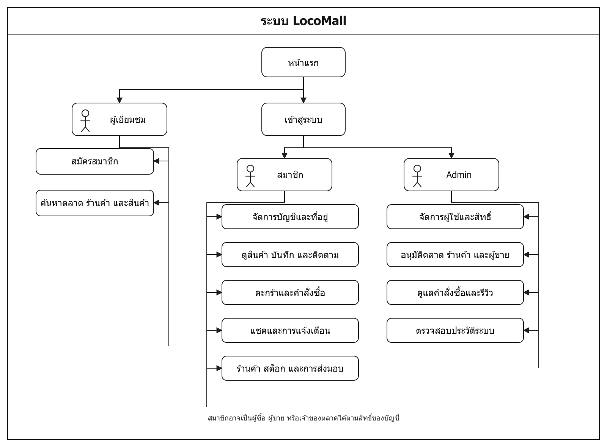

# โครงสร้างระบบ LocoMall แบบลำดับขั้น

แผนภาพนี้สรุปผู้ใช้และฟังก์ชันหลักของระบบในรูปแบบเดียวกับตัวอย่าง โดยไม่ลงรายละเอียดระดับหน้าจอหรือฐานข้อมูล

- ไฟล์ภาพสำหรับดูหรือแทรกในรายงาน: [PNG](system-hierarchical-chart.png)
- ไฟล์ต้นฉบับเวกเตอร์สำหรับแก้ไขและขยายภาพ: [SVG](system-hierarchical-chart.svg)

สมาชิกหนึ่งบัญชีอาจมีสิทธิ์เป็นผู้ซื้อ ผู้ขาย หรือเจ้าของตลาดได้ตามข้อมูลและสิทธิ์ที่ได้รับ ส่วน Admin เป็นบทบาทผู้ดูแลแพลตฟอร์มแยกต่างหาก
